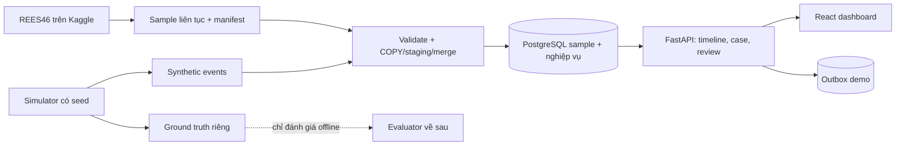

# Bot & Fraud Detection Lab

Dự án nghiên cứu và xây dựng hệ thống phát hiện bot, hỗ trợ điều tra lạm dụng ưu đãi trong thương mại điện tử. Hệ thống kết hợp dữ liệu hành vi công khai, dữ liệu mô phỏng có nhãn và quy trình analyst review. Hai mục tiêu **bot** và **promo abuse** được đánh giá riêng; dữ liệu REES46 chưa xác minh giữ nhãn `unknown`.

Tài liệu chính: [roadmap 5 tháng](roadmap_bot_fraud_detection_5_months_accelerated.md), [phạm vi MVP](docs/scope.md), [chính sách nhãn](docs/label-policy.md), [hợp đồng dữ liệu](docs/contracts.md) và [kế hoạch server](docs/server-plan.md).

## Mục tiêu và phạm vi

- **Tháng 1:** một luồng chạy xuyên suốt trên sample PostgreSQL: event → feature/rule hoặc anomaly score → case/evidence → review/audit. Tuần 1–2 tập trung vào dữ liệu, API, simulator và case fixture; rule bắt đầu tuần 3, Isolation Forest bắt đầu tuần 4.
- **Tháng 2:** đưa raw/clean/features lớn sang storage trên server, thêm Spark batch, Kafka và streaming tối thiểu. PostgreSQL tiếp tục giữ dữ liệu nghiệp vụ, case và review.
- **Tháng 3–5:** đánh giá mô hình có nhãn, feature quan hệ/graph, cải thiện độ tin cậy, vận hành, benchmark và hoàn thiện báo cáo theo roadmap.

MVP không xây một website bán hàng đầy đủ. Dashboard phục vụ analyst xem evidence và lưu kết luận; các giao dịch register/redeem chỉ là nghiệp vụ demo cần thiết để thử outbox và kịch bản lạm dụng.

## Trạng thái hiện tại

Repo đang ở giai đoạn **chuẩn bị**. Các tài liệu trong `docs/` đã có nội dung ban đầu. Phần lớn file Python chỉ có dòng `TODO`; `apps/api/app/main.py` còn rỗng. `compose.yaml`, `Dockerfile`, Alembic và `requirements.lock` cũng là file giữ chỗ. Vì vậy **chưa có API, importer, simulator, migration hay Docker stack chạy được**. Các lệnh trong roadmap/hướng dẫn là giao diện cần triển khai tiếp, chưa được kiểm chứng tại repo này.

`requirements.in` là danh sách dependency dự kiến; `requirements.lock` chưa chứa phiên bản khóa. `.env.example` chỉ là mẫu, còn `.env` hiện rỗng và được Git bỏ qua. Không ghi mật khẩu thật vào README hoặc commit `.env`.

## Kiến trúc dự kiến cho MVP



Đây là **thiết kế mục tiêu**, chưa phải sơ đồ dịch vụ đang chạy. Sample public và synthetic dùng cùng event contract nhưng có `source`/ID namespace riêng. Nhãn mô phỏng nằm ngoài payload event và API inference. Review của analyst là một kết luận nghiệp vụ, không ghi đè ground truth. Outbox được ghi cùng transaction demo; publisher Kafka thuộc giai đoạn sau.

## Công nghệ và thời điểm sử dụng

| Thành phần | Công nghệ | Thời điểm/trạng thái trong repo |
| --- | --- | --- |
| Ngôn ngữ và API | Python, FastAPI, Pydantic | Tháng 1; dependency đã khai báo, API chưa triển khai |
| Database nghiệp vụ | PostgreSQL, psycopg 3, SQLAlchemy, Alembic | Tháng 1; schema và migration còn là khung |
| Xử lý sample | Kaggle Notebook, CSV/gzip, PyArrow | Tuần 1; script local còn `TODO` |
| Giao diện analyst | React, TypeScript, Vite | Tuần 2; `apps/dashboard/` chưa có source |
| Đóng gói và kiểm tra | Docker Compose, pytest, HTTPX, Ruff | Tháng 1; Compose/test chưa triển khai |
| Phát hiện ban đầu | SQL rules, scikit-learn Isolation Forest | Tuần 3–4; chưa có code/model |
| Dữ liệu lớn và luồng sự kiện | Parquet, MinIO/S3, PySpark, Kafka | Tháng 2 theo roadmap; chưa cài trong repo |
| Mô hình và quan hệ | scikit-learn baseline, XGBoost, NetworkX; GraphFrames khi phù hợp | Tháng 3 trở đi; chưa cài trong repo |
| Cache/điều tra mở rộng | Redis nếu cần, LangGraph/LLM sau khi có evidence ổn định | Giai đoạn sau; chưa cài trong repo |

Phiên bản Python/PostgreSQL và image cần được chốt cùng lockfile trước khi build; danh sách trên mô tả lựa chọn công nghệ, không có nghĩa toàn bộ đã hoạt động.

## Cấu trúc thư mục

```text
.
├── apps/
│   ├── api/app/          # FastAPI: contract, router và service
│   └── dashboard/        # React/TypeScript, hiện chưa có source
├── scripts/              # Lấy mẫu, import, seed và simulator
├── migrations/           # Schema SQL và Alembic revisions
├── data/
│   ├── public/sample/    # Sample REES46 tải từ Kaggle/server
│   ├── manifests/        # Provenance, checksum và count
│   └── synthetic/        # Event và nhãn mô phỏng tách riêng
├── docs/                 # Phạm vi, nhãn, contract và server
├── reports/              # Kết quả nghiệm thu theo tuần
├── configs/              # Cấu hình khi triển khai
├── tests/                # Kiểm tra khi có chức năng
└── backups/              # Bản sao lưu local, không commit
```

Code ứng dụng nằm trong `apps/`, logic chạy theo lô trong `scripts/`, dữ liệu và provenance tách ở `data/`. Cấu trúc này hiện là khung: thư mục tồn tại không đồng nghĩa tính năng đã có. Xem bảng bên dưới để biết chính xác trạng thái của từng file.

## Quy ước dữ liệu và kiểm tra

- **Đơn vị đánh giá:** một `(source, user_id, target, window_start, window_end)`; `target` là `bot` hoặc `abuse`. Cửa sổ 5 phút dùng khoảng `[window_start, window_end)` theo UTC.
- **Nguồn và nhãn:** REES46 public không có nhãn bot/abuse đã xác minh nên giữ `unknown`. Simulator xuất event và ground truth ra hai vùng riêng; review của analyst lưu riêng trong database.
- **Định danh và retry:** ID public phải tái lập từ file nguồn/dòng gốc theo contract đã chốt; import lại cùng sample không tạo thêm event. Manifest lưu checksum, thời gian, số dòng và quy tắc sample.
- **Giới hạn dữ liệu:** PostgreSQL tháng 1 chỉ chứa sample và dữ liệu phục vụ case/review. Dữ liệu REES46 đầy đủ và job nặng đặt trên Kaggle hoặc server khi có tài nguyên.
- **Bằng chứng nghiệm thu:** ghi số liệu và kết quả kiểm tra thực tế vào `reports/week01.md` và `reports/week02.md`; không coi case fixture là kết quả detection thật.

## Thứ tự triển khai tiếp theo

1. Chốt event/feature/evidence contract và hiện thực `apps/api/app/contracts.py`.
2. Tạo sample REES46 cùng manifest trên Kaggle; tải sample nhỏ về `data/public/sample/` và kiểm tra checksum.
3. Hoàn thiện `requirements.lock`, Dockerfile, Compose, schema và Alembic; sau đó mới chạy database/API.
4. Viết importer và timeline, kiểm tra count và retry của tuần 1.
5. Sang tuần 2, viết simulator, auth, case fixture, review/audit và giao diện analyst.

Không chạy `docker compose up`, Alembic hoặc `python -m scripts.make_sample` với các file khung hiện tại: chúng chưa có cấu hình hay logic cần thiết.

## Từng file dùng để làm gì

**Trạng thái:** `Nội dung` = đã có tài liệu/cấu hình mẫu; `Khung` = có file nhưng chưa có chức năng; `Rỗng` = file chưa có nội dung.

### File ở root

| File | Vai trò | Trạng thái |
| --- | --- | --- |
| `README.md` | Giới thiệu repo, giải thích từng file và trạng thái triển khai. | Nội dung |
| `roadmap_bot_fraud_detection_5_months_accelerated.md` | Kế hoạch 5 tháng, kiến trúc, runbook Docker/deploy và tiêu chí nghiệm thu. | Nội dung |
| `roadmap_bot_fraud_detection_5_months.pdf` | Bản PDF tham khảo của roadmap. | Nội dung |
| `.gitignore` | Ngăn Git theo dõi `.env`, secret, dữ liệu, artifact, backup và cache. | Nội dung |
| `.dockerignore` | Loại secret, dữ liệu lớn, cache và file không cần thiết khỏi Docker build context. | Nội dung |
| `.env.example` | Liệt kê biến môi trường mẫu; các giá trị secret là placeholder. | Nội dung |
| `.env` | Nơi điền cấu hình/secret local khi cần; không commit. | Rỗng |
| `requirements.in` | Danh sách dependency Python cần resolve và khóa phiên bản. | Nội dung |
| `requirements.lock` | Sẽ chứa dependency cùng phiên bản cố định do `pip-compile` tạo. | Khung |
| `Dockerfile` | Sẽ định nghĩa image Python cho API và tools. | Khung |
| `compose.yaml` | Sẽ khai báo PostgreSQL, API và tools cho môi trường local. | Khung |
| `alembic.ini` | Sẽ cấu hình Alembic để chạy migration. | Khung |

### API: `apps/api/app/`

| File | Vai trò dự kiến | Trạng thái |
| --- | --- | --- |
| `apps/__init__.py` | Đánh dấu `apps` là Python package. | Rỗng |
| `apps/api/__init__.py` | Đánh dấu `apps.api` là Python package. | Rỗng |
| `apps/api/app/__init__.py` | Đánh dấu `apps.api.app` là Python package. | Rỗng |
| `apps/api/app/main.py` | Sẽ tạo FastAPI app, `/health`, `/ready` và đăng ký router. | Rỗng |
| `apps/api/app/contracts.py` | Sẽ định nghĩa/validate `EventV1`, `FeatureV1`, `EvidenceV1`. | Khung |
| `apps/api/app/routers/__init__.py` | Đánh dấu thư mục routers là Python package. | Rỗng |
| `apps/api/app/routers/events.py` | Sẽ nhận batch event qua API. | Khung |
| `apps/api/app/routers/timeline.py` | Sẽ đọc timeline có lọc và phân trang. | Khung |
| `apps/api/app/routers/auth.py` | Sẽ cung cấp đăng nhập và thông tin operator. | Khung |
| `apps/api/app/routers/cases.py` | Sẽ trả danh sách/chi tiết case và evidence. | Khung |
| `apps/api/app/routers/reviews.py` | Sẽ nhận kết luận review của analyst. | Khung |
| `apps/api/app/routers/business.py` | Sẽ nhận giao dịch demo như redeem. | Khung |
| `apps/api/app/services/__init__.py` | Đánh dấu thư mục services là Python package. | Rỗng |
| `apps/api/app/services/ingestion.py` | Sẽ validate, dedup và lưu event an toàn khi retry. | Khung |
| `apps/api/app/services/review.py` | Sẽ ghi review, cập nhật case và audit trong cùng transaction. | Khung |
| `apps/api/app/services/redeem.py` | Sẽ ghi redeem demo và outbox trong cùng transaction. | Khung |

### Script và migration

| File | Vai trò dự kiến | Trạng thái |
| --- | --- | --- |
| `scripts/__init__.py` | Cho phép chạy script dạng `python -m scripts.<tên_module>`. | Rỗng |
| `scripts/make_sample.py` | Sẽ lấy sample REES46 theo user/thời gian, có warm-up và manifest. | Khung |
| `scripts/import_sample.py` | Sẽ import sample qua COPY/staging/merge và đối soát count. | Khung |
| `scripts/bootstrap_role.py` | Sẽ tạo/cấp quyền DB role riêng cho API. | Khung |
| `scripts/simulate.py` | Sẽ sinh event normal, bot, flash sale và multi-account theo seed. | Khung |
| `scripts/seed_users.py` | Sẽ tạo operator analyst/admin/viewer cho demo. | Khung |
| `scripts/seed_cases.py` | Sẽ tạo case fixture idempotent từ event đã import. | Khung |
| `migrations/0001_schema.sql` | Sẽ chứa DDL cho bảng event, feature, case, review, audit và outbox. | Khung |
| `migrations/env.py` | Sẽ kết nối Alembic tới PostgreSQL. | Khung |
| `migrations/versions/.gitkeep` | Giữ thư mục revision trong Git; chưa phải migration. | Rỗng |

### Tài liệu và báo cáo

| File | Vai trò | Trạng thái |
| --- | --- | --- |
| `docs/scope.md` | Giới hạn công việc MVP tuần 1–2 và những phần để sang tuần 3–4. | Nội dung |
| `docs/label-policy.md` | Định nghĩa riêng nhãn bot/abuse, `unknown` và cách tách ground truth khỏi review. | Nội dung |
| `docs/contracts.md` | Bản nháp event/feature/evidence contract và nguyên tắc dữ liệu. | Nội dung |
| `docs/server-plan.md` | Ghi máy phát triển, trạng thái chưa có server, cách đo tài nguyên và fallback Kaggle. | Nội dung |
| `reports/week01.md` | Nơi điền số liệu import, manifest, dung lượng và kiểm tra cuối tuần 1. | Khung |
| `reports/week02.md` | Nơi điền kết quả simulator, quyền, review, outbox và restart cuối tuần 2. | Khung |

## Các thư mục dữ liệu hiện có

| Thư mục | Dùng để chứa |
| --- | --- |
| `data/public/sample/` | Sample public REES46 tải về sau khi xử lý trên Kaggle/server. |
| `data/manifests/` | Manifest ghi nguồn, checksum, quy tắc lấy mẫu và số dòng. |
| `data/synthetic/events/` | Event do simulator tạo. |
| `data/synthetic/labels/` | Nhãn ground truth của simulator, tách khỏi event. |
| `apps/dashboard/` | Giao diện React/TypeScript sẽ tạo ở tuần 2; hiện chưa có source. |
| `configs/`, `tests/`, `backups/` | Cấu hình, kiểm tra và bản sao lưu sẽ tạo khi triển khai. |

Dữ liệu thật, model và backup không được commit. Khi nhận sample từ Kaggle, kiểm tra manifest và checksum trước khi import. Thứ tự làm việc chi tiết nằm trong roadmap; ưu tiên hoàn thành contract, sampler, schema và API đọc dữ liệu của tuần 1 trước khi triển khai dashboard.
