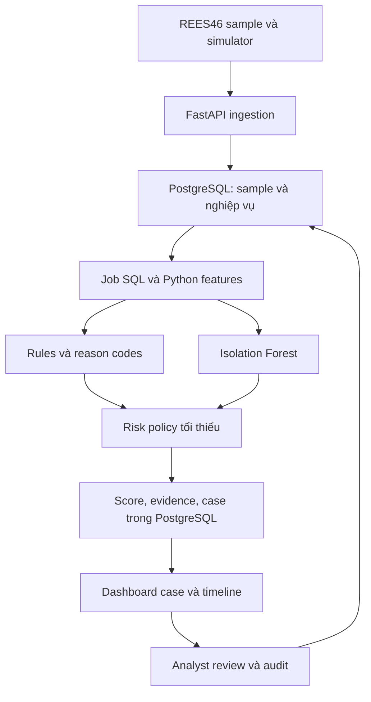
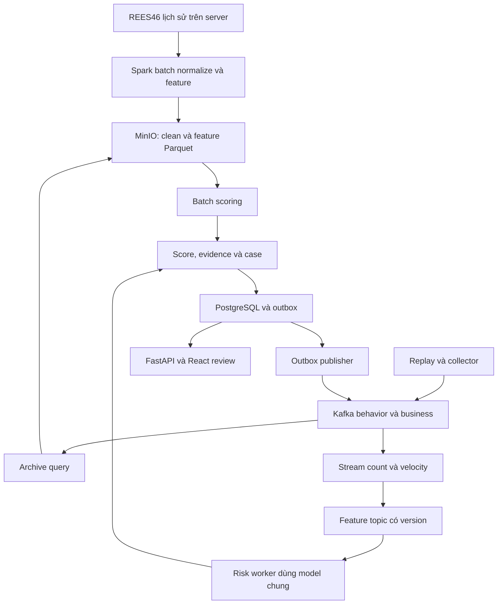
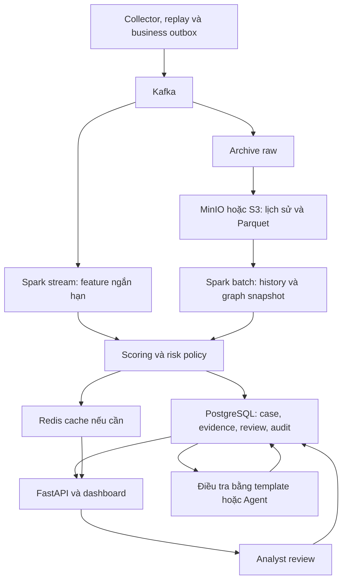

# Lộ trình 5 tháng tăng tốc: MVP 1 tháng, Big Data từ tháng 2

**Tên đề tài đã chốt:** Xây dựng hệ thống phát hiện bot và hỗ trợ điều tra gian lận trong thương mại điện tử dựa trên phân tích dữ liệu lớn.

**Domain:** thương mại điện tử; giới hạn gian lận vào bot và nhóm tài khoản lạm dụng ưu đãi. Không mở thêm nhánh ví điện tử hoặc xác minh danh tính thật.

**Dataset công khai chính:** [REES46 multi-category e-commerce](https://www.kaggle.com/datasets/mkechinov/ecommerce-behavior-data-from-multi-category-store). Không cần tải cosmetics/Taobao/PaySim trong phạm vi chính. Simulator có nhãn bổ sung bot, promo abuse và quan hệ device/IP; telemetry ứng dụng demo bổ sung luồng phát sinh trực tiếp. Public data thiếu nhãn giữ `unknown`.

**Bản cập nhật 12/10/2026:** rút MVP PostgreSQL xuống tuần 1–4; đưa MinIO/S3, Spark batch, Kafka và streaming tối thiểu lên tuần 5–8; dành tuần 9–16 cho mô hình cảnh báo, graph features, độ tin cậy và thực nghiệm quy mô. Agent giữ phạm vi nhỏ, triển khai sau khi cảnh báo đã có bằng chứng; LLM không nằm trên đường quyết định score.

**Thời lượng:** 20 tuần tương đối, không mặc định ngày bắt đầu. Năm tháng theo lịch có thêm thời gian dự phòng tùy lịch học/làm việc. Kế hoạch tăng tốc giả định một người có khoảng 25–35 giờ/tuần; nếu ít hơn, cắt phạm vi mở rộng thay vì bỏ kiểm tra tính đúng.

**Điều chỉnh quan trọng:** “MVP PostgreSQL 1 tháng” nghĩa là hoàn thành nền tảng và vòng cảnh báo cơ bản trong tháng 1. PostgreSQL vẫn phục vụ case/review/audit đến cuối dự án; không mất thêm một tháng để import hàng triệu event hay tối ưu mọi query trước khi làm Big Data.

**Ưu tiên:** tính đúng dữ liệu → feature và baseline cảnh báo → pipeline batch/stream → chất lượng và ngân sách cảnh báo → thực nghiệm tái lập. Dashboard đủ dùng từ tháng 1; không phát triển website bán hàng hoàn chỉnh.

**Cách đọc phần lệnh:** đây là thiết kế/template cần implement, chưa phải source của hệ thống đã chạy. Module, CLI và flag riêng của ứng dụng nằm trong phần 23. Image/JAR/architecture phải được pin và smoke-test. Chỉ ghi “đã kiểm chứng” khi có run ID và report; các con số tốc độ/dung lượng trong tài liệu là điểm bắt đầu thử nghiệm.

**Giới hạn máy:** laptop chỉ giữ code, một sample, model đang dùng và báo cáo nhỏ. Dữ liệu đầy đủ, MinIO và job lớn ưu tiên server; nếu chưa có server, tạo sample trên Kaggle và tiếp tục trên filesystem. MinIO local vẫn chiếm disk local.

> Trục sản phẩm: **event → feature có cutoff → detector → risk policy → cảnh báo/case có bằng chứng → analyst review**. Trục thực nghiệm: **đối soát tính đúng → đánh giá model/false positive → đo throughput/latency/RAM/disk**. Không coi tăng số service hoặc tăng số dòng lặp là bằng chứng detection tốt hơn.

## Mục lục

1. [Sản phẩm cuối cùng và phạm vi](#1-sản-phẩm-cuối-cùng-và-phạm-vi)
2. [Các mốc trong 5 tháng](#2-các-mốc-trong-5-tháng)
3. [Công nghệ và thời điểm sử dụng](#3-công-nghệ-và-thời-điểm-sử-dụng)
4. [Kiến trúc từ MVP đến sản phẩm](#4-kiến-trúc-từ-mvp-đến-sản-phẩm)
5. [Chiến lược dữ liệu và nhãn](#5-chiến-lược-dữ-liệu-và-nhãn)
6. [Cơ chế detection cần xây](#6-cơ-chế-detection-cần-xây)
7. [Tháng 1: MVP PostgreSQL và cảnh báo cơ bản](#7-tháng-1-mvp-postgresql-và-cảnh-báo-cơ-bản)
8. [Tháng 2: MinIO, Spark, Kafka và luồng Big Data tối thiểu](#8-tháng-2-minio-spark-kafka-và-luồng-big-data-tối-thiểu)
9. [Tháng 3: mô hình cảnh báo và feature quan hệ](#9-tháng-3-mô-hình-cảnh-báo-và-feature-quan-hệ)
10. [Tháng 4: thực nghiệm Big Data và hoàn thiện cảnh báo](#10-tháng-4-thực-nghiệm-big-data-và-hoàn-thiện-cảnh-báo)
11. [Tháng 5: kiểm chứng cuối, triển khai và bảo vệ](#11-tháng-5-kiểm-chứng-cuối-triển-khai-và-bảo-vệ)
12. [Thiết kế database, API và cấu trúc dự án](#12-thiết-kế-database-api-và-cấu-trúc-dự-án)
13. [Thực nghiệm và tiêu chí nghiệm thu](#13-thực-nghiệm-và-tiêu-chí-nghiệm-thu)
14. [Nguồn lực, rủi ro và phương án giảm phạm vi](#14-nguồn-lực-rủi-ro-và-phương-án-giảm-phạm-vi)
15. [Checklist sản phẩm cuối cùng](#15-checklist-sản-phẩm-cuối-cùng)
16. [Tài liệu kỹ thuật tham khảo](#16-tài-liệu-kỹ-thuật-tham-khảo)
17. [Nguồn dataset và quy trình tải dữ liệu](#17-nguồn-dataset-và-quy-trình-tải-dữ-liệu)
18. [Crawl và thu thập dữ liệu bổ sung](#18-crawl-và-thu-thập-dữ-liệu-bổ-sung)
19. [Docker: nền tảng, cấu hình và image](#19-docker-nền-tảng-cấu-hình-và-image)
20. [Runbook Docker theo từng tháng](#20-runbook-docker-theo-từng-tháng)
21. [Deploy staging và sản phẩm thử nghiệm](#21-deploy-staging-và-sản-phẩm-thử-nghiệm)
22. [Vận hành, backup, rollback và xử lý sự cố](#22-vận-hành-backup-rollback-và-xử-lý-sự-cố)
23. [Hợp đồng CLI, thứ tự triển khai và bàn giao](#23-hợp-đồng-cli-thứ-tự-triển-khai-và-bàn-giao)

## 1. Sản phẩm cuối cùng và phạm vi

### 1.1. Sản phẩm phải thực hiện được những gì?

1. Nhận sự kiện từ ứng dụng mô phỏng hoặc chương trình replay dataset.
2. Chuẩn hóa và lưu lịch sử sự kiện để xử lý lại.
3. Tính feature theo tài khoản, session và cửa sổ thời gian.
4. Phát hiện bất thường ở tài khoản và dấu hiệu phối hợp giữa nhiều tài khoản.
5. Tạo kết quả đánh giá có phiên bản model, thời điểm, feature và bằng chứng đi kèm.
6. Gom các cảnh báo liên quan thành case để analyst điều tra.
7. Hiển thị timeline hành vi, đồ thị liên kết và lý do bị gắn cờ.
8. Tạo report template có bằng chứng; thêm Agent LLM với tool đọc khi core đạt và còn nguồn lực.
9. Cho analyst xác nhận, bác bỏ hoặc tiếp tục theo dõi; thao tác khóa/thu hồi phải qua phê duyệt.
10. Lưu audit, kết luận và nhãn phản hồi để phục vụ đánh giá và huấn luyện sau này.

### 1.2. Phân biệt ba mục tiêu detection

| Mục tiêu | Ý nghĩa | Đầu ra nên dùng |
| --- | --- | --- |
| Bất thường | Hành vi khác phân bố tham chiếu | Anomaly score, lý do cần xem xét |
| Bot | Có dấu hiệu tự động hóa | Bot score hoặc xác suất khi đã kiểm định calibration |
| Tài khoản phối hợp/lạm dụng | Nhiều tài khoản liên quan cùng thực hiện một mục đích đáng nghi | Cluster risk, promo-abuse score, case có bằng chứng |

**Bất thường không đồng nghĩa bot; bot không mặc nhiên là gian lận.** Hành vi mua hàng hoặc đăng ký cũng chưa đủ để chứng minh một danh tính giả. Trong phạm vi này, kết luận phù hợp là “nghi vấn tài khoản phối hợp/lạm dụng”; xác minh danh tính thật cần nguồn dữ liệu khác và quy trình nghiệp vụ riêng.

### 1.3. Phạm vi bắt buộc và mở rộng

| Mức | Chức năng |
| --- | --- |
| Bắt buộc | Ingestion, feature engineering, rules/anomaly baseline, graph features khi nguồn phù hợp, case management, analyst review, audit, dashboard, report template có bằng chứng, benchmark |
| Có điều kiện | XGBoost khi có nhãn đủ chất lượng; calibration khi có validation phù hợp; GraphFrames khi graph đủ lớn và môi trường tương thích; Agent LLM sau khi có report template |
| Mở rộng | RAG, pgvector, community detection sâu hơn, feedback retraining tự động có kiểm soát |
| Chưa đưa vào 5 tháng | Kubernetes, nhiều microservice, GNN, Transformer cho chuỗi hành vi, triển khai đa vùng, tự động khóa không có phê duyệt |

Không xây một website thương mại điện tử đầy đủ. Chỉ cần ứng dụng hoặc simulator sinh các luồng nghiệp vụ phục vụ detection; giao diện chính là dashboard cho analyst/admin.

## 2. Các mốc trong 5 tháng

| Giai đoạn | Tuần | Trọng tâm | Quy mô bắt đầu, tăng sau khi đo | Demo bắt buộc |
| --- | --- | --- | --- | --- |
| Tháng 1 | 1–4 | MVP cảnh báo trên PostgreSQL/sample | 50.000–300.000 public event tham khảo + simulator có nhãn | Event → feature → rules/Isolation Forest → case → review → audit |
| Tháng 2 | 5–8 | Storage server, Spark batch, Kafka và stream tối thiểu | 1 → 5 → 10 triệu event hoặc từng file/tháng phù hợp tài nguyên | Raw server → clean Parquet; SQL/Spark parity; replay → window feature → case |
| Tháng 3 | 9–12 | Mô hình có nhãn, graph, hiệu chỉnh risk policy | Feature sample có split; raw lịch sử mở rộng độc lập | Baseline vs XGBoost; behavior vs behavior+graph; báo cáo false positive và alert budget |
| Tháng 4 | 13–16 | Big Data benchmark, recovery, cảnh báo hoàn chỉnh; Agent nhỏ | 10 → 50 triệu hoặc mức thực đạt; không bắt buộc full 15 GB nếu thiếu tài nguyên | Throughput/latency/RAM/disk; phục hồi có đối soát; case report truy vết được |
| Tháng 5 | 17–20 | Đánh giá cuối, triển khai, báo cáo và bảo vệ | Dataset/split/model freeze | Kết quả test chưa dùng để tune, restore/rollback, release và demo tái lập |

**Cổng tuần 4:** MVP có ít nhất rules và anomaly baseline, case/review/audit; chưa yêu cầu graph UI, LLM hoặc classifier đạt chất lượng cao.

**Cổng tuần 8:** batch/stream tạo feature cùng contract; cảnh báo stream đầu tiên đọc được; restart thử nghiệm có đối soát. Chưa yêu cầu toàn bộ temporal features chạy online hoặc toàn lịch sử chạy trong một lượt.

**Cổng tuần 12:** có so sánh model, graph ablation trên dữ liệu đủ trường/nhãn và policy cảnh báo chọn trên validation. Nếu nhãn chưa đạt, giữ rules/anomaly và nêu giới hạn, không tạo ground truth giả.

**Cổng tuần 16:** benchmark và recovery có log, pipeline cảnh báo ổn định; hỗ trợ điều tra có template, LLM có điều kiện.

**Cổng tuần 20:** người khác chạy demo theo README, kết quả/bằng chứng truy vết được, giới hạn synthetic và tài nguyên được ghi rõ.

**Nguyên tắc tăng tốc:** chỉ giữ một đường vertical slice chạy được ở mỗi cổng; thử hạ tầng tiếp theo trên fixture nhỏ ngay từ tuần 4–5. Nếu core lỗi, dành 2–3 ngày đầu giai đoạn sau sửa và hoãn UI/Agent nâng cao. Không mất thêm cả tháng để hoàn thiện PostgreSQL.

## 3. Công nghệ và thời điểm sử dụng

### 3.1. Stack đề xuất

| Thành phần | Công nghệ chọn | Bắt đầu | Vai trò |
| --- | --- | --- | --- |
| Ngôn ngữ backend/data | Python | Tháng 1 | API, ETL, feature, model, simulator, Agent |
| Backend API | FastAPI + Pydantic | Tháng 1 | Ingestion, đọc case, review, kiểm tra schema |
| Database nghiệp vụ | PostgreSQL | Tháng 1 → cuối | Tài khoản, trạng thái, case, review, audit, metadata model |
| ORM/migration | SQLAlchemy + Alembic; psycopg cho COPY | Tháng 1 | Quản lý transaction, schema và bulk import |
| Frontend | React + TypeScript + Vite | Tháng 1 | Dashboard analyst/admin |
| UI/data fetching | Tailwind CSS + TanStack Query | Tháng 1 | Bảng, bộ lọc, trạng thái tải, refresh kết quả |
| Đồ thị trên UI | Cytoscape.js | Tháng 3 | Xem subgraph có giới hạn kích thước |
| Feature trên sample | SQL + Pandas/PyArrow; DuckDB cho ETL khi cần | Tháng 1 | Aggregate trong DB, xử lý bảng feature vừa RAM, đọc/ghi Parquet |
| Graph prototype | NetworkX | Tháng 3 | Kiểm tra graph features trên sample |
| ML baseline | scikit-learn: Isolation Forest, Logistic Regression | Isolation Forest tháng 1; classifier tháng 3 | Anomaly detection và baseline có nhãn |
| Model có nhãn chính | XGBoost | Tháng 3 nếu nhãn sẵn sàng | Phân loại bot hoặc promo abuse trên feature tổng hợp |
| Giải thích model | SHAP + reason codes từ rule | Reason codes tháng 1; SHAP tháng 3 | Cho biết feature đóng góp vào dự đoán, bổ sung bằng chứng |
| Event bus | Apache Kafka + Python Kafka client | Tháng 2, tuần 7 | Vận chuyển event, buffering và replay |
| Batch/stream processing | Apache Spark + PySpark | Tháng 2, batch tuần 6 và stream tuần 8 | ETL, aggregate feature, window gần thời gian thực |
| Lưu trữ dữ liệu lớn | MinIO hoặc S3-compatible + Parquet nén, đặt trên server | Tháng 2, tuần 5 | Raw/clean/features, lịch sử để xử lý lại; xem cập nhật tình trạng MinIO ở phần 19.7 |
| Graph phân tán | Spark SQL trước, GraphFrames phù hợp Spark/Scala khi cần | Tháng 3–4 có điều kiện | Feature và thành phần liên thông trên snapshot graph |
| Cache feature/score | Redis | Tuần 8 nếu dùng realtime template; tối ưu tháng 3 | Snapshot mới nhất để API đọc nhanh |
| Điều phối Agent | LangGraph + LLM qua API được lựa chọn | Tháng 4 | Truy xuất tool, tổng hợp, lưu trạng thái điều tra |
| Theo dõi experiment | MLflow hoặc run manifest local trước | Tháng 1–5 | Run, metrics, tham số, artifact và phiên bản model |
| Đóng gói | Docker + Docker Compose | Tháng 1 → cuối | Môi trường tái lập được; profile theo giai đoạn |
| Kiểm thử/chất lượng | pytest, Ruff; CI nếu có remote repo | Tháng 1 → cuối | Kiểm tra feature, luồng case, quyền và tính đúng dữ liệu |
| Quan sát vận hành | JSON logs, Prometheus + Grafana | Logs từ tháng 1; metrics tháng 2–5 | Latency, throughput, lag, lỗi, tài nguyên |
| Kiểm tra tải | Replay producer + Locust cho API | Tháng 2–5 | Tách tải event pipeline khỏi tải dashboard/API |
| Triển khai demo | VM/VPS, Docker Compose, reverse proxy Caddy hoặc Nginx | Staging tháng 1–2; release tháng 5 | Endpoint HTTPS, tài khoản analyst, vận hành demo |

**Thêm có điều kiện:** Iceberg từ tháng 3 nếu cần snapshot/upsert/schema evolution và có thời gian compatibility; Plain Parquet + manifest là đường mặc định. Không thêm Trino/Superset vì dashboard React đã phục vụ case/review. Một VM không bắt buộc Spark cluster; `local[1–2]` trên server vẫn chạy batch/stream thử nghiệm, nhưng chưa chứng minh distributed scaling.

### 3.2. Những quyết định giúp tránh làm lại

- Backend Python dùng SQLAlchemy thay vì bổ sung Prisma vào stack FastAPI. Chỉ đưa Prisma vào nếu có backend TypeScript riêng với lý do rõ ràng.
- Feature/model/risk là module độc lập với nơi đọc dữ liệu. SQL và Spark cùng xuất một feature contract.
- PostgreSQL không bị thay thế khi có Kafka; chỉ giảm vai trò lưu và phân tích toàn bộ behavioral events.
- Spark tính trên event và graph lớn; model huấn luyện trên bảng feature đã tổng hợp. Không đưa hàng trăm triệu raw event thẳng vào scikit-learn.
- NetworkX và GraphFrames là hai giai đoạn triển khai cùng ý nghĩa feature; không phải hai graph database.
- Redis là cache có thể khôi phục; PostgreSQL/object storage giữ dữ liệu bền vững theo loại dữ liệu.
- Chưa cần vector database ở bản đầu. Agent có thể dùng truy vấn có cấu trúc; pgvector chỉ thêm khi có bài toán tìm case tương tự hoặc tài liệu cần semantic search.
- Chốt phiên bản sau thử nghiệm tương thích và lưu lockfile/image tag. Đối chiếu Spark, Python, JVM, Scala, Kafka connector, S3 connector và GraphFrames cùng nhau; không chọn riêng từng bản mới nhất.

## 4. Kiến trúc từ MVP đến sản phẩm

### 4.1. MVP cảnh báo cuối tháng 1



- Backend/UI chỉ cần ingestion, case list/detail, timeline, review và audit; auth analyst/admin tối thiểu. Query pagination và index phục vụ đúng các màn hình này.
- Job chạy theo lịch hoặc lệnh, mặc định một job tại một thời điểm. Feature version/cutoff/model checksum có ngay từ đầu.
- Rules tuần 3; Isolation Forest bản đầu tuần 4. Supervised baseline, graph ablation và SHAP chưa là điều kiện chốt tháng 1.
- Business request ghi transaction/outbox nhưng publisher Kafka bắt đầu tuần 7. Action workflow tháng 1 chỉ cần review và proposal; execution khóa/thu hồi demo phát triển sau, luôn phê duyệt ở backend.
- PostgreSQL chỉ chứa sample, kết quả phục vụ và nghiệp vụ; sample size bị giới hạn bằng config. Không nạp full REES46 vào PostgreSQL để chứng minh Big Data.

### 4.2. Pipeline dữ liệu lớn tối thiểu cuối tháng 2



- Hai đường batch và stream cùng định nghĩa feature. Batch lịch sử đọc file trực tiếp; chỉ replay một slice qua Kafka để thử stream. Producer rate không phải throughput xử lý thành công.
- Tuần 8 stream chỉ count/velocity/diversity đơn giản đã có parity test. Interval/sequence phức tạp và graph có lịch riêng trong tháng 3; không nhận nguyên feature contract batch khi stream chưa tính đủ.
- Nếu feature stream là subset, tạo `feature_version=stream-v1` và model phù hợp subset hoặc chỉ rules. Không điền 0 cho feature chưa có để dùng model batch một cách âm thầm.
- Không ghi hai lần cùng cảnh báo: shadow query chỉ so sánh; chỉ một đường được kích hoạt tạo case cho cùng target/unit/window. Idempotency key gồm run namespace, target, account/group, window, policy/model version theo thiết kế.

### 4.3. Kiến trúc mục tiêu và vị trí chạy



| Nơi | Giữ/chạy | Không cần giữ/chạy |
| --- | --- | --- |
| Laptop ít disk | Code, config không bí mật, một sample, model đang dùng, dashboard development | Full raw, full clean, full feature, cả stack phân tán |
| Server một VM | MinIO/storage, PostgreSQL, Kafka một broker, API/worker; Spark giới hạn tài nguyên | Không bật mọi job batch/stream/train/graph đồng thời |
| Kaggle | Gắn REES46 input, tạo sample, train/ETL theo phiên | Không coi là server API/Kafka liên tục |
| Nhiều VM có tài nguyên độc lập | Benchmark scale-out có driver/executor network, shared object storage | Không coi nhiều container một máy là nhiều máy |

MinIO local dùng disk local; MinIO server dùng disk server. Iceberg là table format tùy chọn trên Parquet, PostgreSQL JDBC catalog nếu chọn nhánh đó; database case/review là trách nhiệm khác. Graph snapshot chạy theo lịch, chỉ serving subgraph hữu hạn lên UI. LLM không nằm trong vòng scoring và không tự thực hiện action.

### 4.4. Hai luồng sự kiện và một luồng snapshot

| Loại | Ví dụ | Đường ghi | Điều phải đảm bảo |
| --- | --- | --- | --- |
| Business | Register/redeem/order demo, review/action | Transaction PostgreSQL + outbox → publisher → Kafka | Cùng commit; retry và consumer lặp an toàn |
| Behavior | View/cart/search khi nguồn có | Collector/replay → Kafka → archive và feature | Schema, event ID, ack/retry, late/duplicate policy |
| External account snapshot | JSON Rewards có score/cảnh báo ngoài hệ thống | Topic hoặc bảng riêng, lưu provenance/observed_at | Không biến snapshot thành clickstream; score/flag ngoài model giữ riêng khỏi feature |

MVP behavior sample ghi PostgreSQL. Từ tháng 2 đổi ingestion adapter bằng config, giữ event contract. Outbox có thể gửi lặp nếu publisher chết sau send; không tuyên bố exactly-once toàn hệ thống. Debezium chưa là dependency bắt buộc.

### 4.5. Tiêu chí chọn Plain Parquet hay Iceberg

| Câu hỏi | Plain Parquet + manifest | Iceberg có điều kiện |
| --- | --- | --- |
| Append và feature batch theo run | Đủ cho MVP/benchmark ban đầu | Có thể dùng nhưng tăng công dựng catalog/JAR |
| Output publish | Ghi vào prefix run mới, validate, rồi cập nhật manifest/pointer | Commit bảng, snapshot và catalog |
| Update/dedup theo batch | Idempotent batch manifest, rewrite partition/run có kiểm soát | Có thể dùng merge/upsert sau kiểm tra |
| Time travel/schema evolution | Tự quản version rõ | Có cơ chế table format phù hợp |
| Điểm đưa vào roadmap | Mặc định tuần 5–8 | Spike tối đa 2–3 ngày ở tuần 12; bỏ nếu chưa tạo lợi ích đo được |

Không cài full lakehouse BI stack chỉ vì project tham khảo dùng. Phần đóng góp chính là cảnh báo có bằng chứng và xử lý dữ liệu lớn, không phải số lượng công nghệ.

## 5. Chiến lược dữ liệu và nhãn

### 5.1. Dùng ba nguồn dữ liệu với ba mục đích khác nhau

| Nguồn | Dùng để làm gì? | Không thể tự suy ra điều gì? |
| --- | --- | --- |
| REES46 multi-category đã chốt | ETL, feature hành vi, benchmark quy mô, khảo sát anomaly | Danh tính giả, device/IP, registration/coupon hoặc nhãn bot nếu không có trường tương ứng |
| Simulator có kịch bản và nhãn | Kiểm tra bot, coordinated accounts, graph, false positive và demo | Hiệu quả trên gian lận thực tế ngoài phân bố mô phỏng |
| Nhãn analyst hoặc dữ liệu có nhãn phù hợp domain | Đánh giá thực tế hơn và cải thiện model | “Không bị phát hiện” không mặc nhiên là người thật; thao tác khóa không mặc nhiên là nhãn đúng |

Với REES46, kiểm tra đúng schema của những file tải về. Các trường hành vi thường gồm thời gian, loại event, sản phẩm, category, brand, price, user và session. Đọc tài liệu dataset và kiểm tra file thực tế trước khi khẳng định thiếu/có trường hoặc nhãn.

Không dùng cosmetics/Taobao/PaySim trong pipeline chính. Có thể khảo sát nguồn khác ở hướng phát triển, không join user/product IDs giữa các nguồn khi không có mapping chính thức. Hai snapshot Rewards đã cung cấp chỉ là case study trạng thái cảnh báo ngoài hệ thống; không phải ground truth hay log hành vi chi tiết.

### 5.2. Những kịch bản simulator tối thiểu

1. **Người dùng thông thường:** tốc độ và chuỗi hành động có biến thiên, thời gian nghỉ, sở thích sản phẩm khác nhau.
2. **Người dùng hợp lệ dễ bị nghi nhầm:** săn flash sale, mua nhiều, cùng Wi-Fi/NAT, gia đình dùng chung thiết bị, chương trình tự động hóa được cho phép.
3. **Bot đơn giản:** nhiều view, khoảng cách event gần đều, phạm vi sản phẩm rộng.
4. **Bot có random delay:** tránh chỉ học một dấu hiệu thời gian đều.
5. **Bot tốc độ thấp:** từng tài khoản có mức hoạt động giống người; cần tín hiệu nhóm.
6. **Nhóm lạm dụng ưu đãi:** nhiều tài khoản, một số thiết bị/IP liên quan, đăng ký và redeem gần nhau.
7. **Nhóm dùng chung IP hợp lệ:** nhiều tài khoản qua NAT nhưng thiết bị, timing và nghiệp vụ khác nhau.
8. **Lỗi vận chuyển dữ liệu:** event trùng, đến muộn, sai schema, mất kết nối, restart giữa batch.

Mỗi kịch bản có `scenario_id`, seed, tham số, thời gian bắt đầu và ground truth. Lưu nhãn vào vùng riêng để đánh giá; không cho model nhìn `scenario_id`, seed, bot flag hoặc đặc điểm ID chỉ xuất hiện ở bot.

### 5.3. Hợp đồng sự kiện

```json
{
  "event_id": "0f924b77-117f-4b17-843b-0bb7d2f9f281",
  "schema_version": 1,
  "event_time": "2026-10-05T07:30:00Z",
  "ingested_at": "2026-10-05T07:30:01Z",
  "event_type": "view",
  "user_id": "u_123",
  "session_id": "s_456",
  "product_id": "p_789",
  "device_id_hash": null,
  "ip_token": null,
  "coupon_id": null,
  "source": "public_clickstream",
  "trace_id": "trace_001"
}
```

- Các trường chỉ áp dụng cho một số loại event được phép null; thiếu device/IP phải được biểu diễn là thiếu.
- Dataset không có event ID: sinh ID ổn định từ nhận dạng file nguồn và số dòng, hoặc quy tắc khác có thể tái lập; cùng record replay lại giữ nguyên ID.
- Phân biệt `event_time` với thời điểm ingestion. Lưu UTC, UI hiển thị theo múi giờ đã chọn.
- Business event dùng ID do hệ thống tạo và liên kết tới transaction/aggregate.
- Client có thể làm giả một số metadata. Trong hệ thống thật, collector xác định IP và xác thực nguồn phù hợp; device token chỉ là một tín hiệu, không phải bằng chứng định danh tuyệt đối.
- Thiết kế giới hạn payload, xác thực nguồn, lỗi trả về và quy tắc tương thích `schema_version`.

### 5.4. Sampling và split

- Sample theo khoảng thời gian liên tục và giữ trọn lịch sử cần thiết của session/user; tránh lấy ngẫu nhiên từng dòng khiến mất inter-event pattern.
- Train, validation, test tách theo thời gian; preprocessing chỉ fit trên train.
- Giữ cả bot và benign scenario trong các tập, nhưng đổi tham số và seed giữa tập.
- Thêm test giữ riêng nhóm tài khoản hoặc bot campaign để đo khả năng tổng quát hóa.
- Feature tại thời điểm `t` chỉ dùng thông tin đã có tại `t`; graph snapshot và nhãn hàng xóm cũng phải tuân thủ nguyên tắc này.
- Dữ liệu public chưa nhãn giữ trạng thái `unknown`, không ép toàn bộ thành `normal` để tính precision/recall.
- Lưu manifest: nguồn, license, checksum, số dòng, schema, thời gian phủ, cách sample, split, seed và phiên bản simulator.

## 6. Cơ chế detection cần xây

### 6.1. Đơn vị dự đoán

MVP chọn **tài khoản trong một cửa sổ thời gian** làm đơn vị chính, ví dụ user-window 5 phút. Bổ sung feature lịch sử 1 giờ/24 giờ và cấp session khi dữ liệu cho phép. Graph detector bổ sung đánh giá cụm tài khoản.

Không gộp toàn bộ lịch sử tài khoản thành một vector duy nhất nếu muốn phản ứng với hành vi mới. Cần lưu `window_start`, `window_end`, `computed_at`, `feature_version` và độ đầy đủ dữ liệu.

### 6.2. Feature tối thiểu

| Nhóm | Feature đề xuất | Cách tính/chú ý |
| --- | --- | --- |
| Tốc độ | Event count, views/min, carts/min, purchase count | Xác định rõ cửa sổ và thời lượng quan sát |
| Khoảng cách thời gian | Mean/median/std inter-event time, CV | Sort event-time; xử lý event trùng, timestamp độ phân giải thấp và sample ít |
| Độ đa dạng | Unique products/categories, event-type entropy | Null category khác category mới; entropy cần đủ event |
| Chuyển đổi | Cart/view, purchase/view | Denominator bằng 0 có quy tắc và cờ missing rõ ràng |
| Chuỗi | Tỷ lệ view→view, view→cart, cart→purchase | Không nối event giữa các session không liên quan |
| Session | Duration, events/session, số session | Nếu tự sessionize cần quy tắc timeout được ghi lại |
| Lịch sử | Active hours, long activity streak, baseline deviation | Phải đủ khoảng quan sát; đêm theo timezone/ngữ cảnh phù hợp |
| Danh tính/liên kết | Accounts/device, accounts/IP, device/IP change count | Chỉ tính khi dữ liệu có trường tương ứng và đủ độ tin cậy |
| Nghiệp vụ ưu đãi | Redeem count, account age at redeem, đăng ký→redeem | Chỉ áp dụng nguồn có event đăng ký/ưu đãi |
| Graph | Account count/component, shared-device count, coordination timing | Tách account count khỏi tổng node; kiểm soát các hub phổ biến |
| Chất lượng dữ liệu | Event count, missing fields, feature age, source | Dùng cho kiểm tra độ tin cậy; tránh học artifact của simulator |

`CV = std(Δt) / mean(Δt)` chỉ có ý nghĩa khi mean dương và đủ số khoảng. Không kết luận bot chỉ vì độ lệch chuẩn nhỏ; batching hoặc timestamp làm tròn cũng có thể tạo pattern này.

### 6.3. Các detector theo thứ tự triển khai và mốc mới

1. **Rules — tuần 3:** velocity, registration burst, nhiều account/device, redeem phối hợp. Lưu rule ID, ngưỡng, số đo và thời gian; dùng làm baseline và bằng chứng.
2. **Isolation Forest — tuần 4 bản đầu, tuần 9 cải thiện:** học trên feature hành vi phù hợp; xuất anomaly score/rank. Ghi rõ chiều score vì API gốc không mặc định “càng cao càng bất thường”. Không đổi score thành phần trăm bot.
3. **Supervised baseline — tuần 9:** Logistic Regression hoặc Random Forest trên nhãn kiểm định được.
4. **XGBoost — tuần 10:** thử sau baseline; đo riêng bot và promo abuse nếu nhãn đủ, thay vì coi hai mục tiêu giống nhau.
5. **Graph features — tuần 11:** đưa quan hệ vào bảng feature; dùng cùng một model family và split khi so behavior-only với behavior+graph.
6. **Risk policy — tối thiểu tuần 3–4, hiệu chỉnh tuần 12:** map kết quả thành `LOW`, `MONITOR`, `REVIEW`, cùng reason codes và chất lượng bằng chứng.

Đây là thứ tự phát triển/thực nghiệm, không phải chuỗi đưa output model này vào model khác. Graph features có thể là input của classifier; risk policy có từ MVP. Không bắt buộc tạo một weighted sum của mọi score. Bot model có thể đã dùng graph features; cộng thêm graph risk lần nữa dễ đếm trùng bằng chứng. MVP có thể lưu anomaly score và classifier score riêng, rồi dùng policy tạo case. Nếu học bộ hợp nhất sau này, dùng validation/out-of-fold predictions và chuẩn hóa ý nghĩa score trước.

### 6.4. Graph dùng như thế nào?

- Node chính: account, device token, IP token; bổ sung coupon khi có dữ liệu.
- Edge có `first_seen`, `last_seen`, số lần quan sát, source và confidence.
- Graph phân tích dùng cửa sổ thời gian hoặc giới hạn lịch sử, không nối vô hạn mọi quan hệ cũ.
- Tính degree bằng số account phân biệt; không để nhiều event của cùng account làm tăng degree sai.
- Cùng IP có thể chỉ là NAT; cùng coupon hoặc mua cùng sản phẩm cũng phổ biến. Không dùng cạnh này làm bằng chứng đủ để kết luận fraud.
- Product/coupon phổ biến có thể nối gần như cả mạng thành một component lớn. Không đưa các hub này vào graph phối hợp theo cách không lọc; cần ngưỡng thời gian, trọng số hoặc subgraph riêng.
- Connected components tạo nhóm liên quan, không tự phân loại nhóm là gian lận. Chấm nhóm bằng quan hệ có trọng số, mức đồng bộ, hành vi và kết luận xác nhận có trước.
- `confirmed_fraud_neighbor_ratio` chỉ dùng nhãn đã xác nhận trước lúc dự đoán. Không dùng score nghi vấn của detector làm “nhãn thật” rồi lan truyền vô hạn.

### 6.5. Evidence và Agent

Mỗi kết quả lưu snapshot feature, phiên bản model/rule, thời điểm, event/edge tham chiếu và lý do. SHAP thể hiện đóng góp vào dự đoán của model, không phải chứng minh nhân quả hoặc chứng minh người dùng gian lận.

Agent nhận `case_id`, gọi tool đọc có giới hạn, rồi xuất báo cáo có cấu trúc:

- Kết luận nghi vấn và phạm vi quan sát.
- Bằng chứng định lượng, kèm ID và thời điểm.
- Dữ liệu thiếu hoặc yếu; giải thích hợp lệ có thể tồn tại.
- Đề xuất bước kiểm tra tiếp theo.
- Hành động đề xuất cần analyst quyết định.

Agent không tự sửa score ML, không dựng event/edge, không được tự gọi thao tác khóa hoặc thu hồi. Mọi con số quan trọng trên báo cáo phải đối chiếu được với tool result.

### 6.6. Feedback loop

Tách `action_taken` khỏi `label`: khóa, theo dõi hoặc bỏ qua là hành động; confirmed bot, confirmed abuse, legitimate, inconclusive là kết luận điều tra. Analyst có thể khóa để phòng ngừa khi kết luận vẫn chưa đủ chắc chắn.

Retraining dùng nhãn có lý do và chất lượng đủ, tách biệt test cố định, so candidate với model đang chạy và cần phê duyệt đổi model. Không huấn luyện lại trực tiếp sau mỗi lần nhấn LOCK.

### 6.7. Mô hình cảnh báo: score khác quyết định tạo case

| Thành phần | Input | Output | Mốc |
| --- | --- | --- | --- |
| Feature builder | Event trước cutoff, snapshot graph hợp lệ | Feature + completeness + version | Tuần 3, 6, 8, 11 |
| Detector | Feature theo đúng schema/target | Raw score/rank hoặc classifier score | Rules tuần 3; IF tuần 4; supervised tuần 9–10 |
| Risk policy | Scores, reason codes, freshness, evidence quality | LOW/MONITOR/REVIEW hoặc insufficient evidence | Tuần 3–4 bản đầu, tuần 12 v2 |
| Alert manager | Quyết định policy và case đang mở | Tạo/update/escalate case; dedup/cooldown | Tuần 3–4, 12, 15 |
| Review | Case có bằng chứng, quyền và kết luận | Review label, action request, audit | Tuần 2–4 và hoàn thiện tuần 15 |

Không lấy “gọi model được” làm tiêu chí hoàn thành mô hình cảnh báo. Phải đo case load, false positive, detection delay và giải thích truy vết được. LOW nghĩa là chưa đủ tín hiệu ưu tiên, không là chứng nhận tài khoản an toàn.

**Policy config cần có:** target, score method/direction, model/feature version, window, thresholds, min evidence/completeness, feature/graph TTL, review budget, cooldown, hysteresis, escalation condition và policy version. Các giá trị ngưỡng là tham số chọn trên validation; ví dụ ngân sách 20 case mỗi run chỉ là giới hạn thử nghiệm cho analyst demo, không phải tỷ lệ bot trong dataset.

**Case key:** định nghĩa rõ account/group, target và phạm vi time; cùng case có nhiều assessment/evidence revision. Event delivery lặp không tạo case mới; hành vi mới đủ khác có thể update/escalate hoặc mở case theo policy. Không gom tất cả user cùng IP thành một fraud case.

**Missing/stale:** public thiếu device/IP không bị gán 0 giả; score quá hạn hiển thị stale; feature schema thiếu thì từ chối model không tương thích hoặc dùng fallback rules đã định nghĩa. Snapshot Rewards external score không đưa vào feature để “đoán” chính external warning.

**Đo từ tuần 3:** số assessment, số case mới/update, alerts per 1.000 account-windows, tỷ lệ review/confirmed/inconclusive, processing latency và detection delay. Cần cả benign users không bị cảnh báo trong tập đánh giá, không chỉ những case đã bị detector chọn.

**Online vs offline:** feature batch phải có cutoff như khi vận hành; có parity fixture tại boundary/window/late event. Target và policy riêng cho bot và promo abuse. Một model dùng graph features không cộng cùng bằng chứng graph thêm lần nữa nếu chưa có fusion protocol được đánh giá.

## 7. Tháng 1: MVP PostgreSQL và cảnh báo cơ bản

**Mục tiêu:** Đạt vertical slice trong 4 tuần; giới hạn UI và dữ liệu, không làm full e-commerce hoặc full graph.

**Runbook tương ứng:** phần 20.1; Docker/deploy ở phần 19–22.

### Tuần 1 — Contract, sample, schema và vòng đọc dữ liệu

**Công việc:**

1. Chốt positive label riêng bot/abuse, unit user-window 5 phút và 3–5 case điều tra.
2. Gắn REES46 multi-category trên Kaggle hoặc tải một file lên server; đo nén/giải nén và tạo sample liên tục có warm-up.
3. Tạo event/feature/evidence contract v1, mapping null/source/ID; lưu manifest và phân biệt public unknown với synthetic.
4. Dựng PostgreSQL/FastAPI/tools bằng Compose; migration cho event sample, feature, assessment, case, review, audit và outbox.
5. Import sample qua COPY/staging/merge, đối soát count; API health/ready và timeline pagination chạy được.
6. Bắt đầu xin server trường hoặc tạo tài khoản cloud; đặt deadline cuối tuần 2, có fallback Kaggle/filesystem.

**Công nghệ:** PostgreSQL, FastAPI, Alembic, Python/PyArrow, Docker, Kaggle.

**Đầu ra:** Sample/schema/manifest, API nhận và đọc event; chưa cần UI đẹp.

**Hoàn thành khi:** Import/retry không nhân đôi event; timeline fixture khớp nguồn; có disk inventory và phương án server.

### Tuần 2 — Simulator và case/review tối thiểu

**Công việc:**

1. Sinh normal, bot đều nhịp, flash-sale benign và multi-account demo; labels ở prefix riêng.
2. Tạo login analyst/admin, case list/detail, timeline và form review; không xây catalog/order UI đầy đủ.
3. Định nghĩa LOW/MONITOR/REVIEW và reason codes; dựng case bằng fixture trước khi model hoàn thiện.
4. Lưu review legitimate/confirmed_bot/confirmed_abuse/inconclusive, người thực hiện/thời điểm/lý do; audit append.
5. Business demo API ghi transaction/outbox; chưa phát Kafka. Action proposal chỉ lưu, execution chưa là blocker tháng 1.
6. Chuẩn bị image Python/ARM64 nếu server ARM; storage smoke plan và auth/network cho staging.

**Công nghệ:** Python simulator, FastAPI, PostgreSQL, React/TypeScript.

**Đầu ra:** UI case/review, simulator seed tái lập, auth/audit.

**Hoàn thành khi:** Review lưu lại qua restart; người không đủ quyền bị từ chối; public/synthetic/labels không bị trộn semantics.

### Tuần 3 — Feature v1, rules và cảnh báo đầu tiên

**Công việc:**

1. SQL tính count/window, distinct products, ratios và quality flags; interval đơn giản trên sample.
2. Kiểm tra cutoff, warm-up, zero denominator, duplicate và chunk/session boundary bằng fixture tính tay.
3. Rules velocity và coordination trên synthetic có device; thresholds cấu hình được, lưu số đo thực tế và version.
4. Job detection tạo assessment/evidence/case theo dedup key; cooldown/rate limit cảnh báo, không mỗi event một case.
5. Dashboard hiển thị reason, time range, score source, freshness và evidence link.
6. Đóng gói scoring interface độc lập backend; thống kê processing latency/case count từ bây giờ.

**Công nghệ:** SQL, Python, pytest, PostgreSQL, React.

**Đầu ra:** Feature v1 và rule-only vertical slice end-to-end.

**Hoàn thành khi:** Re-run cùng input/cutoff không tạo case mới ngoài policy; unknown và thiếu dữ liệu có trạng thái đúng.

### Tuần 4 — Isolation Forest tối thiểu và chốt MVP

**Công việc:**

1. Train Isolation Forest trên bảng feature phù hợp; ghi score direction, preprocessor/feature order và model checksum.
2. Chọn threshold sơ bộ trên validation hoặc rank/review budget; chưa diễn giải score là xác suất bot.
3. So rule-only/anomaly trên simulator và review public unknown; lưu report ban đầu, không tune trên test.
4. Chạy event → feature → rules/IF → case → review → audit; kiểm tra restart và lỗi thiếu model.
5. Deploy sample staging nếu server sẵn; nếu chưa có, demo local vẫn đạt cổng.
6. Dành 1–2 ngày dựng Spark/S3/Kafka compatibility fixture; chưa tăng full dataset hoặc thêm graph/Agent.

**Công nghệ:** scikit-learn, run manifests/MLflow file backend, Docker.

**Đầu ra:** MVP 1 tháng và release mvp-v1; core modules tái dùng cho Spark.

**Hoàn thành khi:** Có cảnh báo đọc được, evidence/review/audit bền vững; không có khóa tự động; metrics ghi phạm vi synthetic.


## 8. Tháng 2: MinIO, Spark, Kafka và luồng Big Data tối thiểu

**Mục tiêu:** Đưa dữ liệu lớn ra khỏi laptop, chuyển tính feature theo contract và tạo cảnh báo streaming đầu tiên.

**Runbook tương ứng:** phần 20.2; Docker/deploy ở phần 19–22.

### Tuần 5 — Storage server và pipeline raw/clean

**Công việc:**

1. Chốt server một VM trước; inventory CPU/RAM/disk/arch, mount data disk và reserve temp/headroom.
2. Deploy MinIO snapshot được pin hoặc S3-compatible theo phần 19.7; internal endpoint/credential files, read/write/list smoke.
3. Tạo raw/clean/features/graph/models/manifests/quarantine; quyết định retention và backup ngoài host.
4. Tải raw trực tiếp nơi xử lý, không qua laptop; một tháng/file trước, giữ nén và source checksum.
5. Chunk normalize hoặc DuckDB tạo clean Parquet nén, partition ngày; không append nhiều chunk rồi load hết RAM.
6. Publish output theo run manifest sau count/schema checks; tạm bỏ full Bronze Parquet để giảm bản sao.

**Công nghệ:** MinIO/S3, boto3, Pandas/PyArrow hoặc DuckDB, VM/Docker.

**Đầu ra:** Storage server và sample/clean manifest đọc được từ job.

**Hoàn thành khi:** Restart storage còn dữ liệu; job rerun không nhân đôi output; raw+clean+temp không vượt ngân sách.

### Tuần 6 — Spark batch và feature parity

**Công việc:**

1. Pin Spark/Scala/Hadoop/JVM/S3 connector và Python/model dependencies; smoke 100–1.000 rows.
2. Backfill raw theo từng tháng hoặc partition có kiểm soát; gzip không tự chia thành nhiều read task.
3. Port count/diversity/ratio/session feature sang Spark, giữ cutoff/null/rounding theo contract.
4. SQL/Python và Spark đọc cùng sample/IDs, so count và feature tolerance; giải thích mismatch trước benchmark.
5. Ghi clean và feature Parquet theo run, kiểm tra atomic publish/idempotent batch manifest.
6. Đo read/compute/write, RAM peak, temp peak, bytes input/output; tăng 1 → 5 triệu chỉ sau pass.

**Công nghệ:** PySpark batch, Parquet, MinIO, shared feature contract.

**Đầu ra:** Batch ETL/feature trên server và parity report.

**Hoàn thành khi:** Cùng input cho cùng output trong tolerance; không collect/toPandas raw lớn về driver; có resource sheet.

### Tuần 7 — Kafka, collector, replay và outbox

**Công việc:**

1. Dựng một broker KRaft cho lab; internal listener, topic behavior.v1/business.v1/features.v1/quarantine.v1.
2. Chọn key/order/partitions, retention per-partition và disk budget; RF=1 không HA.
3. Producer giữ event ID, ack/delivery errors, backpressure và run namespace; đo rate được xác nhận.
4. Collector đổi backend có config/rollback; business publisher có lease/retry và transaction outbox.
5. Archive stream nhỏ ghi raw vào MinIO; checkpoint query riêng và count reconciliation.
6. Thử disconnect/restart publisher; cùng record retry không tạo nghiệp vụ kép; tốc độ thấp trước.

**Công nghệ:** Kafka, Python client, FastAPI, outbox worker, Spark archive.

**Đầu ra:** Event bus và luồng archive; replay không phải live stream từ REES46.

**Hoàn thành khi:** Client nhận đúng metadata endpoint; raw có thể phát lại; failed deliveries/quarantine được báo cáo.

### Tuần 8 — Streaming feature và cảnh báo end-to-end

**Công việc:**

1. Window count/velocity và feature đơn giản; parse event_time, watermark/late policy theo fixture.
2. Feature-topic key user/window/version/revision; sink idempotency và lỗi update đến trễ/ghi lùi.
3. Dùng rules hoặc model được train cho stream subset; không dùng model batch thiếu feature.
4. Shadow so batch/stream trên cùng events; chỉ cutover sau count/feature/case checks.
5. Bật risk consumer ghi score/evidence/case vào PostgreSQL, tắt active PG detector cũ cho cùng unit.
6. Replay benign/bot, restart stream/risk worker; dashboard hiển thị freshness, lag và thiếu dữ liệu; rollback được.

**Công nghệ:** Spark Structured Streaming, Kafka, risk worker, PostgreSQL; Redis theo template nếu bật.

**Đầu ra:** Big Data vertical slice cuối tháng 2.

**Hoàn thành khi:** Event qua Kafka tạo case/review được; checkpoint recovery và parity pass ở load đã công bố.


## 9. Tháng 3: mô hình cảnh báo và feature quan hệ

**Mục tiêu:** Dành bốn tuần cho chất lượng detection, không dùng việc cài thêm hạ tầng để thay cho thực nghiệm.

**Runbook tương ứng:** phần 20.3; Docker/deploy ở phần 19–22.

### Tuần 9 — Dataset nhãn và supervised baseline

**Công việc:**

1. Audit simulator artifacts, ID/source shortcuts, mẫu benign khó; thêm bot random delay và slow bot.
2. Freeze train/validation/test theo thời gian/campaign/tài khoản phù hợp; preprocessing fit train.
3. Train Logistic Regression hoặc Random Forest; cải thiện Isolation Forest có đánh giá riêng.
4. Đo precision/recall/AP và precision@K, FPR từng scenario; record bootstrap/uncertainty nếu đủ đơn vị độc lập.
5. Public REES46 khảo sát anomaly/analyst review, không tính bot accuracy từ nhãn giả.
6. Lưu model registry metadata và feature-serving contract; tính độ trễ scoring trên feature bounded.

**Công nghệ:** scikit-learn, MLflow/run manifests, simulator v2.

**Đầu ra:** Supervised baseline có nhãn đủ và báo cáo đánh giá.

**Hoàn thành khi:** Test chưa dùng tune; scenario/seed/label không ở input; ghi rõ chưa kiểm chứng fraud thực tế.

### Tuần 10 — XGBoost và phân tích lỗi

**Công việc:**

1. Train XGBoost cùng input/split; search có ngân sách nhỏ, early stopping theo validation phù hợp.
2. So baseline vs XGBoost ở cùng policy/alert budget; không mặc định model phức tạp tốt hơn.
3. Bot và promo abuse có target/metrics riêng; nhãn thiếu thì task đó chưa được đánh giá.
4. SHAP trên case/feature sample có giới hạn, đối chiếu contribution với actual feature.
5. Phân tích false positives flash-sale/shared-device và false negatives slow/random bot.
6. Đo model size/RAM/latency, chọn candidate theo quality + review load + resource.

**Công nghệ:** XGBoost, SHAP có giới hạn, MLflow.

**Đầu ra:** Candidate classifier và error report.

**Hoàn thành khi:** Quyết định chọn model có bằng chứng; SHAP không được dùng làm chứng minh nhân quả/gian lận.

### Tuần 11 — Graph features và ablation

**Công việc:**

1. Graph account/device/IP/coupon từ simulator/telemetry có trường thật; REES46 thiếu identity giữ null.
2. Snapshot có time range/as_of, edge type/weight; kiểm soát hub/NAT và degree distinct accounts.
3. NetworkX trên sample; Spark SQL cho degree/coordination lớn hơn; GraphFrames chỉ sau spike.
4. So behavior-only vs behavior+graph với cùng model family, split và cutoff.
5. Giữ graph không có thông tin tương lai; confirmed-neighbor chỉ dùng kết luận đã có trước.
6. Subgraph API/Cytoscape bounded, không load toàn graph vào UI hoặc NetworkX laptop.

**Công nghệ:** NetworkX, Spark SQL, Cytoscape.js; GraphFrames có điều kiện.

**Đầu ra:** Graph ablation và evidence quan hệ.

**Hoàn thành khi:** Có benign shared-network test; không join ID public với identity synthetic tùy tiện.

### Tuần 12 — Risk policy, threshold và ngân sách cảnh báo

**Công việc:**

1. Chọn threshold trên validation theo precision/recall và năng lực review; không tune test.
2. Bot/anomaly/abuse score giữ riêng; rules + evidence quality quyết định LOW/MONITOR/REVIEW.
3. Hysteresis/cooldown/dedup/escalation; case group khi có quan hệ đủ mạnh, không vô hạn theo IP.
4. Hiển thị missing/stale feature, model/graph version; insufficient evidence tách khỏi LOW.
5. Calibration chỉ cho classifier khi có validation độc lập, báo reliability; anomaly score không là % bot.
6. Benchmark sơ bộ policy load/detection delay; nếu cần Iceberg, spike tối đa 2–3 ngày không làm trễ quality gate.

**Công nghệ:** Risk policy engine, validation metrics, PostgreSQL case workflow.

**Đầu ra:** Policy v2, model được chọn và bảng operating points.

**Hoàn thành khi:** Đạt cổng tháng 3: chất lượng và giới hạn được báo cáo, alert budget đo được, pipeline stream dùng đúng schema.


## 10. Tháng 4: thực nghiệm Big Data và hoàn thiện cảnh báo

**Mục tiêu:** Dùng thời gian được giải phóng để đo quy mô, recovery và cải thiện cảnh báo; Agent chỉ là phần hỗ trợ điều tra.

**Runbook tương ứng:** phần 20.4; Docker/deploy ở phần 19–22.

### Tuần 13 — Feature history/graph trên dữ liệu lớn

**Công việc:**

1. Mở rộng dữ liệu từng file/ngày/run, giữ warm-up; raw/clean lớn trên server.
2. Đo partition/file sizes; compact file nhỏ có plan, không mặc định 128 MB luôn tối ưu.
3. Spark history/graph snapshot có lịch và freshness; cache bounded hoặc DISK_ONLY khi đã đo.
4. Giữ job batch/train ngoài thời gian stream demo; chặn job nếu disk/headroom không đủ.
5. Đo sự khác biệt graph fresh/stale/missing tới score; serving subset trong PostgreSQL.
6. Nếu multi-VM khả dụng, chuẩn bị equal-input/resource benchmark riêng; một VM vẫn có kết quả hợp lệ được ghi đúng.

**Công nghệ:** Spark batch, MinIO, graph jobs, resource monitoring.

**Đầu ra:** Feature lớn versioned, storage report và graph freshness metrics.

**Hoàn thành khi:** Không mất evidence khi compact; full dataset chưa chạy được thì ghi mức/giới hạn thực đạt.

### Tuần 14 — Benchmark throughput, latency và bottleneck

**Công việc:**

1. Chọn workload import/window/feature/scoring/dashboard rõ; output parity trước timing.
2. Đo producer ack, accepted unique, processed valid, consumer lag và p50/p95 latency.
3. Tăng load bậc thang thấp → vừa → cao theo tài nguyên, recording CPU/RAM/temp/disk/I/O.
4. So PostgreSQL sample với Spark cùng envelope; dataset lớn đo riêng, không ép PostgreSQL chậm.
5. Tách cold/warm cache, startup/compute/write; repeat số lần thực tế đủ và ghi variance.
6. Đọc plan/skew/shuffle/state, sửa một bottleneck mỗi lượt và lưu config trước/sau.

**Công nghệ:** Replay load, Spark metrics, PostgreSQL EXPLAIN, JSON logs/Grafana tùy tài nguyên.

**Đầu ra:** Raw benchmark CSV/JSON và phân tích bottleneck.

**Hoàn thành khi:** Có cấu hình/bytes/count/run IDs; synthetic replay lặp chỉ là load, không là thêm mẫu detection độc lập.

### Tuần 15 — Recovery và độ tin cậy cảnh báo

**Công việc:**

1. Restart broker/query/worker theo kịch bản controlled; checkpoint không dùng chung query.
2. Thử event duplicate/late/out-of-order và publisher chết giữa send/mark; đối soát mọi outcome.
3. Sink transaction/dedup/revision guard; model activation có audit/rollback, không đổi đè file đang đọc.
4. Redis mất cache vẫn đọc durable score; stale/missing feature không bị coi là account an toàn.
5. Alert cooldown/escalation/case assignment và quyền review/action; execution demo có approval/idempotency.
6. Restore PostgreSQL và evidence/model references vào môi trường tách biệt; chuẩn bị report template không LLM.

**Công nghệ:** Kafka/Spark recovery, PostgreSQL transactions, backup/restore.

**Đầu ra:** Reliability report, restore drill và cảnh báo có evidence ổn định.

**Hoàn thành khi:** Không tạo case/action kép; còn thiếu raw/offset được báo pending/data loss đúng thay vì bỏ qua.

### Tuần 16 — Hỗ trợ điều tra tối thiểu và chốt tích hợp

**Công việc:**

1. Template report lấy case/timeline/feature/graph có references; UI đã dùng được khi không có LLM.
2. Nếu còn ngân sách, Agent chỉ 3–4 read tools, job async lease/retry, bounds và timeout.
3. LLM output schema/evidence/numeric validator; không tự đặt score, nhãn thật hay khóa/thu hồi.
4. Đánh giá template vs Agent trên bộ case nhỏ cố định, ghi tokens/cost/latency và unsupported claims.
5. Chạy stream → risk → case → report → analyst trên server, đóng release integration-v2.
6. Freeze feature set/target/protocol; reserve lỗi trước tháng 5, không thêm RAG/vector database.

**Công nghệ:** FastAPI/React, template reports; LangGraph/LLM có điều kiện.

**Đầu ra:** Sản phẩm tích hợp và báo cáo hỗ trợ điều tra.

**Hoàn thành khi:** Tắt LLM vẫn review được; Agent thất bại có fallback; core alert/Big Data metrics đã có trước.


## 11. Tháng 5: kiểm chứng cuối, triển khai và bảo vệ

**Mục tiêu:** Kết luận dựa trên test và benchmark tái lập; tháng 5 không còn là lúc bắt đầu deploy.

**Runbook tương ứng:** phần 20.5; Docker/deploy ở phần 19–22.

### Tuần 17 — Test detection cuối và error analysis

**Công việc:**

1. Freeze model/feature/policy/split trước khi chạy held-out test.
2. Run baseline, behavior+graph và các ablation đã chốt; bot/abuse metrics riêng.
3. Báo precision/recall/AP/FPR/precision@K và detection delay; case review budget đi kèm.
4. Đánh giá campaign/parameter chưa gặp và benign hard cases; phân tích thiếu identity/cold start.
5. Nếu sửa model do thấy test, tạo version/test mới đúng protocol; không gọi lần tune lại là test độc lập.
6. Ghi giới hạn domain/synthetic và kết quả khảo sát public unknown vào báo cáo.

**Công nghệ:** Experiment runner, plots/metrics, MLflow.

**Đầu ra:** Test report và bảng kết quả chính thức.

**Hoàn thành khi:** Mọi claim truy được tới frozen run; chưa có real labels thì không khẳng định hiệu quả fraud thực tế.

### Tuần 18 — Benchmark cuối và migration/scaling report

**Công việc:**

1. Chạy workload và resource profiles đã freeze, đối soát output trước đo.
2. Repeat benchmark và recovery đã chọn; báo cả timeout/OOM nếu gặp.
3. Single-node vs multi-node chỉ khi có nhiều máy độc lập; cùng input, budget ghi rõ.
4. Đo total disk raw/clean/features/Kafka/temp/backup, không chỉ file Parquet cuối.
5. Chốt min configuration chạy demo và max load đã kiểm chứng; không nêu SLA ngoài phạm vi đo.
6. Viết kiến trúc triển khai cuối, cost/quota và migration notes, chuẩn bị chart/raw results.

**Công nghệ:** Spark/Kafka load, monitoring và manifests.

**Đầu ra:** Benchmark report tái lập và resource sheet.

**Hoàn thành khi:** Người khác biết cách tái tạo input/config/command; không đánh đồng VM free với cluster HA.

### Tuần 19 — Release, deploy và restore/rollback

**Công việc:**

1. Deploy cùng image/model digest đã test sang server demo; migration chỉ một job.
2. HTTPS hoặc SSH tunnel theo topology, auth/roles, ports nội bộ, readiness.
3. Backup ngoài host; restore DB/lake manifest/artifact liên kết và rollback model/app đã diễn tập.
4. Chạy sample smoke sau deploy và reboot; checkpoint/volumes/credentials permissions đúng.
5. Review template/Agent cuối: references, missing evidence, benign explanation, cost/latency.
6. Tạo operator/demo namespace và runbook reset có guard; không xóa data thật để làm demo.

**Công nghệ:** Docker Compose, Caddy/Nginx, backup tools, server.

**Đầu ra:** Release candidate trên môi trường đích và restore/rollback report.

**Hoàn thành khi:** Endpoint dùng được; dữ liệu/review/audit sống qua restart; app lỗi không làm mất bằng chứng.

### Tuần 20 — Báo cáo, demo và bàn giao

**Công việc:**

1. Tag release, freeze feature mới; chỉ sửa blocker có regression check.
2. Hoàn thiện README/sample E2E, schema, architecture, limits và compatibility manifest.
3. Chương phương pháp phân biệt chất lượng cảnh báo với quy mô xử lý; mô tả raw public/synthetic/snapshot.
4. Demo 5–10 phút: benign → bot → group abuse → review nghi nhầm; có video dự phòng.
5. Đối chiếu số liệu/claim với artifacts; không tuyên bố runtime/cloud/benchmark chưa chạy.
6. Bàn giao source, sample được phép dùng, model, configs, metrics, backup/restore và hướng phát triển.

**Công nghệ:** Git/release, Markdown, báo cáo và slide.

**Đầu ra:** Sản phẩm thử nghiệm hoàn chỉnh và bộ bàn giao.

**Hoàn thành khi:** Một người khác chạy sample demo được; results và decisions có version/provenance.

## 12. Thiết kế database, API và cấu trúc dự án

### 12.1. Các bảng PostgreSQL chính

| Bảng | Nội dung | Ghi chú |
| --- | --- | --- |
| `operators`, `operator_roles` | Analyst/admin và quyền | Tách khỏi account đang bị điều tra |
| `accounts` | Tài khoản mô phỏng/nghiệp vụ, trạng thái | Registration time chỉ có khi nguồn cung cấp |
| `sessions` | Session metadata nếu cần | Đừng giả định mọi public session có đủ lịch sử |
| `events_sample` | Event sample cho MVP | Partition/index theo workload; lịch sử lớn sang lake |
| `identity_links` | Account-device/IP và thời gian quan sát | Chỉ nguồn có dữ liệu; serving subset sau migration |
| `outbox_events` | Business event chờ publish | ID, aggregate key, payload, retry/lease metadata |
| `feature_snapshots` | Feature dùng để ra quyết định | Lưu phục vụ/audit subset; feature bulk ở Parquet |
| `risk_assessments` | Score, target, version, cutoff | Unique theo đơn vị scoring đã chốt |
| `fraud_cases`, `case_members` | Case và account/cluster liên quan | Trạng thái, owner, dedup key, evidence quality |
| `case_evidence` | Event/edge/feature references | Có snapshot hoặc version để tránh evidence thay đổi |
| `analyst_reviews` | Kết luận, lý do, độ chắc chắn | Không đồng nhất với action |
| `action_requests`, `action_executions` | Yêu cầu/phê duyệt/thực thi | Người phê duyệt, idempotency key, lỗi/kết quả |
| `agent_runs`, `agent_reports` | Tool trace và report | Model/prompt version, token/latency, evidence refs |
| `model_versions` | Model được deploy và metadata | URI artifact, checksum, feature contract |
| `audit_logs` | Ai làm gì, khi nào, giá trị trước/sau | Kiểm soát quyền sửa/xóa và retention |

Trạng thái case gợi ý: `OPEN → IN_REVIEW → RESOLVED`, hoặc `MONITORING`, có thể mở lại khi có bằng chứng mới. Trạng thái action gợi ý: `PROPOSED → APPROVED → EXECUTED`, hoặc `REJECTED/FAILED`. Phê duyệt và thực thi cần kiểm tra quyền và trạng thái ở backend.

### 12.2. API tối thiểu

| Nhóm | Endpoint gợi ý | Mục đích |
| --- | --- | --- |
| Auth | `POST /auth/login`, `GET /auth/me` | Đăng nhập và quyền |
| Ingestion | `POST /events/batch` | Nhận behavioral events đã xác thực nguồn |
| Account | `GET /accounts/{id}`, `GET /accounts/{id}/timeline` | Profile và lịch sử có pagination |
| Risk | `GET /accounts/{id}/risk` | Score, freshness, version, evidence quality |
| Graph | `GET /accounts/{id}/neighbors` | Subgraph giới hạn số node/edge và time range |
| Case | `GET /cases`, `GET /cases/{id}` | Tìm case và bằng chứng |
| Review | `POST /cases/{id}/reviews` | Kết luận điều tra và lý do |
| Action | `POST /cases/{id}/actions`, `POST /actions/{id}/approve` | Đề xuất/phê duyệt; execution theo workflow |
| Agent | `POST /cases/{id}/investigations`, `GET /investigations/{id}` | Chạy bất đồng bộ, lấy trạng thái/report |
| Ops | `GET /health`, `GET /ready`, endpoint metrics nội bộ | Quan sát vận hành |

Các nghiệp vụ register/redeem/purchase có endpoint riêng nếu simulator gọi hệ thống nghiệp vụ. Một behavioral event `purchase` do client gửi không được tự coi là giao dịch đã xác nhận.

### 12.3. Tổ chức code đề xuất

| Đường dẫn | Trách nhiệm |
| --- | --- |
| `apps/api/` | FastAPI, auth, routers, service nghiệp vụ |
| `apps/web/` | React dashboard, graph view, case/review UI |
| `workers/outbox/` | Publish business events và retry |
| `workers/detection/` | Scoring, case creation, ghi kết quả |
| `workers/investigation/` | Chạy Agent ngoài request HTTP dài |
| `packages/contracts/` | Event, feature, score, evidence và report schema |
| `packages/features/` | Định nghĩa feature, SQL/Python và Spark adapters |
| `packages/detection/` | Rule, model inference và risk policy |
| `packages/graph/` | NetworkX/GraphFrames và subgraph serving |
| `packages/agents/` | LangGraph, tools, prompts, validators |
| `pipelines/batch/`, `pipelines/streaming/` | ETL và window jobs |
| `simulator/` | Normal/bot/promo abuse scenarios và replay CLI |
| `experiments/` | Training, ablation, benchmark protocol |
| `migrations/` | Alembic migrations |
| `tests/` | Feature fixture, integration, quyền, recovery và acceptance |
| `infra/` | Compose profiles, metrics, reverse proxy |
| `docs/` | Architecture, ERD, data dictionary, runbook, giới hạn |

Notebook dùng khám phá; logic cần chạy lại chuyển vào module/script. Dữ liệu lớn, credentials và model binaries không commit trực tiếp vào Git; lưu manifest/artifact URI và checksum.

## 13. Thực nghiệm và tiêu chí nghiệm thu

### 13.1. Detection experiments

| Thực nghiệm | So sánh | Câu hỏi cần trả lời |
| --- | --- | --- |
| Baseline | Rule-only, Isolation Forest, classifier có nhãn | ML giúp gì so với threshold đơn giản? |
| Feature ablation | Behavior, graph, behavior+graph | Quan hệ có thêm ích lợi ở coordinated accounts? |
| Temporal ablation | Có/không interval hoặc history | Bot random delay và người dùng nhanh bị ảnh hưởng ra sao? |
| Generalization | Campaign/seed/parameter chưa gặp | Model có học đúng pattern hay nhớ simulator? |
| False-positive scenarios | NAT, shared device, flash sale | Case load và nghi nhầm có chấp nhận được? |
| Cold start/missing identity | User mới, không IP/device | Hệ thống biểu diễn thiếu bằng chứng thế nào? |
| Drift | Đổi tỷ lệ bot hoặc hành vi benign | Score/calibration/threshold còn ổn không? |

Nếu dùng binary metrics, định nghĩa positive rõ cho từng task. Không gộp “bot”, “abuse” và “khác số đông” thành một nhãn mà không giải thích.

**Metrics ưu tiên:** precision, recall, F1, PR curve và Average Precision; báo cáo rõ AP hay diện tích dưới PR theo cách tích phân. Bổ sung false-positive rate, precision@K/case load và thời gian phát hiện. Accuracy đơn lẻ dễ gây hiểu nhầm khi lớp nghi vấn rất ít.

**Không có nhãn thật:** chỉ kết luận chất lượng trên synthetic/labeled test đã mô tả. Analyst review trên unknown data là kết quả khảo sát có phương pháp, không thay thế ground truth toàn dataset.

### 13.2. Benchmark công bằng

1. Chốt workload: import, window aggregation, feature batch, graph snapshot, scoring, dashboard query.
2. Dùng cùng input, khoảng thời gian, xử lý null/dedup và ý nghĩa output.
3. Đưa cùng ngân sách tài nguyên cho phép so một máy; benchmark scaling nhiều máy báo cáo riêng kèm chi phí.
4. Tối ưu hợp lý cả PostgreSQL và Spark; lưu index/query plan/Spark plan/config.
5. Ghi thời gian startup, read, compute, write và end-to-end; không so thời gian query-only với whole job.
6. Phân biệt cold cache và warm cache, chạy lặp đủ để thấy biến thiên.
7. Đối soát kết quả trước khi so tốc độ.
8. Báo cáo cả trường hợp OOM/timeout với resource limit và mức dữ liệu đã thử.

**Nguyên tắc benchmark:** không chủ động làm PostgreSQL chậm. Giá trị khóa luận đến từ workload và phép đo công bằng. Spark có thể có lợi khi phân tán được workload đủ lớn; kết quả phụ thuộc CPU, RAM, I/O, shuffle và cách triển khai, không có ngưỡng record bảo đảm thắng.

### 13.3. Độ trễ và tính đúng pipeline

- **Processing latency:** collector nhận event → score/case đọc được. Dùng mốc thời gian đo hợp lệ và đồng bộ clock.
- **Detection delay:** hành vi nghi vấn bắt đầu → cảnh báo đầu tiên; cần ground truth scenario và cách xác định điểm bắt đầu.
- **Event lateness:** ingestion time so với event time; replay lịch sử cần tách khỏi processing latency vì timestamp cũ.
- **Throughput:** event được xử lý và ghi kết quả hợp lệ mỗi giây, không chỉ tốc độ producer gửi.
- **Reconciliation:** input = accepted unique + deduplicated + rejected/quarantined + pending theo phạm vi đo và trạng thái job.

Mục tiêu latency gợi ý để bắt đầu là score đọc được trong khoảng 10–30 giây ở mức replay đã chốt; đây là SLA thử nghiệm cần đo và điều chỉnh theo cửa sổ/trigger, không phải bảo đảm real-time cứng. Graph snapshot có SLA freshness riêng.

### 13.4. Đánh giá Agent

| Chỉ số | Cách kiểm tra |
| --- | --- |
| Evidence validity | Evidence ID tồn tại và thuộc case/time range |
| Numeric accuracy | Mọi con số khớp tool output hoặc phép tính ghi rõ |
| Unsupported claims | Đếm kết luận không có bằng chứng hoặc vượt mức evidence |
| Uncertainty handling | Case thiếu dữ liệu được báo thiếu và đề xuất kiểm tra |
| Review usefulness | So thời gian/độ đúng quyết định analyst với report template |
| Reliability | Timeout, retry, lỗi tool, fallback thành công |
| Cost | Tokens, chi phí/case, latency phân vị |

Không dùng riêng LLM khác làm trọng tài. Kiểm tra tự động bằng schema/reference và đánh giá thủ công trên bộ case có rubric.

### 13.5. Thực nghiệm cảnh báo và operating points

| Thí nghiệm | Đo gì? | Cố định/kiểm soát |
| --- | --- | --- |
| Rule-only vs anomaly vs supervised | Precision/recall/AP khi có nhãn; khảo sát public unknown riêng | Target, input/split và unit prediction |
| Threshold sweep | Precision-recall, FPR, case load, precision@K | Chọn trên validation; test chỉ đánh giá |
| Policy ablation | Cooldown/dedup/hysteresis giúp giảm spam hay trì hoãn phát hiện? | Cùng stream, cutoff và model |
| Behavior vs behavior+graph | Coordinated detection và benign NAT/shared-device false positive | Cùng model family và split, graph as_of |
| Batch vs streaming | Feature/score/case parity và update revision | Cùng event set, time policy; chỉ một active sink |
| Missing/drift | Cold start, thiếu identity, graph stale, tỷ lệ bot đổi | Scenario held-out, không gán unknown=normal |
| Capacity envelope | Quality/latency khi tăng rate và state cardinality | Report producer ack, consumer lag và valid sinks |

Lưu `operating_points.csv` gồm threshold/policy version, precision/recall/AP/FPR, case_count, review_budget, latency_p95 và phạm vi nhãn. Nếu chưa có real bot ground truth, kết luận model chỉ áp dụng bộ labeled/synthetic đã mô tả. Đếm account/campaign độc lập, không coi replay cùng file nhiều lần là tăng sample size cho thống kê detection.

### 13.6. Tiêu chí nghiệm thu chức năng

- Normal scenario có thể đi qua pipeline mà không bị khóa.
- Bot/coordinated scenario tạo score và case khi đạt policy đã kiểm định.
- Mỗi case có model/feature version, time range và evidence truy xuất được.
- Hai analyst không ghi đè kết luận/hành động trái trạng thái mà không phát hiện xung đột.
- Replay event, batch hoặc action không tạo giao dịch/case/action execution ngoài ý muốn.
- Agent lỗi vẫn có bằng chứng và review UI dùng được.
- Thao tác khóa/thu hồi chưa phê duyệt bị backend từ chối; phê duyệt/thực thi có audit.
- Backup/restore giữ case, review, audit và artifact references cần thiết.

## 14. Nguồn lực, rủi ro và phương án giảm phạm vi

### 14.1. Tài nguyên, lưu trữ và server miễn phí

| Môi trường | Đề xuất | Giới hạn phải đo |
| --- | --- | --- |
| Laptop ít disk | Chỉ code/sample/model active/report; PG sample và API/UI nếu đủ | Dataset sample và Docker cache/logs có ngân sách; không full raw |
| Kaggle notebook | Tạo sample/ETL/train theo phiên, gắn nguồn chính làm input | Tài liệu có phiên CPU/GPU 12 giờ và output lưu 20 GB; không Kafka/API server liên tục |
| Server trường/lab | Ưu tiên nếu có quyền dùng miễn phí | Được cấp CPU/RAM/disk/network nào, thời gian và backup trách nhiệm ai |
| Oracle Always Free A1 | Tài liệu 12/10/2026 ghi tổng 2 OCPU/12 GB RAM, 200 GB boot + block volume | Home region/capacity; ARM64; có thể thu hồi VM idle; không bảo đảm đủ full stack đồng thời |
| Azure Students/GCP trial | Dùng credit cho đợt benchmark nếu đủ điều kiện | Credit và hạn dùng, disk/IP/egress; không gọi là VM mạnh free lâu dài |

Nguồn quota: [Oracle Always Free](https://docs.oracle.com/en-us/iaas/Content/FreeTier/freetier_topic-Always_Free_Resources.htm), [Kaggle notebooks](https://www.kaggle.com/docs/notebooks), [Azure Students](https://azure.microsoft.com/en-us/free/students), [Google Cloud free](https://cloud.google.com/free). Kiểm tra lại Console/offer khi tạo tài nguyên; bản roadmap không có nghĩa tài nguyên đã được cấp.

**Phân bổ ví dụ trên một VM 200 GB tổng:** boot 50 GB + data volume 150 GB. Không nhầm block volume với quota managed object storage. MinIO self-host dùng disk data của VM; quota block phải cộng boot và data. Đây là layout đề xuất, chưa đo capacity của dataset đã chọn.

**Cách chọn môi trường:** tuần 1–2 tìm server, nhưng không để việc đăng ký/capacity chặn MVP. Tuần 5 nếu chưa có VM, dùng Kaggle chuẩn bị Parquet và filesystem trên sample; chỉ tăng full-data khi có chỗ. One VM hoặc vài container không là HA/distributed benchmark.

**Disk inventory:** đo riêng archive nén, CSV nếu giải nén, clean Parquet nén, feature/graph bulk, PostgreSQL/index, Kafka per-partition × replicas, Spark spill, Docker images/cache/logs, checkpoint và backup. Chuyển một slice trước, đo bytes/row và expansion rồi dự toán; không khẳng định 15 GB nén = 15 GB cần lưu.

**Không gian làm việc:** output chạy vào prefix run mới, đối soát rồi publish manifest. Temp chỉ dọn theo run đã kết thúc; labels/reviews/model/manifest/evidence phải backup ngoài host. Checkpoint không xóa để giải phóng chỗ khi query còn cần recovery. Iceberg snapshot retention nếu dùng phải có plan riêng.

**CPU/RAM:** một job batch/train/graph nặng tại một thời điểm. Spark driver heap, Python worker/native memory và object-store overhead đều cần tính; giảm parallelism không thay cho kiểm tra OOM. Không collect/toPandas raw lớn. Model train trên feature sample phù hợp, full feature có thể giữ trên server.

**Thứ tự bật dịch vụ trên VM nhỏ:** storage + PG/API → chạy batch một lần → Kafka + stream fixture → risk/dashboard. Dừng batch/train trước demo stream. Nếu hai Spark query vượt RAM, dùng archive worker Python bounded hoặc một query tích hợp đã implement/idempotency-test; không tự khẳng định giảm service là đã có exactly-once.

**LLM:** không cần key trả phí để hoàn thành core. Template report là fallback/baseline; LLM dùng ngân sách/case cụ thể ở tuần 16 nếu có.

### 14.2. Rủi ro và cách xử lý

| Rủi ro | Hậu quả | Cách xử lý |
| --- | --- | --- |
| Public data không có nhãn/identity | Không đánh giá fraud hoặc graph như dự tính | Chốt từ tuần 1; dùng simulator có provenance, giới hạn claim |
| Synthetic quá dễ | Model chỉ nhận ra artifact | Randomize tham số, giữ benign hard cases, test campaign mới, loại ID/source shortcuts |
| Feature leakage | Metrics đẹp nhưng không dùng được online | Time cutoff, split theo thời gian/campaign, audit feature lineage |
| Graph hub/NAT | Nghi nhầm nhiều tài khoản | Weight/type/time filters, benign network tests, không kết luận từ component size |
| Stack quá nặng | Trễ tiến độ, khó debug | Profile theo workload; MVP tuần 4, Big Data tuần 5–8; hoãn UI/Agent/Iceberg nâng cao |
| Driver/Pandas hết RAM | Không chạy được full sample | Chunk/SQL aggregate, Spark trên raw, training trên feature sample |
| Event/sink ghi lặp | Sai score, case và action | ID ổn định, dedup, idempotent writes, recovery tests |
| Streaming feature khác batch | Model nhận input khác train | Shared feature contract, parity tests, version và freshness |
| Agent bịa bằng chứng | Analyst quyết định sai | Reference validation, giới hạn tool, uncertainty và fallback |
| Nhãn analyst bị thiên lệch | Retraining củng cố lỗi cũ | Tách action/label, nhãn chất lượng, sample cả case thấp rủi ro, giữ test cố định |
| Công nghệ/version không tương thích | Mất thời gian dựng môi trường | Compatibility spike trước migration, pin và lưu lockfiles |
| Benchmark không công bằng | Kết luận thiếu thuyết phục | Same workload/resource envelope, output checks, raw logs và repeat runs |

Không khẳng định tuân thủ một quy định pháp lý chỉ vì đã hash dữ liệu. Triển khai thật cần xác định phạm vi dữ liệu, quyền truy cập, retention và yêu cầu pháp lý áp dụng. Trong demo ưu tiên identity tổng hợp và dữ liệu được phép sử dụng.

### 14.3. Thứ tự cắt giảm khi chậm

1. Bỏ RAG/pgvector và semantic memory trước.
2. Bỏ model chuỗi nâng cao; giữ velocity/temporal features và một classifier.
3. Giảm feature streaming phức tạp; giữ feature batch rõ ràng và stream count/velocity.
4. Giảm lịch graph; nếu GraphFrames chưa ổn, dùng SQL degree features và NetworkX trên subgraph có giới hạn, ghi rõ chưa đánh giá graph phân tán.
5. Giảm dataset benchmark và tốc độ replay theo tài nguyên; ghi mức thực đạt.
6. Nếu LLM/Agent làm trễ core, giữ report template có bằng chứng và analyst review; ghi rõ chưa đánh giá Agent LLM.

**Không cắt:** tính đúng dữ liệu, baseline detection, source/label clarity, evidence, analyst phê duyệt, audit và thực nghiệm công bằng.

### 14.4. Cách quản lý tiến độ

- Cuối mỗi tuần có một demo nhỏ và checklist acceptance, không chỉ danh sách công nghệ đã cài.
- Mỗi tháng có cổng hoàn thành; core chưa đạt thì sửa core trước khi mở rộng.
- Lưu nhật ký experiment, version và các quyết định kiến trúc khi thực hiện, tránh đến tháng 5 mới ghi lại.
- Viết dần báo cáo: tháng 1 bài toán/dữ liệu; tháng 2 kiến trúc/Big Data; tháng 3 phương pháp cảnh báo; tháng 4 thực nghiệm/triển khai; tháng 5 kết quả và phân tích.
- Dành khoảng 20% thời gian cho lỗi, kiểm tra tích hợp và tài liệu; điều chỉnh khối lượng feature nếu lịch thực tế không đủ.

## 15. Checklist sản phẩm cuối cùng

### Dữ liệu và kiến trúc

- [ ] Domain e-commerce, REES46 multi-category duy nhất, event/feature contract đã chốt.
- [ ] Cổng MVP tuần 4 và Big Data vertical slice tuần 8 có run/report.
- [ ] Public, synthetic và analyst labels có provenance riêng.
- [ ] Raw/clean/features có manifest và version.
- [ ] PostgreSQL giữ nghiệp vụ; Kafka/Spark xử lý event theo trách nhiệm rõ ràng.
- [ ] Batch backfill và streaming replay có đường chạy riêng.
- [ ] Checkpoint, dedup, retry và sink semantics đã kiểm tra.

### Detection và graph

- [ ] Có rule baseline và Isolation Forest.
- [ ] Có supervised baseline nếu nhãn đủ; giới hạn đánh giá được ghi rõ nếu chưa đủ.
- [ ] Graph features tham gia detection và có ablation, không chỉ dùng vẽ UI.
- [ ] Đã kiểm tra bot random delay/tốc độ thấp và benign shared-network scenarios.
- [ ] Threshold chọn trên validation; score và xác suất được diễn giải đúng.
- [ ] Feature/graph snapshot không dùng thông tin tương lai.

### Agent, case và hành động

- [ ] Case có score, version, evidence và time range.
- [ ] Report template có evidence/numeric validation; nếu dùng Agent LLM có tool trace, timeout/fallback và đánh giá riêng.
- [ ] Agent không tự đặt score ML hoặc thực hiện khóa/thu hồi.
- [ ] Analyst kết luận/phê duyệt ở backend; action và label tách biệt.
- [ ] Audit và idempotency cho action đã kiểm tra.

### Sản phẩm và thực nghiệm

- [ ] Dashboard có auth, case list, timeline, graph, report và review.
- [ ] Score/case freshness hiển thị được.
- [ ] Có benchmark công bằng, raw results và resource/config sheet.
- [ ] Có metrics detection, operating points/alert budget, false-positive analysis và Agent evaluation nếu triển khai LLM.
- [ ] Môi trường deploy, backup/restore và rollback đã chạy thử.
- [ ] Người khác chạy sample demo theo README được.
- [ ] Demo script/video và báo cáo nêu rõ giới hạn thực tế.

## 16. Tài liệu kỹ thuật tham khảo

Các tài liệu nền tảng của bản 05/10/2026 được giữ; lịch/kiến trúc và nguồn quota/storage cập nhật ngày 12/10/2026. Các đường dẫn có thể trỏ tới bản tài liệu thay đổi theo thời gian; khi triển khai ghi lại version sử dụng thực tế.

1. [PostgreSQL — Table Partitioning](https://www.postgresql.org/docs/current/ddl-partitioning.html): dùng để thiết kế partition, pruning, index và các giới hạn khóa trên bảng partition; partition cần phù hợp workload.
2. [PostgreSQL — Populating a Database](https://www.postgresql.org/docs/current/populate.html): hướng dẫn bulk loading/COPY và tối ưu import, cần đọc trước khi benchmark dữ liệu lớn.
3. [Apache Spark — Structured Streaming Guide 3.5.8](https://spark.apache.org/docs/3.5.8/structured-streaming-programming-guide.html): đối chiếu event-time windows, watermark, dedup, checkpoint và sink semantics. `foreachBatch` mặc định at-least-once; cần thiết kế idempotency cho đích ghi.
4. [Debezium — Outbox Event Router](https://debezium.io/documentation/reference/stable/transformations/outbox-event-router.html): mô hình event outbox và event ID hỗ trợ xử lý trùng; Debezium là hướng nâng cấp tùy chọn.
5. [GraphFrames — Installation](https://graphframes.io/02-quick-start/01-installation.html): đối chiếu artifact theo Spark/Scala và Python package phù hợp.
6. [scikit-learn — IsolationForest](https://scikit-learn.org/stable/modules/generated/sklearn.ensemble.IsolationForest.html): kiểm tra ý nghĩa output, score direction và tham số; score không phải xác suất bot.
7. [scikit-learn — Probability calibration](https://scikit-learn.org/stable/modules/calibration.html): hiệu chỉnh xác suất trên dữ liệu độc lập với training và kiểm tra reliability; hiệu quả chỉ được xác lập trên phân bố đánh giá.
8. [REES46 public e-commerce behavior dataset](https://www.kaggle.com/datasets/mkechinov/ecommerce-behavior-data-from-multi-category-store): nguồn clickstream; kiểm tra schema và quyền sử dụng file thực tế trước khi chọn sample.
9. [LangGraph — interrupt reference](https://reference.langchain.com/python/langgraph/types/interrupt): tham khảo pause/resume và HITL trong orchestration. Phê duyệt action vẫn cần kiểm tra quyền và trạng thái ở service nghiệp vụ.

**Kết quả kỳ vọng của 5 tháng:** một hệ thống thử nghiệm có thể nhận và xử lý dữ liệu, chấm nghi vấn bằng model, bổ sung quan hệ graph, tạo case có bằng chứng, hỗ trợ analyst bằng report template/Agent có điều kiện và ghi lại quyết định. Phần đóng góp nghiên cứu được chứng minh bằng thực nghiệm: tác dụng của feature hành vi/graph, chất lượng điều tra, và giới hạn xử lý khi quy mô dữ liệu tăng.

## 17. Nguồn dataset và quy trình tải dữ liệu

### 17.1. Dataset chính đã chốt và nguồn bổ sung

| Nguồn | Vai trò | Nhãn/identity | Quyết định |
| --- | --- | --- | --- |
| [REES46 multi-category e-commerce](https://www.kaggle.com/datasets/mkechinov/ecommerce-behavior-data-from-multi-category-store) | Nguồn public chính cho ETL, feature hành vi, replay và Big Data benchmark | Schema phổ biến event_time/type/product/category/brand/price/user/session; kiểm tra file thật. Không mặc định bot label/device/IP/coupon | Chỉ lấy một nguồn; sample tháng 1, tăng từng file/tháng từ tháng 2 |
| Simulator tự xây | Bot, coordinated accounts, promo abuse và benign hard cases | Nhãn theo scenario/campaign/seed, giữ riêng khỏi feature | Bắt buộc cho labeled experiments; không chứng minh hiệu quả fraud thực tế |
| Telemetry ứng dụng demo | Collector/business outbox và latency thực tế | Nguồn được kiểm soát, cần review cho kết luận | Chỉ xây luồng cần cho detection, không full shop |
| Snapshot tài khoản bên ngoài đã cung cấp | Case study và ingest account_snapshot | External score/warning là weak evidence; không nhãn bot xác minh | Optional, không dùng external flag/score để dự đoán chính nó |

Cosmetics, Taobao và PaySim không là dependency của roadmap mới. Không tải chúng chỉ để tăng GB hoặc join user/product IDs thiếu mapping. Cosmetics chỉ cân nhắc ở nghiên cứu chuyển domain sau này; không thiếu nó vẫn hoàn thành đề tài.

Trang nguồn có thể yêu cầu đăng nhập/chấp nhận điều kiện; tải file chính thức, lưu version/checksum/schema/license. Sample đầu tiên trích từ chính multi-category, không lấy cosmetics rồi đổi schema ở tháng sau.

**15 GB cần kiểm tra là CSV hay archive nén:** size trang Kaggle không tự là RAM footprint hay storage toàn pipeline. Inventory từng file/tháng trước khi download. Dữ liệu lớn tải trực tiếp server hoặc gắn input Kaggle, không download hết lên laptop rồi upload lại.

### 17.2. Tải bằng Kaggle CLI

Nguồn đối chiếu: [Kaggle CLI authentication](https://github.com/Kaggle/kaggle-cli/blob/main/docs/README.md) và [datasets commands](https://github.com/Kaggle/kaggle-cli/blob/main/docs/datasets.md).

1. Tạo tài khoản và xem yêu cầu sử dụng trên trang dataset.
2. Cài CLI trong môi trường Python riêng, dùng Python được phiên bản CLI hỗ trợ.
3. Chọn OAuth hoặc token file theo tài liệu; không chèn token vào README, Dockerfile hay log.
4. Liệt kê file trước khi tải, chọn một file phù hợp thay vì tải toàn bộ ngay.
5. Ghi version, metadata và checksum của artifact đã tải.

```bash
python3 -m venv .venv-data
. .venv-data/bin/activate
python -m pip install kaggle
kaggle --version
kaggle auth login

mkdir -p data/raw/rees46 data/manifests/rees46
kaggle datasets files mkechinov/ecommerce-behavior-data-from-multi-category-store
kaggle datasets metadata mkechinov/ecommerce-behavior-data-from-multi-category-store -p data/manifests/rees46
```

Đặt `DATA_FILE` bằng tên đúng từ danh sách file vừa xem. Ví dụ dưới đây cố ý không đoán tên file hiện tại:

```bash
DATA_FILE='TEN_FILE_CHINH_XAC_TU_DANH_SACH'
kaggle datasets download mkechinov/ecommerce-behavior-data-from-multi-category-store -f "$DATA_FILE" -p data/raw/rees46
find data/raw/rees46 -maxdepth 2 -type f
```

Lệnh `find` trong cẩm nang dùng để liệt kê file tải về; các lệnh kiểm tra repository có thể dùng `rg --files`.

Giữ archive gốc nếu đủ disk. CLI có `--unzip`, nhưng tùy lựa chọn có thể xóa archive sau giải nén; nếu cần checksum artifact tải về thì hash trước khi giải nén. Dùng `unzip -l` hoặc `tar -tf` kiểm tra archive, rồi giải nén đúng định dạng và đúng thư mục. Không ghép lệnh giải nén với một tên archive suy đoán.

```bash
sha256sum data/raw/rees46/* > data/manifests/rees46/checksums.txt
python -m pip freeze > data/manifests/rees46/download-environment.txt
```

Checksum trên áp dụng thư mục chỉ có file; nếu giải nén tạo thư mục con, sinh manifest bằng script duyệt đệ quy có thứ tự. Lệnh tải dataset lớn chạy trên máy của bạn hoặc server; tài liệu này không có nghĩa dataset đã được tải sẵn.

**Không dùng OAuth được trên server headless:** cấu hình token file theo tài liệu Kaggle hiện hành hoặc tải trên máy cá nhân rồi chuyển archive bằng SSH/object storage. Chỉ mount credential read-only vào job download nếu cần Docker; không cấp Kaggle token cho API/detection worker.

### 17.3. Tải và trích sample khi laptop ít disk

**Nhánh notebook:** tạo Kaggle notebook từ dataset multi-category, gắn input, kiểm tra filenames/header/time range. Đọc theo chunk, giữ time range/cohort với warm-up, ghi Parquet vào output và Save & Run All. Chỉ tải sample/manifest/model/metrics cần dùng. Notebook có quota thời gian/output; không lưu raw + mọi lớp full-data vào output một cách mặc định.

**Nhánh server:** xác nhận data disk đã mount đúng trước khi download. Liệt kê file bằng Kaggle CLI, chọn một file, checksum archive, đọc CSV.gz trực tiếp theo chunk hoặc Spark. Với ZIP chứa nhiều file, kiểm tra tên thành viên và chỉ giải nén phần cần. Không dùng một tên archive phỏng đoán.

**Nhánh offline:** SSD ngoài giữ raw/clean/temp; app vẫn dùng CPU/RAM laptop. Bind mount đúng ổ vào container và kiểm tra bytes free; MinIO chạy laptop không tạo thêm dung lượng vật lý.

**Global feature sau chunk:** chunk normalize có thể độc lập theo record; user-window/session/interval/unique-count có thể trải qua nhiều chunk. Ghi clean rồi group/window bằng DuckDB/Spark hoặc state được thiết kế; không cộng distinct counts từng chunk hoặc cắt session ở batch boundary.

**Dtypes/output:** timestamp UTC parse lỗi vào quarantine; IDs có source namespace; tiền dùng decimal/fixed precision khi cần semantics tiền. Parquet chọn nén bằng cấu hình, ghi file vừa phải và compact sau khi đo; không tạo file cực nhỏ theo từng event/user.

**Giữ provenance:** file hash + source row hoặc event identity tái lập; output run namespace + manifest. Retry/recovery giữ ID, benchmark độc lập có run namespace theo policy; không nhân số mẫu nghiên cứu bằng replay lặp.

### 17.4. Quy trình chuẩn hóa từ file tới dữ liệu huấn luyện

| Bước | Thực hiện | Đầu ra/kiểm tra |
| --- | --- | --- |
| 1. Inventory | Tên nguồn, version, license, số file, bytes, compression | Dataset manifest |
| 2. Inspect | Header, dtypes, sample, timestamp, missing, unique IDs | Profiling report; không load toàn file vào RAM |
| 3. Validate | Required fields, parse time, allowed event types, payload bounds | Valid/quarantine counts và lý do |
| 4. Normalize | UTC, event taxonomy, string IDs, decimal price, source | Normalized event contract |
| 5. Identify | Event ID ổn định từ nguồn/file/row; giữ raw locator | Có thể truy ngược raw record |
| 6. Dedup | Loại delivery duplicate theo event ID; phân biệt business duplicate | Dedup report; không loại nhầm hai hành động thật giống nhau |
| 7. Sample | Chọn time range/cohort, giữ lịch sử cần cho window/session | Sample manifest và warm-up interval |
| 8. Store | PostgreSQL sample; clean Parquet partition vừa phải | Import report, count reconciliation |
| 9. Split | Time/campaign split, embargo/warm-up nếu cần | Split manifest và tập test được freeze |
| 10. Features | Cutoff, version, missing flags, snapshot | Feature dataset; labels giữ riêng |

**Ví dụ mapping REES46 → contract:**

| Trường nguồn | Trường hệ thống | Cách xử lý |
| --- | --- | --- |
| `event_time` | `event_time` | Parse theo timezone nguồn rồi UTC; lỗi vào quarantine |
| `event_type` | `event_type` | Bảng mapping versioned; loại chưa biết không tự coi normal |
| `user_id` | `user_id` | String có namespace nguồn; không trộn ID giữa dataset |
| `user_session` | `session_id` | Có thể thiếu; sessionize chỉ nếu đã định nghĩa và gắn cờ inferred |
| `product_id` | `product_id` | Namespace nguồn; không join với catalog crawl khác bằng ID ngẫu nhiên |
| `price` | Payload price | Decimal/fixed precision; không dùng float cho nghiệp vụ tiền |
| Category/brand | Product metadata | Giữ null đúng nghĩa |
| Không có device/IP | `device_id_hash`, `ip_token` | Null; synthetic identity phải có source riêng |

Không biến mỗi event `purchase` thành một order có cùng ý nghĩa trong tất cả dataset. Có nguồn dùng một event cho một sản phẩm trong đơn nhiều sản phẩm; phải đọc semantics trước khi tính transactions/hour hoặc doanh thu.

### 17.5. Cấu trúc dữ liệu trên disk/lake

| Vùng | Mẫu đường dẫn | Quy tắc |
| --- | --- | --- |
| Archive gốc | `data/raw/rees46/source-version/...` | Giữ nguyên nội dung; checksum |
| Hồ sơ nguồn | `data/manifests/rees46/...` | Source URL, license, tool/version, số dòng |
| Clean events | `data/clean/source=rees46/event_date=YYYY-MM-DD/...parquet` | Schema rõ, row reconciliation |
| Synthetic events | `data/synthetic/run-id/events/...` hoặc prefix server riêng | Không âm thầm sửa public raw |
| Ground truth | `data/labels/run-id/...parquet` | Chỉ training/evaluation đọc khi phù hợp; inference không truy cập |
| Feature bulk | `data/features/feature-version/run-id/...parquet` | Cutoff, split, feature order |
| Model | `artifacts/models/model-version/...` | Model + metadata + checksum + dependency versions |
| Metrics | `artifacts/experiments/run-id/...` | Raw results, plots, config và resource sheet |

Quy mô lớn có cùng layout trên object storage, dùng `s3a://...` với Spark và `s3://...` với SDK phù hợp. Đó là hai URI scheme của client, không phải hai bản dataset khác nhau.

### 17.6. Replay đúng và công bằng

- Replay normal và synthetic scenario qua cùng serializer, collector và batching để model không học dấu hiệu transport.
- Hỗ trợ fixed-rate, time-scaled và burst replay; seed/cấu hình được ghi vào run manifest.
- Replay giữ timestamp lịch sử nếu đo event-time behavior; đo processing latency bằng mốc receive của run, không lấy “bây giờ trừ timestamp năm 2019”.
- Nếu dịch thời gian về hiện tại, dịch nhất quán toàn scenario và ghi offset. Không randomize từng timestamp làm mất pattern gốc.
- Timestamp nguồn có độ phân giải thấp không được làm mịn giả để tạo evidence tốc độ cao.
- Giữ event ID ổn định khi thử recovery. Một benchmark run mới có namespace/run ID theo policy rõ để không bị nhầm với retry.
- Backfill dùng Spark batch trực tiếp; Kafka replay dùng thử pipeline streaming và load.
- Không trộn timestamp REES46 lịch sử với simulator hiện tại trong một stateful query có watermark khi chưa đồng bộ timeline: dùng query/checkpoint riêng hoặc shift toàn scenario cùng offset, giữ original_event_time và manifest.
- Preprocess train chỉ dùng cutoff/split đã chốt; labels và external warning fields không đi vào feature inference.

## 18. Crawl và thu thập dữ liệu bổ sung

### 18.1. Khi nào thực sự cần crawl?

| Nhu cầu | Cách phù hợp | Có cần crawler? |
| --- | --- | --- |
| Hàng triệu lịch sử view/cart/purchase | Public dataset hoặc telemetry được cấp quyền | Không lấy được lịch sử này bằng crawl trang sản phẩm |
| Danh mục, tên/giá/category sản phẩm cho demo | Catalog tổng hợp, API/export cho phép hoặc trang công khai được phép | Có thể, nhưng là metadata |
| IP/device/session của người dùng | Instrument collector/app mình kiểm soát | Không có trong HTML công khai |
| Nhãn bot/fraud | Scenario ground truth hoặc review có bằng chứng | Crawl không tự tạo nhãn |
| Demo crawler tạo automation traffic | Crawler hoặc Playwright trên ứng dụng của mình | Có, trong môi trường kiểm soát |
| Ví điện tử/giao dịch của nền tảng thật | Dữ liệu được bên vận hành cấp quyền | Không crawl dữ liệu tài khoản cá nhân |

Để hoàn thành roadmap, crawl không phải dependency bắt buộc. Chọn catalog tổng hợp nếu metadata không ảnh hưởng kết quả nghiên cứu; dành thời gian cho detection và kiểm định nhãn.

### 18.2. Công nghệ thu thập

- **HTTPX:** API JSON/export có pagination; dùng khi cấu trúc rõ, lượng nhỏ/vừa.
- **Scrapy:** HTML/API nhiều trang, queue, retry, checkpoint và xuất JSONL.
- **Playwright:** thao tác trên UI động của ứng dụng kiểm soát hoặc nguồn cho phép; chi phí cao hơn HTTP crawler.
- **Collector của FastAPI:** nhận event từ React, simulator và công cụ load; đây là nguồn hành vi phục vụ pipeline.

Không thêm Scrapy/Playwright vào runtime API nếu chỉ chạy job thu thập. Đóng gói image `collector-tools` riêng hoặc chạy qua tools profile với requirements phù hợp.

### 18.3. Quy trình crawl metadata

1. Chốt một nguồn cụ thể và xác nhận quyền/điều kiện thu thập; đọc robots policy và API docs nếu có. `robots.txt` là chỉ dẫn kỹ thuật, không tự thay điều kiện sử dụng.
2. Chọn allowlist domain và URL pattern; chỉ lấy field cần thiết.
3. Thử 10–100 record, kiểm tra selector, pagination, currency/price và null.
4. Giới hạn tốc độ, timeout, retry và số trang/item; tôn trọng `Retry-After`, giảm tải hoặc dừng khi nguồn từ chối.
5. Ghi raw locator, fetched_at, parser version, content hash và job ID.
6. Validate/dedup theo source + external product ID; lưu JSONL raw rồi chuyển Parquet.
7. Kiểm tra biến động schema/selector; crawler phải lỗi rõ khi field cốt lõi biến mất, không xuất hàng nghìn record null.
8. Lưu metadata nguồn/license và báo cáo số trang/item/error.

Không cần vượt CAPTCHA, xoay proxy để tránh block hoặc scrape tài khoản thật cho đề tài. Khi nguồn không cho tải, dùng API/export được phép hoặc simulator.

### 18.4. Ví dụ Scrapy trên catalog demo do mình kiểm soát

**Tiền đề cần implement:** API của dự án cung cấp `GET /demo/catalog?page=1`, trả `items` và `next_page`. Mỗi item có product ID, name, price, currency, category; dữ liệu là catalog mô phỏng. API trong Compose được gọi bằng hostname `api`. Đây là ví dụ độc lập, không phải selector đã kiểm tra cho website bên ngoài.

Lưu đoạn dưới vào `collectors/catalog_spider.py` trong repository sau khi tạo endpoint demo:

```python
import scrapy
from datetime import datetime, timezone


class DemoCatalogSpider(scrapy.Spider):
    name = "demo_catalog"
    allowed_domains = ["api"]
    start_urls = ["http://api:8000/demo/catalog?page=1"]
    custom_settings = {
        "ROBOTSTXT_OBEY": True,
        "CONCURRENT_REQUESTS_PER_DOMAIN": 1,
        "DOWNLOAD_DELAY": 1.0,
        "AUTOTHROTTLE_ENABLED": True,
        "AUTOTHROTTLE_START_DELAY": 1.0,
        "AUTOTHROTTLE_MAX_DELAY": 30.0,
        "DOWNLOAD_TIMEOUT": 20,
        "RETRY_TIMES": 2,
        "CLOSESPIDER_ITEMCOUNT": 1000,
        "USER_AGENT": "ThesisCatalogCollector/1.0",
    }

    def parse(self, response):
        payload = response.json()
        if not isinstance(payload.get("items"), list):
            raise ValueError("Catalog response has no items list")
        for item in payload["items"]:
            if not item.get("product_id") or not item.get("name"):
                raise ValueError("Missing required catalog fields")
            yield {
                "source": "owned_demo_catalog",
                "external_product_id": str(item["product_id"]),
                "name": item["name"],
                "price_text": str(item.get("price", "")),
                "currency": item.get("currency"),
                "category": item.get("category"),
                "source_url": response.url,
                "fetched_at": datetime.now(timezone.utc).isoformat(),
                "parser_version": "catalog-v1",
            }
        next_page = payload.get("next_page")
        if next_page is not None:
            page = int(next_page)
            yield response.follow(
                f"/demo/catalog?page={page}", callback=self.parse
            )
```

Sau khi tools image có Scrapy, chạy trong Compose network:

```bash
docker compose --env-file .env.dev -f compose.yaml -f compose.dev.yaml up -d api
docker compose --env-file .env.dev -f compose.yaml -f compose.dev.yaml run --rm tools scrapy runspider collectors/catalog_spider.py -O /data/raw/catalog/demo-catalog.jsonl -s JOBDIR=/data/crawl-state/catalog-run-001
```

Tạo thư mục output và quyền ghi trước. `-O` ghi đè output: dùng đường dẫn mới cho mỗi run; nếu resume cùng job, dùng feed append phù hợp rồi dedup kết quả. `JOBDIR` cần storage bền vững và không được dùng đồng thời cho hai crawl. Tham khảo [Scrapy jobs](https://docs.scrapy.org/en/latest/topics/jobs.html), [settings](https://docs.scrapy.org/en/latest/topics/settings.html) và [AutoThrottle](https://docs.scrapy.org/en/latest/topics/autothrottle.html).

**Sau crawl:** validate price/currency → giữ catalog raw → chuẩn hóa catalog riêng → đưa metadata vào app nếu cần. Không biến mỗi sản phẩm crawl thành một view event của một người dùng thật.

### 18.5. Thu thập hành vi từ ứng dụng của mình

1. React tạo/nhận session token và gửi `view`, `search`, `cart` theo contract.
2. Collector xác thực nguồn, giới hạn payload/rate và gắn server receive time.
3. Giao dịch/redeem phải phát event từ service nghiệp vụ sau transaction; không tin một click phía client là purchase thành công.
4. Gắn trace/run ID để nối request, event, feature và score.
5. Playwright có thể mô phỏng normal/bot trên UI; ground truth nằm trong run manifest tách khỏi feature.
6. Khi đo detection, cho cả actor benign và bot chạy qua cùng đường telemetry.
7. Nếu có người thử dùng thật, nêu rõ trường nào được thu thập và lưu ở đâu; MVP không cần device fingerprint xâm nhập để chạy demo.

### 18.6. Đặt crawl vào lịch 20 tuần

| Tuần | Công việc bổ sung | Giới hạn thời gian |
| --- | --- | --- |
| 1 | Chọn nguồn; quyết định có cần metadata thật | Hoàn thành cùng data audit |
| 3–4 | Catalog demo/collector và crawl thử nếu cần | Tối đa vài ngày, không trì hoãn simulator |
| 5–6 | Crawl/import job thành container một lần, raw vào lake | Không chạy cùng scoring worker |
| 11–12 hoặc 16 | Automation qua app để kiểm tra Agent/evidence | Ground truth tách riêng |
| 18 | Traffic simulator/replay cho benchmark | Không gây load benchmark lên website ngoài |

## 19. Docker: nền tảng, cấu hình và image

### 19.1. Những khái niệm cần nắm

| Khái niệm | Trong dự án này |
| --- | --- |
| Image | Bản đóng gói API, worker hoặc Spark runtime; có tag/digest |
| Container | Process chạy từ image; thay container không được làm mất dữ liệu bền vững |
| Named volume | Dữ liệu PostgreSQL, Kafka, object storage hoặc chứng chỉ |
| Bind mount | Data/model/config từ host; code mount chủ yếu lúc phát triển |
| Compose service | API, DB, worker… có DNS service name trong network |
| Profile | Nhóm service bật theo giai đoạn: detection, bigdata, realtime, tools |
| Healthcheck | Kiểm tra process/dịch vụ có sẵn sàng; không tự bảo đảm nghiệp vụ đúng |
| Secret | File được cấp cho service cần dùng; app phải implement reader |

Container gọi database bằng `postgres:5432`, không phải `localhost:5432`. Trình duyệt chạy ngoài Docker không phân giải hostname `api`; frontend dùng `/api` qua reverse proxy hoặc URL công khai đã cấu hình. Xem [Compose networking](https://docs.docker.com/compose/how-tos/networking/).

### 19.2. Chuẩn bị môi trường

**Windows:** dùng Docker Desktop với Linux containers/WSL2; chạy CLI trong WSL nếu dùng lệnh Bash. Giữ repository/data trên filesystem Linux khi cần I/O nhiều; cấu hình tài nguyên Docker đủ theo phép đo. Đối chiếu [Docker Desktop Windows](https://docs.docker.com/desktop/setup/install/windows-install/).

**Linux/VPS:** làm theo [Docker Engine Ubuntu](https://docs.docker.com/engine/install/ubuntu/) hoặc hướng dẫn distro tương ứng; cài Compose plugin. Không sao chép lệnh sửa repository Apt cho một OS chưa xác định.

```bash
docker version
docker compose version
docker run --rm hello-world
docker system df
```

Pin Python/Node/PostgreSQL/Kafka/Spark theo compatibility sheet. Image tag ví dụ trong `.env` chỉ là họ phiên bản; release chính thức ghi full patch/digest sau khi pull và smoke-test. Không tự đổi PostgreSQL major hoặc Spark/Scala giữa kỳ.

### 19.3. Bộ file hạ tầng cần tạo

| File | Nội dung |
| --- | --- |
| `compose.yaml` | DB/API/web/tools và detection worker, không publish cổng mặc định |
| `compose.dev.yaml` | Cổng localhost, debug/dev settings; không dùng trên production |
| `compose.bigdata.yaml` | Kafka, object storage tùy chọn, Spark job container, outbox publisher |
| `compose.realtime.yaml` | Redis, feature stream, archive stream, risk worker và Agent |
| `compose.prod.yaml` | Reverse proxy HTTPS, production settings và restart policies |
| `.env.example` | Tên biến, giá trị không bí mật, hướng dẫn thay placeholder |
| `.env.dev`, `.env.staging`, `.env.prod` | Cấu hình môi trường; không commit credential |
| `.secrets/` | DB/LLM/object storage credentials theo môi trường |
| `infra/docker/api.Dockerfile` | Image Python chung cho API/tools/worker |
| `infra/docker/web.Dockerfile` | Multi-stage build React, serve static files |
| `infra/docker/spark.Dockerfile` | Spark runtime có app, dependency/connector đã pin |
| `infra/caddy/web.Caddyfile`, `infra/caddy/edge.Caddyfile` | SPA/API routing, HTTPS edge |
| `.dockerignore` | Loại credential, data lớn, artifact và cache khỏi build context |

Đặt các Compose file ở root dự án để đường dẫn `./data`, `./infra` nhất quán. Các YAML dưới đây là những file khác nhau; lưu theo nhãn trước code block rồi dùng đúng tổ hợp `-f`.

**`.dockerignore` gợi ý:**

```text
.git
.env
.env.*
.secrets
.venv*
data
artifacts
backups
node_modules
**/__pycache__
*.pyc
```

**`.env.example` cho base stack:**

```dotenv
RELEASE_TAG=dev
APP_ENV=development
PYTHON_BASE=python:3.12-slim
NODE_BASE=node:22-alpine
CADDY_IMAGE=caddy:2-alpine
POSTGRES_IMAGE=postgres:17
POSTGRES_DB=fraudlab
POSTGRES_USER=fraud_bootstrap
PGUSER=fraud_bootstrap
PG_PASSWORD_SECRET=./.secrets/dev/postgres_password
MODEL_ARTIFACT_DIR=/artifacts/models
```

Ví dụ chọn PostgreSQL 17 để mount data directory như template. Nếu chuyển sang major có layout khác, đối chiếu image documentation và lập migration/backup plan; không đổi tag rồi dùng nguyên volume một cách mặc định.

Tạo thư mục và secret local mới, không in giá trị ra terminal:

```bash
mkdir -p .secrets/dev data/raw data/clean data/manifests data/crawl-state artifacts/models artifacts/experiments backups
chmod 700 .secrets .secrets/dev
umask 077
openssl rand -hex 32 > .secrets/dev/postgres_password
cp .env.example .env.dev
```

Lần đầu mới sinh secret. Đổi file password không tự đổi password đã tồn tại trong PostgreSQL volume; rotation phải thực hiện trong DB và app theo runbook. UID của app trong Dockerfile mẫu là 10001; cấp quyền đọc secret và ghi data/artifacts cho đúng UID/group, không `chmod 777` toàn repository. Compose secret dùng file bind mount nên phải kiểm tra quyền thực tế với non-root container.

### 19.4. Dockerfile API và frontend

**`infra/docker/api.Dockerfile`:**

```dockerfile
ARG PYTHON_BASE
FROM ${PYTHON_BASE}
ENV PYTHONDONTWRITEBYTECODE=1 PYTHONUNBUFFERED=1 PYTHONPATH=/app
WORKDIR /app
RUN apt-get update && apt-get install -y --no-install-recommends libgomp1 && rm -rf /var/lib/apt/lists/*
COPY requirements.lock /app/requirements.lock
RUN pip install --no-cache-dir -r /app/requirements.lock
RUN useradd --uid 10001 --user-group --create-home appuser
COPY --chown=appuser:appuser apps /app/apps
COPY --chown=appuser:appuser packages /app/packages
COPY --chown=appuser:appuser workers /app/workers
COPY --chown=appuser:appuser pipelines /app/pipelines
COPY --chown=appuser:appuser simulator /app/simulator
COPY --chown=appuser:appuser collectors /app/collectors
COPY --chown=appuser:appuser experiments /app/experiments
COPY --chown=appuser:appuser migrations /app/migrations
COPY --chown=appuser:appuser alembic.ini /app/alembic.ini
USER appuser
EXPOSE 8000
CMD ["uvicorn", "apps.api.main:app", "--host", "0.0.0.0", "--port", "8000"]
```

Tạo các directory/package cần COPY trước build, dù giai đoạn đầu module chưa có logic. `requirements.lock` pin dependency Python đã kiểm tra; tách dev/training/Agent image sau khi image chung trở nên quá nặng. Không copy `data` hay model binary lớn vào image API.

**`infra/docker/web.Dockerfile`:**

```dockerfile
ARG NODE_BASE
ARG CADDY_IMAGE
FROM ${NODE_BASE} AS ui_build
WORKDIR /ui
COPY apps/web/package.json apps/web/package-lock.json ./
RUN npm ci
COPY apps/web/ ./
RUN npm run build
FROM ${CADDY_IMAGE}
COPY --from=ui_build /ui/dist /srv
COPY infra/caddy/web.Caddyfile /etc/caddy/Caddyfile
EXPOSE 8080
```

Frontend dùng relative API base `/api`. Biến Vite được đưa vào bundle khi build, không tự đổi theo `.env` của container lúc chạy. Không đặt LLM key hoặc DB secret vào biến frontend.

**`infra/caddy/web.Caddyfile`:**

```caddyfile
:8080 {
    handle_path /api/* {
        reverse_proxy api:8000
    }
    handle {
        root * /srv
        try_files {path} /index.html
        file_server
    }
}
```

Proxy strip `/api`, backend giữ route `/cases`, `/accounts`… Nếu dùng OpenAPI/redirect dưới subpath, cấu hình FastAPI `root_path=/api` và trusted proxy headers phù hợp. UI reload `/cases/123` vẫn phải trả SPA; `/api/health` phải tới API, không trả `index.html`.

### 19.5. Compose nền tảng và dev override

**`compose.yaml`:**

```yaml
x-app: &app
  image: fraud-app:${RELEASE_TAG:-dev}
  build:
    context: .
    dockerfile: infra/docker/api.Dockerfile
    args:
      PYTHON_BASE: ${PYTHON_BASE:?set PYTHON_BASE}
  init: true
  restart: unless-stopped
  environment: &app_env
    APP_ENV: ${APP_ENV:-development}
    PGHOST: postgres
    PGPORT: "5432"
    PGDATABASE: ${POSTGRES_DB:-fraudlab}
    PGUSER: ${PGUSER:-fraud_bootstrap}
    PG_PASSWORD_FILE: /run/secrets/postgres_password
    MODEL_ARTIFACT_DIR: /artifacts/models
  secrets:
    - postgres_password
  volumes:
    - ./artifacts/models:/artifacts/models:ro
  logging:
    driver: json-file
    options:
      max-size: "10m"
      max-file: "3"

services:
  postgres:
    image: ${POSTGRES_IMAGE:?set POSTGRES_IMAGE}
    environment:
      POSTGRES_DB: ${POSTGRES_DB:-fraudlab}
      POSTGRES_USER: ${POSTGRES_USER:-fraud_bootstrap}
      POSTGRES_PASSWORD_FILE: /run/secrets/postgres_password
    secrets:
      - postgres_password
    volumes:
      - pg_data:/var/lib/postgresql/data
    healthcheck:
      test: ["CMD-SHELL", "pg_isready -U $${POSTGRES_USER} -d $${POSTGRES_DB}"]
      interval: 5s
      timeout: 3s
      retries: 15
    restart: unless-stopped

  api:
    <<: *app
    depends_on:
      postgres:
        condition: service_healthy
    healthcheck:
      test: ["CMD", "python", "-c", "import urllib.request; urllib.request.urlopen('http://127.0.0.1:8000/ready', timeout=3)"]
      interval: 10s
      timeout: 5s
      retries: 10

  web:
    image: fraud-web:${RELEASE_TAG:-dev}
    build:
      context: .
      dockerfile: infra/docker/web.Dockerfile
      args:
        NODE_BASE: ${NODE_BASE:?set NODE_BASE}
        CADDY_IMAGE: ${CADDY_IMAGE:?set CADDY_IMAGE}
    depends_on:
      api:
        condition: service_healthy
    restart: unless-stopped

  detection-worker:
    <<: *app
    profiles: [detection]
    command: ["python", "-m", "workers.detection.main", "--mode", "postgres"]
    depends_on:
      postgres:
        condition: service_healthy

  tools:
    <<: *app
    profiles: [tools]
    restart: "no"
    command: ["python", "--version"]
    volumes:
      - ./data:/data
      - ./artifacts:/artifacts
    depends_on:
      postgres:
        condition: service_healthy

volumes:
  pg_data:

secrets:
  postgres_password:
    file: ${PG_PASSWORD_SECRET:?set PG_PASSWORD_SECRET}
```

**`compose.dev.yaml`:**

```yaml
services:
  api:
    ports:
      - "127.0.0.1:8000:8000"
  web:
    ports:
      - "127.0.0.1:8080:8080"
  postgres:
    ports:
      - "127.0.0.1:5432:5432"
```

Mẫu dùng image build sẵn cả lúc dev để sát deploy. Nếu muốn hot reload, thêm override code mount và `uvicorn --reload` riêng; không đưa override đó lên server.

**Phần app phải implement:** đọc `PG_PASSWORD_FILE`, tạo SQLAlchemy URL bằng `URL.create` hoặc tương đương; các `_FILE` do mình đặt không tự được Pydantic/SQLAlchemy hiểu. `/ready` kiểm tra dependency cần thiết theo stage; `/health` chỉ phản ánh process. Nếu cache/model chưa có, trả trạng thái degraded hoặc readiness policy đã định nghĩa.

User `POSTGRES_USER` do image khởi tạo có quyền rất cao; tên `fraud_bootstrap` nhắc rằng đây là role bootstrap local. Trước khi public deploy, tách app, migration và backup roles theo phần 21. Không cho API chạy bằng bootstrap role trong sản phẩm triển khai.

Theo [Compose startup order](https://docs.docker.com/compose/how-tos/startup-order/), `service_healthy` giúp chờ dependency ở thời điểm tạo container. App vẫn cần retry/reconnect khi dependency lỗi trong lúc chạy. Xem [profiles](https://docs.docker.com/compose/how-tos/profiles/) và [secret file](https://docs.docker.com/compose/how-tos/use-secrets/).

### 19.6. Kafka từ tháng 2, tuần 7

Sử dụng Apache image, KRaft single-node cho lab; không cần thêm ZooKeeper. Ví dụ chọn `apache/kafka:3.9.1` từ [quickstart 3.9](https://kafka.apache.org/39/getting-started/quickstart/) để minh họa cấu hình đã có tài liệu, không khẳng định đây là bản mới nhất hoặc lựa chọn production cố định. Trước deploy phải kiểm tra version còn được hỗ trợ, cập nhật tương thích và pin digest. Không trộn biến `KAFKA_CFG_*` của image nhà cung cấp khác với `KAFKA_*` của Apache.

Thêm vào `.env.dev`:

```dotenv
KAFKA_IMAGE=apache/kafka:3.9.1
KAFKA_CLUSTER_ID=THAY_BANG_UUID_KAFKA_DA_TAO
SPARK_BASE=spark:3.5.9-scala2.12-java17-python3-ubuntu
OBJECT_STORE_IMAGE=THAY_BANG_IMAGE_LOCAL_DA_BUILD_NEU_DUNG
S3_ACCESS_KEY_SECRET=./.secrets/dev/s3_access_key
S3_SECRET_KEY_SECRET=./.secrets/dev/s3_secret_key
```

Sinh cluster ID một lần bằng tool trong image đã pull; lưu vào cấu hình, không sinh lại mỗi khi restart volume cũ:

```bash
docker run --rm --entrypoint /opt/kafka/bin/kafka-storage.sh apache/kafka:3.9.1 random-uuid
```

**`compose.bigdata.yaml` — phần Kafka và outbox:**

```yaml
services:
  kafka:
    profiles: [bigdata, realtime]
    image: ${KAFKA_IMAGE:?set KAFKA_IMAGE}
    hostname: kafka
    environment:
      CLUSTER_ID: ${KAFKA_CLUSTER_ID:?set KAFKA_CLUSTER_ID}
      KAFKA_NODE_ID: "1"
      KAFKA_PROCESS_ROLES: broker,controller
      KAFKA_LISTENERS: INTERNAL://:9092,CONTROLLER://:9093
      KAFKA_ADVERTISED_LISTENERS: INTERNAL://kafka:9092
      KAFKA_LISTENER_SECURITY_PROTOCOL_MAP: INTERNAL:PLAINTEXT,CONTROLLER:PLAINTEXT
      KAFKA_INTER_BROKER_LISTENER_NAME: INTERNAL
      KAFKA_CONTROLLER_LISTENER_NAMES: CONTROLLER
      KAFKA_CONTROLLER_QUORUM_VOTERS: 1@kafka:9093
      KAFKA_OFFSETS_TOPIC_REPLICATION_FACTOR: "1"
      KAFKA_TRANSACTION_STATE_LOG_REPLICATION_FACTOR: "1"
      KAFKA_TRANSACTION_STATE_LOG_MIN_ISR: "1"
      KAFKA_LOG_DIRS: /var/lib/kafka/data
      KAFKA_AUTO_CREATE_TOPICS_ENABLE: "false"
    volumes:
      - kafka_data:/var/lib/kafka/data
    healthcheck:
      test: ["CMD", "/opt/kafka/bin/kafka-topics.sh", "--bootstrap-server", "kafka:9092", "--list"]
      interval: 15s
      timeout: 10s
      retries: 12
    restart: unless-stopped

  outbox-publisher:
    image: fraud-app:${RELEASE_TAG:-dev}
    profiles: [bigdata, realtime]
    init: true
    command: ["python", "-m", "workers.outbox.main"]
    environment:
      PGHOST: postgres
      PGPORT: "5432"
      PGDATABASE: ${POSTGRES_DB:-fraudlab}
      PGUSER: ${PGUSER:-fraud_bootstrap}
      PG_PASSWORD_FILE: /run/secrets/postgres_password
      KAFKA_BOOTSTRAP_SERVERS: kafka:9092
    secrets: [postgres_password]
    depends_on:
      postgres:
        condition: service_healthy
      kafka:
        condition: service_healthy
    restart: unless-stopped

  spark-jobs:
    image: fraud-spark:${RELEASE_TAG:-dev}
    build:
      context: .
      dockerfile: infra/docker/spark.Dockerfile
      args:
        SPARK_BASE: ${SPARK_BASE:?set SPARK_BASE}
    profiles: [bigdata, realtime, tools]
    init: true
    command: ["python3", "--version"]
    environment:
      KAFKA_BOOTSTRAP_SERVERS: kafka:9092
      S3_ENDPOINT: ${S3_ENDPOINT:-http://object-store:9000}
      S3_ACCESS_KEY_FILE: /run/secrets/s3_access_key
      S3_SECRET_KEY_FILE: /run/secrets/s3_secret_key
      SPARK_MASTER_URL: local[2]
      PYTHONPATH: /app
    secrets: [s3_access_key, s3_secret_key]
    volumes:
      - ./data:/data
      - ./artifacts:/artifacts
      - stream_checkpoints:/checkpoints
    restart: "no"

  object-store:
    profiles: [objectstore]
    image: ${OBJECT_STORE_IMAGE:-fraud-objectstore:manual-build}
    command: ["server", "/data", "--console-address", ":9001"]
    environment:
      MINIO_ROOT_USER_FILE: /run/secrets/s3_access_key
      MINIO_ROOT_PASSWORD_FILE: /run/secrets/s3_secret_key
    secrets: [s3_access_key, s3_secret_key]
    volumes:
      - object_data:/data
    restart: unless-stopped

  tools:
    environment:
      KAFKA_BOOTSTRAP_SERVERS: kafka:9092
      S3_ENDPOINT: ${S3_ENDPOINT:-http://object-store:9000}
      S3_ACCESS_KEY_FILE: /run/secrets/s3_access_key
      S3_SECRET_KEY_FILE: /run/secrets/s3_secret_key
    secrets: [postgres_password, s3_access_key, s3_secret_key]

volumes:
  kafka_data:
  object_data:
  stream_checkpoints:

secrets:
  s3_access_key:
    file: ${S3_ACCESS_KEY_SECRET:?set S3_ACCESS_KEY_SECRET}
  s3_secret_key:
    file: ${S3_SECRET_KEY_SECRET:?set S3_SECRET_KEY_SECRET}
```

`spark-jobs` là service chạy một lần; khởi động Compose xong nó có thể Exit 0, đó không phải streaming đã chạy. Job batch dùng `docker compose run`; stream có service riêng ở phần 19.9. Không bắt buộc Spark job phụ thuộc Kafka khi chỉ backfill file lịch sử.

Template Kafka chỉ có listener nội bộ nên mọi producer/consumer mẫu chạy trong network. Nếu chạy producer trên host, thêm HOST listener + `advertised.listeners` đúng hostname/port rồi publish vào localhost; không chỉ map port mà giữ metadata trả về `kafka:9092` cho client host. Tham khảo [Apache Kafka Docker examples](https://github.com/apache/kafka/blob/trunk/docker/examples/README.md).

Replication factor 1 phục vụ single-node lab; broker mất disk có thể mất event chưa archive. Không dùng cấu hình này để tuyên bố Kafka có HA. Khi đưa broker ra nhiều máy, cấu hình quorum/replication, network và authentication riêng.

### 19.7. MinIO trên server và nhánh storage có chủ đích

**Đối chiếu nguồn ngày 12/10/2026:** [repo MinIO community](https://github.com/minio/minio) hiện ghi không còn được duy trì và mô tả phân phối community bằng mã nguồn; binary cũ không được cập nhật. Vì vậy không mặc định dùng `minio/minio:latest` cho sản phẩm mới. Đây là thay đổi quan trọng so với đề xuất công nghệ trước đó.

| Nhánh | Khi dùng | Cách triển khai |
| --- | --- | --- |
| Local filesystem | Thử Spark và contract trên một máy | Bind mount chung cho mọi job; không gọi đây là object storage hoặc benchmark đa node |
| S3/object storage được duy trì | Môi trường staging/sản phẩm thử nghiệm | Tạo bucket, prefix, credentials/IAM và endpoint theo provider đã chọn |
| MinIO community snapshot tự build | Lab tái lập cần giữ stack cũ | Pin commit, tự build binary/image, ghi rõ giới hạn maintenance và chỉ expose local/internal |
| Sản phẩm thay thế của nhà cung cấp | Khi phù hợp license, API và nguồn lực | Làm theo hướng dẫn hiện hành của sản phẩm đó; không giả định chung image/env với community |

**Quyết định cập nhật 12/10/2026:** dùng MinIO/S3-compatible trên server từ tuần 5 và kiểm tra connector tuần 6. MinIO community snapshot là nhánh lab có pin/build/backup và giới hạn maintenance; không đồng nghĩa bị cấm dùng. Nếu server chưa có, filesystem/Kaggle sample là fallback, giữ contract để đổi endpoint sau. Đối chiếu nguồn hiện tại trước khi chọn bản được duy trì hoặc bản lab.

Nếu chọn MinIO lab, quy trình từ repo tác giả là build binary rồi Docker image. Ví dụ thao tác sau khi đã chọn commit và cài Go theo yêu cầu `go.mod`:

```bash
git clone https://github.com/minio/minio.git vendor/minio
git -C vendor/minio checkout COMMIT_SHA_DA_CHON
cd vendor/minio
go build -o minio .
docker build -t fraud-objectstore:COMMIT_SHA_DA_CHON .
cd ../..
```

Thay placeholder bằng SHA thật và đặt `OBJECT_STORE_IMAGE` đúng tag đã build. Giữ commit/license/build log trong compatibility manifest. Smoke-test hỗ trợ các biến root credential file của image đã build; nếu entrypoint snapshot khác, cấu hình theo snapshot đó. Không tự suy ra guide snapshot này làm repo trở lại được bảo trì.

MinIO cung cấp API tương thích S3; S3A là connector Hadoop/Spark, không là chuẩn lưu trữ riêng. Bucket/Parquet vẫn nằm trên disk của host chạy MinIO. Trên server mount data volume rõ ràng; named volume mặc định có thể nằm trên boot disk và đầy trước dù data disk còn trống. Phần 21.1 có overlay minh họa.

Tạo S3 credentials lab đủ dài bằng secret file, chỉ lần khởi tạo mới. Các job ứng dụng sau bootstrap nên dùng quyền bucket/prefix hạn chế, không dùng root credential. Tạo các prefix `raw/clean/features/graph/models`; bucket có thể là `fraudlab` hoặc tách theo môi trường. Dùng SDK `boto3` cho `storage-init` và một object đọc/ghi thử; luôn kiểm tra endpoint và TLS.

### 19.8. Spark runtime, connector và lựa chọn cluster từ tuần 6

Ví dụ `SPARK_BASE=spark:3.5.9-scala2.12-java17-python3-ubuntu` xuất hiện trong [Docker Official Spark tags](https://hub.docker.com/_/spark) tại thời điểm đối chiếu. Chọn một bộ tương thích, không tự nâng lên Spark 4.x/Scala 2.13 giữa benchmark. Phiên bản Python của driver/executor phải khớp; Python trong Spark image có thể khác Python của API image.

**`infra/docker/spark.Dockerfile`:**

```dockerfile
ARG SPARK_BASE
FROM ${SPARK_BASE}
USER root
WORKDIR /app
COPY requirements-spark.lock /app/requirements-spark.lock
RUN python3 -m pip install --no-cache-dir -r /app/requirements-spark.lock
COPY infra/spark/jars/ /opt/spark/jars/
COPY pipelines /app/pipelines
COPY packages /app/packages
COPY experiments /app/experiments
ENV PYTHONPATH=/app
USER 185
ENTRYPOINT []
CMD ["python3", "--version"]
```

Kiểm tra UID thật của base image; nếu khác 185, điều chỉnh `USER` và volume permissions. Thư mục `infra/spark/jars/` phải tồn tại. `requirements-spark.lock` không cài một bản PySpark khác đè lên runtime trong image; scikit-learn/XGBoost phiên bản inference cần khớp model khi scoring trong Spark.

**Dependency resolution phải làm ở compatibility spike:**

1. Xác định Spark/Scala/Hadoop/JVM từ image đã chọn, lưu version output.
2. Kafka source/sink cần `spark-sql-kafka-0-10` có hậu tố Scala và phiên bản Spark tương ứng, cùng dependency transitive.
3. S3 cần `hadoop-aws` cùng phiên bản Hadoop trong runtime và AWS SDK tương ứng, không đoán AWS SDK v1/v2.
4. GraphFrames cần Python package và JVM artifacts đúng Spark/Scala; có dependency đi kèm.
5. Resolve dependency bằng build tooling hoặc `--packages` trong bước build/test, lưu coordinate/checksum/JAR set; không tải tùy hứng lúc demo đang chạy.
6. Tránh hai bản Hadoop/Guava/AWS SDK/Kafka client xung đột trong classpath.
7. Smoke-test Kafka read/write, S3 put/read/list, Parquet roundtrip, graph connected components và model inference trên 100–1.000 record.

Tham khảo [Spark Kafka integration](https://spark.apache.org/docs/3.5.8/structured-streaming-kafka-integration.html), [Hadoop S3A](https://hadoop.apache.org/docs/stable/hadoop-aws/tools/hadoop-aws/index.html), [GraphFrames installation](https://graphframes.io/02-quick-start/01-installation.html). App đọc credential file và đặt Hadoop/SDK config qua API, không nhét secret vào tham số `spark-submit` có thể xuất hiện trong logs/process list.

**Một máy:** `--master local[2]` phù hợp phát triển; một job dùng vài core trong container, không cần Spark master/worker để chứng minh window đúng.

**Cluster thử nghiệm:** thêm `spark-master`, `spark-worker-*`, `spark-driver` bằng cùng image. Chạy master với `/opt/spark/bin/spark-class org.apache.spark.deploy.master.Master --host spark-master`; worker với `/opt/spark/bin/spark-class org.apache.spark.deploy.worker.Worker spark://spark-master:7077`. Submit PySpark bằng client deploy mode từ driver container có hostname cố định và cổng driver/block-manager reachable. Đọc [Spark standalone](https://spark.apache.org/docs/3.5.8/spark-standalone.html); không mặc định Python standalone hỗ trợ mọi deploy mode như Scala.

Mỗi node cần cùng code/dependency, truy cập được object storage/checkpoint và có network giữa executor/driver. `docker compose --scale` trên cùng host chỉ chia tài nguyên host, không chứng minh horizontal scaling nhiều máy. Benchmark đa VM cần topology rõ; mỗi VM chạy Compose riêng không tự chia sẻ named volume/DNS/network.

### 19.9. Process streaming từ tuần 8, Agent bổ sung tuần 16

Luồng cụ thể để triển khai: Kafka events → hai stream query độc lập (archive và feature) → `features.v1` → risk worker → PostgreSQL score/case → Redis latest cache. Graph batch ghi snapshot vào serving tables, risk worker đọc snapshot gần nhất. Agent worker nhận investigation job trong PostgreSQL.

Thêm `.env.dev`: `REDIS_IMAGE` là tag Redis đã kiểm tra, `LLM_API_KEY_SECRET` là file key hoặc placeholder local để chạy fallback, `LLM_MODEL_ID` là model/provider đã chọn. Không đoán một model API cụ thể trong cẩm nang.

**`compose.realtime.yaml`:**

```yaml
x-stream: &stream
  image: fraud-spark:${RELEASE_TAG:-dev}
  profiles: [realtime]
  init: true
  restart: unless-stopped
  environment:
    KAFKA_BOOTSTRAP_SERVERS: kafka:9092
    S3_ENDPOINT: ${S3_ENDPOINT:-http://object-store:9000}
    S3_ACCESS_KEY_FILE: /run/secrets/s3_access_key
    S3_SECRET_KEY_FILE: /run/secrets/s3_secret_key
    PYTHONPATH: /app
  secrets: [s3_access_key, s3_secret_key]
  volumes:
    - stream_checkpoints:/checkpoints
    - ./data:/data
    - ./artifacts:/artifacts:ro
  depends_on:
    kafka:
      condition: service_healthy

x-worker: &worker
  image: fraud-app:${RELEASE_TAG:-dev}
  profiles: [realtime]
  init: true
  restart: unless-stopped
  environment: &worker_env
    PGHOST: postgres
    PGPORT: "5432"
    PGDATABASE: ${POSTGRES_DB:-fraudlab}
    PGUSER: ${PGUSER:-fraud_bootstrap}
    PG_PASSWORD_FILE: /run/secrets/postgres_password
    KAFKA_BOOTSTRAP_SERVERS: kafka:9092
    REDIS_URL: redis://redis:6379/0
    MODEL_ARTIFACT_DIR: /artifacts/models
  secrets: [postgres_password]
  volumes:
    - ./artifacts/models:/artifacts/models:ro

services:
  redis:
    image: ${REDIS_IMAGE:?set REDIS_IMAGE}
    profiles: [realtime]
    command: ["redis-server", "--maxmemory", "256mb", "--maxmemory-policy", "allkeys-lru"]
    healthcheck:
      test: ["CMD", "redis-cli", "ping"]
      interval: 5s
      timeout: 3s
      retries: 10
    restart: unless-stopped

  archive-stream:
    <<: *stream
    command: ["/opt/spark/bin/spark-submit", "--master", "local[2]", "/app/pipelines/streaming/archive.py", "--checkpoint", "/checkpoints/archive-v1"]

  feature-stream:
    <<: *stream
    command: ["/opt/spark/bin/spark-submit", "--master", "local[2]", "/app/pipelines/streaming/features.py", "--checkpoint", "/checkpoints/features-v1", "--output-topic", "features.v1"]

  risk-worker:
    <<: *worker
    command: ["python", "-m", "workers.detection.main", "--mode", "kafka", "--topic", "features.v1"]
    depends_on:
      postgres:
        condition: service_healthy
      kafka:
        condition: service_healthy
      redis:
        condition: service_healthy

  agent-worker:
    <<: *worker
    command: ["python", "-m", "workers.investigation.main"]
    environment:
      <<: *worker_env
      LLM_MODEL_ID: ${LLM_MODEL_ID:-template-only}
      LLM_API_KEY_FILE: /run/secrets/llm_api_key
      INVESTIGATION_JOB_SOURCE: postgres
    secrets: [postgres_password, llm_api_key]
    depends_on:
      postgres:
        condition: service_healthy

  api:
    environment:
      EVENT_BACKEND: kafka
      KAFKA_BOOTSTRAP_SERVERS: kafka:9092
      REDIS_URL: redis://redis:6379/0

secrets:
  llm_api_key:
    file: ${LLM_API_KEY_SECRET:?set LLM_API_KEY_SECRET}
```

Redis không lưu case hoặc nhãn. Cache có thể bị eviction; API dùng snapshot PostgreSQL khi phù hợp. Lab template Redis không publish port, không có password; staging/public deployment cần giới hạn network và cấu hình ACL/secret theo deployment đã chọn.

**Contract ghi feature:** key phải chứa user/window/feature version; update có revision hoặc source batch identity để consumer tránh ghi lặp/ghi lùi. Window update không chỉ dedup theo user, vì cùng user có nhiều cửa sổ và revision hợp lệ. Risk worker commit offset sau khi ghi PostgreSQL bền vững, dùng transaction/idempotency và retry cache tách biệt.

**Checkpoint local named volume** dùng demo một host. Với nhiều host, thay bằng storage dùng chung được runtime hỗ trợ và đã kiểm tra recovery; executor scratch space không phải checkpoint bền vững. Thay logic stateful/schema có thể không tương thích checkpoint cũ: lập cutover/backfill và checkpoint mới, không xóa checkpoint cũ để “sửa lỗi” mà không đối soát.

### 19.9a. Cấu hình stream tối thiểu cần implement từ tuần 8

Các biến sau là config contract của dự án, không tự được Spark đọc. Adapter `archive.py`/`features.py` phải validate và ánh xạ vào `readStream`, `withWatermark`, trigger/checkpoint và feature logic. Bổ sung chúng vào environment của các stream service qua `.env`/Compose trước khi đo.

| Biến | Giá trị thử ban đầu | Ý nghĩa |
| --- | --- | --- |
| `STREAM_MAX_OFFSETS_PER_TRIGGER` | `1000` | Giới hạn input mỗi query/trigger; không là trần RAM của state |
| `STREAM_TRIGGER_SECONDS` | `10` | Chu kỳ kích hoạt dự kiến; xử lý lâu thì không bảo đảm 10 giây |
| `FEATURE_WINDOW_MINUTES` | `5` | Cửa sổ theo event-time, không theo thời điểm gửi replay |
| `WATERMARK_DELAY_MINUTES` | Chọn từ lateness fixture, ví dụ `2` | Policy dữ liệu muộn; đo drop/update và giữ audit |
| `FEATURE_VERSION` | `stream-v1` | Subset feature stream có schema và model tương ứng |
| `SCORING_TARGET` | `bot` hoặc `promo_abuse` | Task riêng, không gộp public anomaly với fraud label |
| `SHADOW_MODE` | `true` trước cutover | Chỉ ghi report/sink shadow, không case/action active |
| `POLICY_CONFIG` | URI/path file policy versioned | Quality/freshness/threshold/review budget/cooldown |

Templates Spark dùng `local[2]`; trên VM 2 OCPU phải đo hai query cùng lúc, có thể chọn `local[1]` mỗi query và giới hạn heap/native memory sau profiling. Raw archive append có batch manifest/idempotency; feature-topic có key/version/revision; PostgreSQL sink lặp an toàn. Không suy ra exactly-once toàn hệ thống từ checkpoint.

### 19.10. Dữ liệu nào phải sống qua container restart?

| Dữ liệu | Lưu ở đâu? | Backup/recovery |
| --- | --- | --- |
| Business, case, review, audit, outbox | PostgreSQL named volume hoặc DB quản lý | Logical backup + restore test; PITR nếu cần |
| Event chưa archive | Kafka volume/retention | Replication nếu dùng cluster; raw source/replay cho lab |
| Raw/clean/features/graph/model artifacts | Object storage hoặc bind mount lab | Version/manifest, snapshot/backup ngoài host |
| Streaming progress/state | Checkpoint riêng từng query | Giữ bền vững, version, tương thích job |
| Score cache | Redis | Khôi phục từ durable snapshot, không cần coi cache là bản gốc |
| HTTPS cert/state | Caddy volume | Lưu bền vững, hạn chế quyền |
| Secrets | File quản lý theo môi trường | Bản lưu an toàn riêng; không trong backup công khai |

`docker compose down` tháo container/network; `down -v` có thể xóa named volumes. Khi dừng bình thường dùng `stop` hoặc `down` không xóa volume, với đúng project/profile/file set. Named volume là lưu bền vững trên host, chưa phải backup ngoài host. Xem [Docker volumes](https://docs.docker.com/engine/storage/volumes/).

## 20. Runbook Docker theo từng tháng

### Quy ước lệnh

Chạy từ root repository sau khi tạo file cấu hình và module theo phần 23. Các function dưới đây giảm lặp; **đây là Bash**, không phải PowerShell. Mở terminal mới thì định nghĩa lại hoặc đặt trong script project:

```bash
dcbase() {
  docker compose -p fraudlab-dev --env-file .env.dev -f compose.yaml -f compose.dev.yaml "$@"
}
dcdetect() {
  docker compose -p fraudlab-dev --env-file .env.dev -f compose.yaml -f compose.dev.yaml --profile detection "$@"
}
dcbig() {
  docker compose -p fraudlab-dev --env-file .env.dev -f compose.yaml -f compose.bigdata.yaml -f compose.dev.yaml --profile bigdata "$@"
}
dcrt() {
  docker compose -p fraudlab-dev --env-file .env.dev -f compose.yaml -f compose.bigdata.yaml -f compose.realtime.yaml -f compose.dev.yaml --profile bigdata --profile realtime "$@"
}
```

Các alias đặt theo workload, không phải số tháng: dcbase=base, dcdetect=sample detection, dcbig=batch/Kafka, dcrt=streaming. Project name `fraudlab-dev` giữ nguyên giữa các tháng để không vô tình tạo DB volume mới. Staging/production dùng project name riêng và storage riêng. Function không mang ý nghĩa “tháng sau tự tắt worker tháng trước”: khi thay đường xử lý, dừng worker cũ có chủ đích.

`config --quiet` kiểm tra cấu hình không in nội dung biến ra terminal. Nếu cần xem resolved config để debug, tránh lưu/chia sẻ bản chứa secret hoặc endpoint nội bộ.

### 20.1. Tháng 1 — MVP PostgreSQL, rules/IF và case/review

**Trước khi chạy:** đã tạo repository, API entrypoint, `/health`, `/ready`, React build, Alembic migrations, seed operator và data CLI cơ bản. Dùng secret local và cấp đúng volume permissions.

**Bước 1 — Build, kiểm tra và khởi tạo schema:**

```bash
dcbase config --quiet
dcbase build api web
dcbase up -d postgres
dcbase run --rm tools alembic upgrade head
dcbase run --rm tools python -m apps.api.cli seed-demo
dcbase up -d api web
dcbase ps
curl --fail http://127.0.0.1:8000/health
curl --fail http://127.0.0.1:8080/api/ready
```

`seed-demo` tạo catalog/account/operator demo theo môi trường; phải idempotent và từ chối chạy khi `APP_ENV=production`. Operator password được nhập qua cơ chế riêng hoặc file seed secret, không hard-code trong Git. `/ready` sau migration phải kiểm tra schema tương thích.

**Bước 2 — Chuẩn bị dữ liệu:**

Với laptop ít disk, chạy inspect/normalize/sample trên Kaggle hoặc server rồi chỉ tải `/data/sample/mvp` và manifest. Các lệnh raw dưới đây dành cho nơi đã chứa một file nguồn phù hợp; không bắt buộc download full raw về laptop.

```bash
dcbase run --rm tools python -m pipelines.cli inspect --input /data/raw/rees46/TEN_FILE_NGUON.csv.gz --report /data/manifests/rees46/profile.json
dcbase run --rm tools python -m pipelines.cli normalize --input /data/raw/rees46/TEN_FILE_NGUON.csv.gz --output /data/clean/rees46 --source rees46
dcbase run --rm tools python -m pipelines.cli sample --input /data/clean/rees46 --config /app/experiments/sample-mvp.yaml --output /data/sample/mvp
dcbase run --rm tools python -m pipelines.cli import-postgres --input /data/sample/mvp --batch-size 50000
```

`sample-mvp.yaml` cần chọn time range/cohort/warm-up; không dùng `head 1000000` thay cho sample kiểm định temporal features. Import copy vào staging rồi validate/merge theo policy để phát hiện duplicate và tránh partial import khó đối soát.

**Bước 3 — Sinh scenario và demo:**

```bash
dcbase run --rm tools python -m simulator.cli generate --config /app/experiments/scenarios/mvp.yaml --seed 42 --output /data/synthetic/mvp-001
dcbase run --rm tools python -m pipelines.cli import-postgres --input /data/synthetic/mvp-001/events --batch-size 50000
dcbase logs --tail 100 api postgres
```

Mở `http://127.0.0.1:8080`; kiểm tra login, account list, timeline và pagination. Không import labels vào event feature namespace.

**Kiểm tra nền tảng trước scoring:**

- DB migrations/seed chạy lại an toàn.
- API và web ready, network đúng; UI `/api` gọi được backend.
- Import có report accepted/rejected/dedup và số dòng đối chiếu.
- Restart API/web không mất dữ liệu; restart PostgreSQL còn account/event.
- Dataset/raw/labels có source rõ, catalog crawl nếu có lưu riêng.

#### Tuần 3–4 — Feature, anomaly baseline và worker MVP

**Bước 4 — Feature và model:**

```bash
dcdetect config --quiet
dcdetect run --rm tools python -m packages.features.cli build --backend postgres --feature-version v1 --output /data/features/v1/mvp-001
dcdetect run --rm tools python -m experiments.cli train --config /app/experiments/training/baseline.yaml --features /data/features/v1/mvp-001 --output /artifacts/models/candidate-001
dcdetect run --rm tools python -m experiments.cli evaluate --model /artifacts/models/candidate-001 --split validation
```

Tháng 1 config chọn rules/Isolation Forest; supervised baseline/XGBoost chuyển tuần 9–10, không là blocker MVP. Training config trỏ manifest labels/split; dùng `unknown` đúng nghĩa. Model artifact gồm model binary, feature order, preprocessor, target, schema, version/dependencies, training cutoff và checksum. `train` tạo candidate, chưa tự kích hoạt.

**Bước 5 — Chọn model và chạy scoring:**

```bash
dcdetect run --rm tools python -m packages.detection.cli activate-model --version candidate-001 --environment development
dcdetect up -d detection-worker
dcdetect logs --tail 100 detection-worker
```

`activate-model` kiểm tra metadata/checksum/feature schema rồi cập nhật active version có audit. Worker reload có kiểm soát hoặc restart để nhận phiên bản mới. Không sửa đè file model đang được worker đọc.

**Bước 6 — Workflow MVP; graph chuyển tuần 11:**

```bash
dcdetect run --rm tools python -m experiments.cli smoke --suite mvp-e2e
```

`mvp-e2e` dùng user/operator thử nghiệm và fixtures cố định; kiểm tra score → case → review → proposal → audit; approval/execution full bổ sung tuần 15. Không làm khóa tài khoản production thật để smoke-test.

**Triển khai MVP cuối tháng 1 hoặc đầu tháng 2:** có thể deploy DB/API/web/detection-worker lên staging bằng phần 21, chưa cần Big Data. Dùng sample nhỏ và đánh dấu rõ dữ liệu mô phỏng.

**Cổng tháng 1:** cùng feature/model/cutoff cho cùng kết quả; case không trùng sau worker restart; model thiếu hoặc sai schema trả lỗi rõ; review/action có quyền và audit.

### 20.2. Tháng 2 — MinIO, Spark batch, Kafka và streaming tối thiểu

**Bước 1 — Compatibility và hạ tầng:**

```bash
dcbig config --quiet
dcbig build spark-jobs
dcbig up -d kafka
dcbig ps
```

Tuần 5 triển khai storage, tuần 6 chạy Spark batch; tuần 7 mới cần broker/publisher. Các lệnh dưới nhóm theo chức năng, không bắt buộc khởi động Kafka trước storage/batch.

Nhánh MinIO lab sau khi image đã build: `dcbig --profile objectstore up -d object-store`. Nhánh object storage ngoài host: đặt `S3_ENDPOINT` và credential files; không bật `objectstore`. Khi chỉ thử filesystem, job không đọc S3 và có thể chưa cần credential thật, nhưng Compose file có secret field nên cần file placeholder chỉ phục vụ config; tuyệt đối không coi là credential đã hoạt động.

**Bước 2 — Tạo topics:**

```bash
dcbig exec kafka /opt/kafka/bin/kafka-topics.sh --bootstrap-server kafka:9092 --create --if-not-exists --topic behavior.v1 --partitions 3 --replication-factor 1
dcbig exec kafka /opt/kafka/bin/kafka-topics.sh --bootstrap-server kafka:9092 --create --if-not-exists --topic business.v1 --partitions 3 --replication-factor 1
dcbig exec kafka /opt/kafka/bin/kafka-topics.sh --bootstrap-server kafka:9092 --create --if-not-exists --topic features.v1 --partitions 3 --replication-factor 1
dcbig exec kafka /opt/kafka/bin/kafka-topics.sh --bootstrap-server kafka:9092 --create --if-not-exists --topic quarantine.v1 --partitions 1 --replication-factor 1
dcbig exec kafka /opt/kafka/bin/kafka-topics.sh --bootstrap-server kafka:9092 --describe --topic behavior.v1
```

Số partition là điểm bắt đầu lab; đo skew và parallelism rồi chỉnh. Tăng partition có thể đổi partition mapping theo key; thiết kế state/order trước khi đổi. Đặt retention.ms/bytes theo thời gian archive outage có thể chấp nhận và dung lượng disk; raw archive giữ lịch sử dài hơn Kafka.

**Bước 3 — Storage và backfill:**

Thử các lệnh trên fixture/sample trước; đường input raw toàn tháng chỉ chạy khi storage/temp budget và capacity checks đạt. Raw giữ checksum, không cần tạo thêm full Bronze Parquet trong nhánh Plain Parquet.

```bash
dcbig run --rm tools python -m pipelines.cli storage-init --config /app/experiments/storage/lab.yaml
dcbig run --rm spark-jobs /opt/spark/bin/spark-submit --master 'local[2]' /app/pipelines/batch/normalize.py --input s3a://fraudlab/raw/rees46-multi --output s3a://fraudlab/clean/spark-run-001
dcbig run --rm spark-jobs /opt/spark/bin/spark-submit --master 'local[2]' /app/pipelines/batch/features.py --input s3a://fraudlab/clean/spark-run-001 --output s3a://fraudlab/features/v1/spark-run-001
dcbig run --rm spark-jobs /opt/spark/bin/spark-submit --master 'local[2]' /app/pipelines/batch/features.py --input /data/sample/mvp --output /data/features/v1/spark-mvp-parity
dcbig run --rm tools python -m experiments.cli compare-features --reference /data/features/v1/mvp-001 --candidate /data/features/v1/spark-mvp-parity
```

Đối chiếu cùng record range/user/cutoff; đường dẫn hai run cần cùng input sample, không so full dataset với sample. Bucket/prefix fraudlab trong lệnh là ví dụ đã được storage-init tạo trên server; job phải hỗ trợ URI/glob với credentials từ reader. Raw đã upload/tải tại server, không giả định dữ liệu tự nằm trong bucket. Có thể dùng filesystem cho fixture bằng cùng CLI. Sau parity, tăng phạm vi cùng dataset; `storage-init` kiểm tra put/read/list/delete test object bằng credential dành cho job.

Job parity đọc sample clean cùng contract/cutoff mà SQL feature job dùng. Job backfill toàn raw ở hai lệnh trước được đo và đối soát riêng; không sử dụng nó như reference cùng nghĩa với feature sample.

**Bước 4 — Outbox và replay:**

```bash
dcbig up -d outbox-publisher
dcbig run --rm tools python -m simulator.cli replay --input /data/synthetic/mvp-001/events --target kafka --topic behavior.v1 --rate 100 --run-id replay-001
dcbig exec kafka /opt/kafka/bin/kafka-consumer-groups.sh --bootstrap-server kafka:9092 --all-groups --describe
```

Producer viết đúng business/behavior topic theo event type; ví dụ replay behavior chỉ dùng behavioral subset. Outbox và producer client cần ack/retry phù hợp, event ID ổn định và lỗi có report. Chưa có consumer thì `consumer-groups` không đo được processing latency; bắt đầu archive query hoặc stream demo rồi mới đo lag.

**Kiểm tra nền tảng Big Data:** Kafka metadata reachability; storage smoke-test; Spark dependency không conflict; SQL/Spark feature parity; publisher restart không mất/nhân đôi nghiệp vụ; manifest ghi image/JAR/config đã dùng.


#### Tuần 8 — Stream tối thiểu và cutover có đối soát

Template realtime phần 19.9 có Redis và hai Spark query; nếu dùng nguyên template, cần bật Redis dù cache tối ưu còn ở tháng 3. Không bật agent-worker trong tháng 2. Hai query phải nằm trong ngân sách RAM; phương án reduced-query chỉ được dùng sau khi implement/test riêng.

```bash
dcrt config --quiet
dcrt up -d kafka redis
dcrt up -d archive-stream feature-stream
dcdetect stop detection-worker
dcrt up -d risk-worker outbox-publisher api web
dcrt run --rm tools python -m experiments.cli smoke --suite streaming-core-e2e
dcrt run --rm tools python -m experiments.cli reconcile --run-id stream-core-001
```

Smoke suite tự tạo fixture/run-id `stream-core-001`, replay đúng topic và đợi checkpoint/output đạt trạng thái đo được; CLI phải implement hợp đồng này. Nếu chuyển manual replay, dùng run-id khớp để reconcile. Chạy shadow feature query và compare trước khi chuyển active sink; config staging/server dùng env/project riêng, không copy nguyên alias dev lên server.

**Cổng tháng 2:** cùng fixture cho count/feature đúng; case tạo được; restart/retry không nhân đôi; batch job lớn không chạy đồng thời stream demo trên VM nhỏ; có cutover/rollback note.

### 20.3. Tháng 3 — Classifier, graph và risk policy v2

Các command training dùng alias `dcdetect` hoặc tools server tương ứng; không khởi động lại detection-worker PostgreSQL cũ khi risk-worker Kafka là active sink. Train offline không đồng nghĩa chuyển active model.

```bash
dcdetect run --rm tools python -m experiments.cli train --config /app/experiments/training/supervised.yaml --features /data/features/v1/labeled-001 --output /artifacts/models/candidate-supervised-001
dcdetect run --rm tools python -m experiments.cli evaluate --model /artifacts/models/candidate-supervised-001 --split validation
dcdetect run --rm tools python -m packages.graph.cli snapshot --backend networkx --config /app/experiments/graph/mvp.yaml
dcrt run --rm tools python -m experiments.cli compare-models --config /app/experiments/evaluation/model-ablation.yaml
dcrt run --rm tools python -m experiments.cli evaluate-policy --config /app/experiments/evaluation/policy.yaml --split validation
```

Feature run `labeled-001`, nhãn/split và config phải được tạo từ tuần 9. Graph sample phục vụ parity; feature lớn ở MinIO, worker chỉ đọc subset/snapshot cần thiết. `compare-models`/`evaluate-policy` là CLI mới cần implement ở phần 23; không là lệnh MLflow/XGBoost có sẵn.

Sau khi đạt acceptance, activate candidate qua CLI hiện có với đúng environment, audit và feature compatibility; risk worker reload/restart có kiểm soát. Giữ previous model/checksum và policy để rollback. Dataset public unknown không vào binary metrics.

**Cổng tháng 3:** model ablation, graph ablation, operating points và false-positive analysis; policy v2 đúng alert budget; các config không có source/ID/label shortcuts.

### 20.4. Tháng 4 — Benchmark, recovery, graph lớn và Agent tối thiểu

**Trước khi chạy:** đã implement stream scripts, feature-topic contract, risk worker, checkpoint locations, graph serving tables và investigation job lease/retry. Cấu hình LLM provider/key nếu muốn report LLM; thiếu key chạy template fallback có kiểm soát.

**Bước 1 — Kiểm tra đường scoring đã chuyển ở tuần 8:**

```bash
dcdetect stop detection-worker
dcrt config --quiet
dcrt up -d kafka redis
dcrt up -d archive-stream feature-stream
dcrt up -d risk-worker outbox-publisher agent-worker api web
dcrt ps
dcrt logs --tail 100 archive-stream feature-stream risk-worker agent-worker
```

Nếu worker PostgreSQL cũ chưa dừng từ tuần 8, dừng trước khi test; chỉ một active sink cho cùng target/unit. LLM/agent-worker bật tuần 16 sau khi template report đúng. Không khởi động cùng một query với cùng checkpoint trên hai container. Stream phải gọi `awaitTermination`/cơ chế chờ phù hợp; process Exit 0 ngay thường là script chỉ dựng query rồi thoát.

**Bước 2 — Graph snapshot:**

```bash
dcrt run --rm spark-jobs /opt/spark/bin/spark-submit --master 'local[2]' /app/pipelines/batch/graph.py --config /app/experiments/graph/lab.yaml
```

Job ghi snapshot và serving subset có `graph_as_of`. Lịch graph chạy bằng một scheduler trên server hoặc worker lease trong PostgreSQL; tránh nhiều cron/container chạy cùng snapshot. Artifact/model checksum của API và risk worker phải giống nhau.

**Bước 3 — End-to-end replay:**

```bash
dcrt run --rm tools python -m simulator.cli replay --input /data/synthetic/mvp-001/events --target kafka --topic behavior.v1 --rate 100 --run-id realtime-001
dcrt run --rm tools python -m experiments.cli smoke --suite streaming-agent-e2e
dcrt restart feature-stream risk-worker
dcrt run --rm tools python -m experiments.cli reconcile --run-id realtime-001
```

Bài smoke phải dùng cả event business như register/redeem nếu kiểm tra promo abuse, qua service nghiệp vụ/outbox hoặc simulator pipeline đã xác định. Agent được gọi qua `/cases/{id}/investigations`, nhận job ID; UI poll/SSE trạng thái. Không giữ HTTP request chờ nhiều phút trong một API worker.

**Kiểm tra tháng 4:** checkpoint phục hồi; window/late/duplicate đúng; score không ghi lùi; Redis mất cache có fallback; graph stale thể hiện rõ; report số liệu khớp evidence; khóa/thu hồi vẫn qua backend approval.


**Benchmark tuần 13–14:** lấy config từ resource profile và chạy các job ngoài giờ streaming; không hard-code rate 500/1.000 rồi coi là throughput. Các suite phải xuất raw results với input hash, processed count, lag, latency phân vị và RAM/disk peak. Đo trước/sau thay đổi partition/trigger/query logic; giữ output parity.

**Recovery tuần 15:** freeze run/cutoff/model rồi restart theo từng lỗi; đối soát count/case revisions/offset. Restore drill và policy rollback trước khi thêm Agent. Stage này không yêu cầu GraphFrames/LLM nếu tài nguyên hoặc compatibility không đạt; report template và graph feature SQL/sample vẫn phải ghi giới hạn.

### 20.5. Tháng 5 — Freeze release, deploy và nghiệm thu

1. Chọn Git release tag, pin app/model/feature/config version và Docker image digests.
2. Build/push bằng CI hoặc build một lần rồi chuyển image; không rebuild tùy hứng trên server bằng dependency chưa pin.
3. Deploy staging, migrate, smoke-test, backup/restore và benchmark theo phần 21–22.
4. Promoting cùng image/model/config đã kiểm tra sang môi trường demo; credential/endpoint theo môi trường.
5. Tạo demo dataset nhỏ và run ID cố định; lưu một bản video và báo cáo benchmark dự phòng.
6. Chạy acceptance cuối cùng; freeze feature mới sau khi các luồng chính đạt.

**Hồ sơ release tối thiểu:** commit SHA, tag, app/web/Spark image digest, model checksum, feature schema version, migration revision, dataset/split manifest, Compose version, worker count/CPU/RAM, LLM model/prompt version và ngày deploy.

### 20.6. Bảng deploy cần hoàn thành theo từng tháng

| Cuối tháng | Process | Nơi chạy | Bằng chứng |
| --- | --- | --- | --- |
| 1 | PG/API/web/detection worker; feature/train one-shot | Local sample; staging nếu đã có server | Rules/IF → case/review/audit, restart, model metadata |
| 2 | MinIO/S3, Spark batch, Kafka một broker, outbox, archive/feature streams, risk; Redis nếu dùng template | Server một VM hoặc lab bounded | Parquet/connector/parity, streaming-core E2E, checkpoint/reconcile |
| 3 | Offline classifier/graph jobs, risk policy v2 | Server; bounded graph/UI sample | Model/graph ablation, threshold/alert-budget, false-positive report |
| 4 | Benchmark/recovery jobs, report template; Agent có điều kiện | Server, multi-VM chỉ nếu được cấp | Load/RAM/disk, restore/recovery, evidence/report validity |
| 5 | HTTPS edge, scheduler/backup/monitoring, tagged release | Server demo, backup ngoài host | Release manifest, restore/rollback, sample demo và report |

Alias Compose đặt theo workload; tháng mới không tự stop process cũ. Job one-shot Exit 0 là thành công job, không là stream đang chạy. Môi trường free không bắt buộc bật tất cả process đồng thời.

## 21. Deploy staging và sản phẩm thử nghiệm

### 21.1. Chọn topology theo tài nguyên

| Topology | Cách bố trí | Phù hợp |
| --- | --- | --- |
| Một VM | Edge/web/API/DB/Kafka/Redis/worker; Spark giới hạn RAM hoặc chạy job theo lịch | Demo đơn giản, ngân sách thấp; chưa HA |
| Hai VM | App+DB trên VM A; Kafka/Spark trên VM B; storage dùng chung | Tách tải analytics khỏi dashboard; cấu hình network/TLS/auth rõ |
| App VM + managed DB/storage | API/UI/worker trên VM; PostgreSQL và object storage bên ngoài | Giảm quản lý dữ liệu; chi phí/quyền kết nối theo provider |
| Nhiều worker VM | Driver/master và executors có network reachable, chung storage | Benchmark phân tán có resource sheet; thêm khi cần chứng minh scaling |

Đề xuất đầu tiên: staging/sản phẩm thử nghiệm trên một VM hoặc app VM + DB/storage quản lý; benchmark nặng chạy môi trường riêng để không làm dashboard hết RAM. Không cần Kubernetes để hoàn thành lộ trình.

### 21.1a. MinIO dùng data disk server, không boot disk laptop

Ví dụ file `compose.server-storage.yaml` khi self-host storage (chưa triển khai thực):

```yaml
volumes:
  object_data:
    driver: local
    driver_opts:
      type: none
      o: bind
      device: ${SERVER_OBJECT_DATA_DIR:?set SERVER_OBJECT_DATA_DIR}
```

Đặt `SERVER_OBJECT_DATA_DIR=/srv/fraudlab/object-data` sau khi data volume đã mount ở `/srv/fraudlab`. Thư mục phải tồn tại và UID MinIO được quyền; kiểm tra `df`/mount thực, không chỉ thư mục tồn tại. Cùng service `object-store` vẫn mount `object_data:/data` như template. Thêm overlay này vào file set **chỉ trên server self-host**, cùng `--profile objectstore`; chưa có volume cũ ở project mới thì tạo mới đúng options. Không xóa/recreate volume đang có dữ liệu để đổi mount; cần migration/copy/verify riêng.

Storage ngoài server không dùng overlay/objectstore, chỉ endpoint/credential. Archive/clean/feature bulk nằm tại server/storage; laptop không cần sync toàn bucket. Download jobs chạy nơi lưu dữ liệu. Spark spill/checkpoint cũng phải đặt trên disk đủ chỗ; MinIO không thay cho compute hoặc backup.

### 21.1b. Profile server nhỏ và fallback không chặn tiến độ

1. Tuần 1–2 xin server/đăng ký cloud; dùng quota và architecture thực được cấp ở phần 14.1.
2. Tuần 4 deploy sample PG/API/web/detector nếu VM sẵn, nếu chưa thì local gate vẫn đạt.
3. Tuần 5–6 storage + batch one-shot; CPU/RAM cgroup và driver/Python budget theo đo.
4. Tuần 7–8 bật broker + stream ở rate thấp, dừng batch/train/graph nặng.
5. Tháng 3–4 tăng chỉ sau count/feature parity và resource headroom; model train/graph chạy theo lịch.
6. Backup ngoài host cho labels/reviews/model/config/run results; raw có checksum/source để tải lại, không phải mọi artifact đều tái tạo dễ.

Không phụ thuộc một VM free tồn tại suốt 5 tháng: có manifest và script redeploy; Kaggle/filesystem sample là fallback cho phát triển. ARM64 cần image/JAR/native Python wheel phù hợp. VM một host không HA; multi-VM benchmark và MinIO distributed không là yêu cầu MVP.

### 21.2. Checklist server trước lần deploy đầu

1. Chọn OS được Docker hỗ trợ; có disk đủ cho DB, Kafka, data, checkpoint và backup.
2. Cài Docker Engine/Compose theo tài liệu, xác minh `hello-world` và resource limits.
3. Tạo thư mục project cố định, deploy account và storage directories; kiểm tra UID đọc/ghi.
4. Tạo cấu hình staging/production và secret riêng; dev credentials không được dùng lại.
5. Domain trỏ đúng IP nếu dùng HTTPS public; port 80/443 tới edge; SSH chỉ nguồn quản trị phù hợp.
6. PostgreSQL/Kafka/Redis/Spark UI/object console không publish công khai. Docker published port có thể vượt một số rule firewall host; kiểm tra thực từ ngoài server và dùng cloud firewall/network rules phù hợp.
7. Kiểm tra đồng bộ clock, DNS và egress tới LLM/object storage nếu sử dụng.
8. Chuẩn bị backup ngoài host, log rotation và cảnh báo disk/memory.

Giai đoạn MVP tháng 1 chỉ bật base/detection; deploy staging không đợi tháng 5. Production demo cuối kỳ thêm Big Data/realtime theo năng lực tài nguyên, không bắt buộc bật mọi job nặng đồng thời.

### 21.3. Tách quyền database và secret trước public deploy

| Role/credential | Cần quyền | Service được dùng |
| --- | --- | --- |
| Bootstrap DB admin | Tạo DB/role, maintenance cần thiết | Job quản trị giới hạn, không API |
| Migration owner | DDL theo schema dự án | Job Alembic một lần |
| Application | SELECT/INSERT/UPDATE cần cho nghiệp vụ | API/worker theo quyền thực |
| Investigation reader | Đọc evidence đã được cấp | Agent tools/service; không DDL/khóa |
| Backup | Đọc đủ dữ liệu để backup | Backup job |
| Object storage job | Prefix/bucket theo nhiệm vụ | ETL/archive/feature jobs |
| LLM key | Gọi model cần dùng | Agent worker; không frontend |

Role setup phải được viết thành script admin idempotent, password nhận từ secret hoặc prompt; grant hiện tại + default privileges cho bảng tương lai, kiểm tra sequence/function permissions và schema ownership. Audit table/action API cần service constraints riêng, không chỉ dựa vào button ẩn trên UI.

Trong production overlay, `postgres` nhận `bootstrap_password`; app `postgres_password` là credential của app role. Migration dùng `db_owner_password` và role migration bằng override riêng cho tools. Không để các image đọc cùng một password file mà tài liệu lại tuyên bố đã tách quyền.

Thêm auth signing secret vào API và key rotation/session policy phù hợp; đặt secure cookie/HTTPS/trusted origin. Backend rate limit/login policy và analyst account lifecycle phải được kiểm tra trước khi mở public endpoint.

### 21.4. Reverse proxy HTTPS

**`infra/caddy/edge.Caddyfile`:**

```caddyfile
{$PUBLIC_DOMAIN} {
    reverse_proxy web:8080
}
```

**`compose.prod.yaml` — khung tối thiểu:**

```yaml
services:
  edge:
    image: ${CADDY_IMAGE:?set CADDY_IMAGE}
    ports:
      - "80:80"
      - "443:443"
    environment:
      PUBLIC_DOMAIN: ${PUBLIC_DOMAIN:?set PUBLIC_DOMAIN}
    volumes:
      - ./infra/caddy/edge.Caddyfile:/etc/caddy/Caddyfile:ro
      - caddy_data:/data
      - caddy_config:/config
    depends_on:
      web:
        condition: service_started
    restart: unless-stopped

  postgres:
    environment:
      POSTGRES_PASSWORD_FILE: /run/secrets/bootstrap_password
    secrets: [bootstrap_password]

  api:
    environment:
      APP_ENV: production
      AUTH_SIGNING_KEY_FILE: /run/secrets/auth_signing_key
      PUBLIC_ORIGIN: https://${PUBLIC_DOMAIN}
    secrets: [postgres_password, auth_signing_key]

volumes:
  caddy_data:
  caddy_config:

secrets:
  bootstrap_password:
    file: ${BOOTSTRAP_PASSWORD_SECRET:?set BOOTSTRAP_PASSWORD_SECRET}
  auth_signing_key:
    file: ${AUTH_SIGNING_KEY_SECRET:?set AUTH_SIGNING_KEY_SECRET}
```

Không thêm `compose.dev.yaml` vào production: base stack không publish DB/API/web ports nên chỉ edge public. Các secrets base có thể được merge thêm; sau merge kiểm tra từng service có đúng secret cần dùng, không cấp admin credential ngoài postgres/admin job.

Caddy tự xử lý HTTPS khi domain/DNS, challenge route và network phù hợp; cert/state volume phải sống qua redeploy. Trường hợp IP-only hoặc network kín cần cấu hình chứng chỉ khác; không hứa automatic certificate cho bất kỳ hostname nào. Xem [Caddy automatic HTTPS](https://caddyserver.com/docs/automatic-https).

### 21.5. Thứ tự deploy một release

**Hàm chạy production demo cuối kỳ:**

```bash
dcp() {
  docker compose -p fraudlab-prod --env-file .env.prod -f compose.yaml -f compose.bigdata.yaml -f compose.realtime.yaml -f compose.prod.yaml --profile bigdata --profile realtime "$@"
}
```

Nhánh storage ngoài host không bật objectstore. Nếu dùng local lab storage khi demo, thêm profile một cách rõ ràng và ghi hạn chế. Staging có function tương tự nhưng project name, domain, env và volumes tách biệt; nếu cùng host, không dùng hai edge publish cùng 80/443.

1. Đưa release manifest/image/config lên server; thay app image names bằng registry prefix hoặc `docker load` image build đã kiểm tra. Image local `fraud-app:TAG` trong mẫu không có nghĩa đã ở registry.
2. `dcp config --quiet`; kiểm tra project, secrets, mounts, image digest và ports.
3. Backup trước migration; stop/drain publisher/worker theo loại thay đổi.
4. Khởi động DB; admin setup roles; chạy Alembic bằng migration credentials qua override riêng.
5. Khởi động Kafka/Redis và kiểm tra storage/model artifact; tạo topic nếu chưa có.
6. Khởi động API/web/edge; xác minh HTTPS/auth/readiness.
7. Khởi động archive/feature stream từ checkpoint phù hợp, risk/outbox/Agent workers.
8. Smoke-test fixture nhỏ; xem log, score freshness, job/lag và case dedup.
9. Ghi release/deploy timestamp và đối soát số case/event từ trước/sau cutover.

**Ví dụ override cho migration — `compose.migrate.yaml`:**

```yaml
services:
  tools:
    environment:
      PGUSER: ${MIGRATION_USER:?set MIGRATION_USER}
      PG_PASSWORD_FILE: /run/secrets/db_owner_password
    secrets: [db_owner_password]
secrets:
  db_owner_password:
    file: ${DB_OWNER_PASSWORD_SECRET:?set DB_OWNER_PASSWORD_SECRET}
```

Chạy job migration với đúng file set/environment bằng function riêng:

```bash
dcm() {
  docker compose -p fraudlab-prod --env-file .env.prod -f compose.yaml -f compose.prod.yaml -f compose.migrate.yaml "$@"
}
dcm run --rm tools alembic upgrade head
dcp up -d postgres kafka redis
dcp up -d api web edge
dcp up -d outbox-publisher archive-stream feature-stream risk-worker agent-worker
dcp ps
curl --fail https://TEN_DOMAIN_DA_CAU_HINH/api/health
```

`dcm` và `dcp` phải dùng cùng DB/project; migration vẫn chỉ một job, không chạy tự động trong mọi replica API. Giữ backward-compatible migration theo expand→migrate→contract khi có thể. Rollback app không tự rollback schema.

Không bật tất cả nếu server thiếu RAM: local Spark queries mẫu mỗi query có driver riêng. Đặt memory/CPU giới hạn từng service sau profiling, ưu tiên không để Spark làm PostgreSQL/API bị OOM.

### 21.6. CI/CD tối thiểu

| Bước | Tự động hóa cần có |
| --- | --- |
| Validate | Ruff/type checks cần thiết, unit/integration tests core, Compose config |
| Build | API/web/Spark images, dependency lockfile, artifact metadata |
| Publish | Registry hoặc image archive, digest và release manifest |
| Staging | Migration một lần, deploy, smoke, model/feature compatibility |
| Promote | Cùng digest/model đã kiểm tra, cấu hình/secret môi trường đích |
| Observe | Post-deploy metrics, error rate, lag, stale features và case volume |
| Recover | Redeploy release cũ tương thích; restore/PITR nếu schema/data lỗi |

Nếu không có registry/CI, build image một lần trên máy tin cậy, `docker save` và chuyển bằng SSH, `docker load` trên server rồi verify image ID/digest. Ghi rõ cách chuyển model/data; không gửi secret kèm image archive.

Không đưa những file hiện chưa tồn tại thành một CI đang hoạt động. Tuần 2 tạo CI cơ bản; tuần 5–8 thêm connector/parity; tuần 15 restore drill; tuần 19 release promotion/restore kiểm tra cuối.

## 22. Vận hành, backup, rollback và xử lý sự cố

### 22.1. Logs, metrics và lịch job

| Thành phần | Metrics/logs cần có | Điều cần quan sát |
| --- | --- | --- |
| Collector/API | Request ID, accepted/rejected, p95, 4xx/5xx, publish retry | Ingestion lỗi hay chậm trước Kafka? |
| PostgreSQL | Connections, query latency, locks, DB/index bytes, outbox age | Backlog nghiệp vụ, query chặn nhau, disk tăng |
| Kafka | Lag, bytes/retention, publish errors, partition skew | Producer nhanh hơn consumer, thiếu disk hoặc client không reach metadata |
| Spark | Input/processed rows, trigger duration, state size, watermark, restarts | State tăng vô hạn, batch vượt trigger interval, skew/OOM |
| Storage | Object count/bytes, request errors, file size | Small files, permission/TLS, cost và backlog archive |
| Risk worker | Model version, score latency, dedup, case count, stale graph | Model/schema lệch, nhiều case bất thường |
| Agent | Jobs pending/leased, retries, tool latency, unsupported evidence, token/cost | Worker chết, LLM chậm, report không dùng được |
| Host | RAM/swap, disk/inodes, CPU/I/O, clock, container restarts | Giới hạn tài nguyên thật và sự cố chung |

API xuất `/metrics` nội bộ. Để có Kafka/Spark/DB/Redis metrics cần exporter hoặc instrumentation phù hợp; thêm Grafana không tự sinh metrics. Không đưa credential hoặc dữ liệu cá nhân vào metric labels/logs.

**Theo dõi experiment:** MLflow có thể chạy như service riêng với volume tracking/artifacts hoặc backend DB được chọn; expose localhost/internal, pin image/runtime và kiểm tra auth theo phiên bản. Lab nhỏ có thể dùng local tracking directory bền vững. Set `MLFLOW_TRACKING_URI` cho training tools; upload metadata/artifact và kiểm tra retrieval. Không public MLflow UI bằng cổng không có bảo vệ.

**Quan sát bằng Docker:**

```bash
dcrt ps
dcrt logs --tail 200 risk-worker feature-stream api
docker stats --no-stream
docker system df
df -h
```

Dùng công cụ filesystem phù hợp host; trên Windows chạy Bash/WSL hoặc lệnh tương đương. Log tail và inspect phải tránh in environment có secret. Cấu hình log rotation cho cả infrastructure services, không chỉ API anchor.

**Lịch gợi ý:** graph snapshot theo freshness đã đo; archive compaction theo kích thước/số file; backup DB hằng ngày ở demo hoặc theo RPO cần đạt; reconciliation sau restart/redeploy; retrain theo run có phê duyệt. Không chạy train hoặc full graph trong request HTTP. Scheduler dùng server timer/cron hoặc worker lease duy nhất; mọi run có run ID và retry policy.

### 22.2. Backup: lưu đủ bộ dữ liệu để khôi phục được

| Thành phần | Phải lưu | Điều cần tránh |
| --- | --- | --- |
| PostgreSQL | DB dump/PITR theo yêu cầu, role/grant setup, migration revision | Chỉ tar volume đang ghi mà không có quy trình nhất quán |
| Object data | Raw, manifest, feature/model/evidence snapshot cần giữ | Chỉ backup model mà evidence đã bị xóa |
| Kafka | Retention/replication config, source/replay mapping, dữ liệu chưa archive nếu cần | Coi Kafka retention là backup dài hạn duy nhất |
| Checkpoint | Query/version, source offsets, state và compatible runtime | Restore state rồi trỏ sang topic/cluster khác mà không đối soát |
| Model/config | Digest, schema, active version, prompt/rule/threshold config | Chỉ copy model binary không có feature order |
| Secrets | Bản lưu riêng có kiểm soát | Gộp secret vào artifact/demo bundle công khai |

Backup phải có checksum, ngày tạo, source environment, release và data cutoff. Lưu ít nhất một bản ngoài server đang chạy. Chọn retention theo dung lượng/quyền dữ liệu; mẫu khóa luận có thể bắt đầu 7 bản ngày và 4 bản tuần rồi điều chỉnh.

**Ví dụ backup DB lab/demo:** dùng `dcrt` cho local hoặc `dcp` cho server; đoạn dưới dùng local function đã định nghĩa và role bootstrap trong container để minh họa. Production nên chạy backup job với role riêng/quyền phù hợp.

```bash
mkdir -p backups
BACKUP_STAMP=$(date -u +%Y%m%dT%H%M%SZ)
umask 077
dcrt exec -T postgres sh -c 'exec pg_dump -U "$POSTGRES_USER" -d "$POSTGRES_DB" -Fc --no-owner --no-acl' > "backups/fraudlab-${BACKUP_STAMP}.dump"
test -s "backups/fraudlab-${BACKUP_STAMP}.dump"
sha256sum "backups/fraudlab-${BACKUP_STAMP}.dump" > "backups/fraudlab-${BACKUP_STAMP}.dump.sha256"
```

Shell/script thực tế dùng `set -e` hoặc kiểm tra exit code để không đánh dấu backup thành công khi pg_dump lỗi. `--no-owner --no-acl` giúp chuyển môi trường nhưng yêu cầu khôi phục ownership/grants bằng script role setup; logical dump không tự chứa toàn bộ cluster roles. Dùng pg_dump phù hợp server version và đọc [PostgreSQL pg_dump](https://www.postgresql.org/docs/17/app-pgdump.html).

DB dump có snapshot nhất quán của DB nhưng không nguyên tử với Kafka/object storage/checkpoint. Đối với **demo snapshot tái lập**, tạm dừng producer, drain pipeline, ghi offsets/cutoff, dừng writer rồi backup các thành phần cần đồng bộ. Đối với vận hành liên tục, cần protocol khôi phục, immutable evidence/artifact và reconciliation thay vì hứa snapshot toàn hệ thống tự nhất quán.

### 22.3. Restore drill vào database mới

Không thử restore lần đầu lên DB đang hoạt động. Dùng database `fraudlab_restore` mới trong môi trường lab tách biệt hoặc project staging riêng, và backup đã xác minh checksum.

```bash
dcrt exec -T postgres sh -c 'createdb -U "$POSTGRES_USER" fraudlab_restore'
dcrt exec -T postgres sh -c 'pg_restore -U "$POSTGRES_USER" -d fraudlab_restore --no-owner --no-acl --exit-on-error' < backups/TEN_BACKUP_DA_CHON.dump
```

Database đích phải chưa tồn tại hoặc được chuẩn bị theo runbook riêng; khi command báo đã tồn tại, kiểm tra mục tiêu thay vì tự động drop. `pg_restore` thành công chưa đủ:

1. Kiểm tra migration revision, row counts, referential integrity và ownership/grants.
2. Trỏ một API/tools instance ở staging vào DB restore bằng cấu hình riêng, tránh sửa app live.
3. Kiểm tra login thử nghiệm, case/report/evidence references và model metadata.
4. Restore/copy object artifacts cần thiết và verify checksum.
5. Kiểm tra outbox pending và action executions; không tự phát lại action khóa/thu hồi ở môi trường phục hồi.
6. Nếu phục hồi streaming, kiểm tra topic/offset/retention/checkpoint compatibility rồi resume có kiểm soát.
7. Chạy smoke/reconciliation, ghi thời gian restore và dữ liệu mất nếu có.

Tham khảo [PostgreSQL pg_restore](https://www.postgresql.org/docs/17/app-pgrestore.html). Trước khi nạp dump từ nguồn khác, xác định nguồn tin cậy và kiểm tra nội dung/đối tượng phù hợp.

**RPO/RTO của đề tài:** ghi mức mục tiêu và mức thực đạt. RPO là khoảng dữ liệu có thể mất, RTO là thời gian phục hồi. Backup hằng ngày không đồng nghĩa event pipeline chỉ mất vài giây dữ liệu; còn phụ thuộc raw source/Kafka và protocol replay.

### 22.4. Rollback app, model và pipeline

| Loại lỗi | Rollback phù hợp | Kiểm tra trước khi làm |
| --- | --- | --- |
| API/UI regression | Redeploy image digest cũ | Schema DB còn tương thích và session/auth config |
| Model chất lượng giảm | Activate model cũ, restart/reload worker | Feature contract, threshold và artifact checksum |
| Feature job sai | Dừng writer, chạy version đã kiểm tra và backfill | Window/state/offset, versioned output và parity |
| Graph snapshot sai | Phục hồi serving snapshot hợp lệ trước đó | Cutoff/freshness, không dùng nhãn tương lai |
| Migration/data sai | Migration sửa tiếp hoặc restore/PITR theo protocol | Backup, downstream consistency, action side effects |
| Agent prompt lỗi | Dùng prompt cũ hoặc report template | Giữ tool trace và analyst workflow |

Không tự rollback destructive schema bằng Alembic downgrade mà chưa hiểu dữ liệu bị mất. Không tự xóa Kafka volume, object storage hay checkpoint để giải quyết lỗi. Checkpoint mới cần run/cutover plan để không tạo alert/action trùng.

Deploy demo có thể chấp nhận một maintenance window ngắn được đo; không tuyên bố zero downtime nếu Compose chỉ recreate service trên một VM.

### 22.5. Những sự cố thường gặp

| Triệu chứng | Nguyên nhân hay gặp | Bước xử lý |
| --- | --- | --- |
| API không kết nối DB | Dùng localhost, DB chưa ready, credential/role sai | Kiểm tra hostname `postgres`, `/ready`, secret reader và DB grants |
| Đổi password file nhưng DB vẫn dùng mật khẩu cũ | Env init chỉ áp dụng khi volume mới | Rotation bằng DB admin và cập nhật app; không xóa volume |
| Container non-root Permission denied | UID/GID bind mount/secret không phù hợp | Xác định UID image và quyền đường dẫn; cấp quyền tối thiểu |
| UI API trả HTML | SPA fallback bắt nhầm `/api`, route proxy sai | Kiểm tra `handle_path`, root_path và API response type |
| Browser không gọi được `http://api:8000` | Service DNS chỉ bên trong Docker | Frontend dùng `/api` qua proxy |
| Kafka bootstrap được nhưng publish/consume lỗi | Advertised listener không reachable | Kiểm tra client chạy host hay container, listener/port đúng |
| Kafka broker healthy nhưng pipeline không chạy | Chưa tạo topic/chưa chạy consumer | Topic list/describe, logs, consumer group; producer rate không phải throughput |
| Kafka hết disk | Retention quá lớn, archive backlog | Giảm input, xử lý consumer/storage, điều chỉnh retention có đánh giá mất data |
| Spark ClassNotFound/NoSuchMethod | JAR missing hoặc dependency conflict | Đối chiếu Spark/Scala/Hadoop/SDK và resolved dependency set |
| Spark OOM/state tăng | Window/state thiếu bound, skew hoặc batch quá lớn | Watermark/state metrics, partitions, limit micro-batch và resources |
| Spark service Exit 0 ngay | Là job một lần hoặc không await stream | Phân biệt `spark-jobs` và stream services; kiểm tra entrypoint |
| Late events nhiều | Replay order/timestamp, watermark quá gắt | Kiểm tra event-time/source và policy backfill; không chỉ tăng delay tùy ý |
| Score/case tăng sau restart | At-least-once sink không idempotent | Event/window/revision keys, transaction, consumer offset và dedup |
| Score quay về phiên bản cũ | Consumer chạy lặp/ghi đè cache không kiểm tra version | Version/time guard, active model config và stale flags |
| Graph component gần bằng toàn mạng | Product/coupon/IP hub nối tất cả | Tách edge type, giới hạn time, filter/weight và benign network tests |
| Agent job mắc kẹt | Lease không hết hạn, worker chết, API/tool timeout | Lease/reclaim, retry cap, fallback và job trace |
| Agent báo thiếu key | Secret file unreadable, reader chưa implement | Kiểm tra file permissions và provider config; không in key ra log |
| Restore xong action tự chạy lại | Outbox/action state phục hồi không được tách | Cô lập recovery, kiểm tra execution idempotency và pending jobs |

### 22.6. Dừng, restart và reset demo

- Dừng service tạm thời: `stop`; khởi động lại: `start` hoặc `up -d` với đúng cấu hình.
- Đổi code/image: build/load image đã pin và `up -d` service cần đổi; `restart` không tự nhận mọi thay đổi Compose/config.
- Dừng toàn môi trường: dùng đủ file/profile đang chạy; không xóa volume.
- Reset demo: CLI reset chỉ xóa namespace/run fixture trong **development/staging**, có guard; không drop toàn database.
- Giữ backup và release manifest trước cutover lớn.
- Kafka offsets/checkpoint cùng namespace phải được đối soát khi replay lại scenario, không chỉ reset UI.

CLI reset phải từ chối `APP_ENV=production`, kiểm tra namespace và đưa ra danh sách record sẽ ảnh hưởng. Một nút reset thuận tiện không được có quyền xóa dữ liệu ngoài run demo.

### 22.7. Smoke-test sau mỗi deploy

1. Health/ready + HTTPS đúng; schema revision và model checksum khớp release.
2. Analyst đăng nhập và chỉ xem/thực hiện những thao tác được cấp.
3. Gửi một behavioral event hợp lệ và một event sai; xử lý/validation đúng contract.
4. Replay fixture normal/bot ngắn; score có cutoff/version và evidence đúng.
5. Graph view chỉ tải subgraph giới hạn, hiển thị nguồn và tuổi snapshot.
6. Agent investigation tạo job/report, lỗi LLM vẫn có fallback.
7. Một action proposal chưa được approve không thể execute; approval/audit có kiểm tra backend.
8. Restart worker, gửi lặp fixture và kiểm tra không nhân đôi nghiệp vụ/case/action.
9. Đo p95, lag, pending jobs, stale rate và memory/disk sau deploy.
10. Lưu smoke report và run ID; không kiểm tra bằng mắt rồi bỏ qua số liệu.

## 23. Hợp đồng CLI, thứ tự triển khai và bàn giao

### 23.1. Những lệnh riêng của dự án phải được implement

Tất cả module/flag ở bảng dưới là **đặc tả interface đề xuất**, không phải package bên ngoài đã cài. Cần viết parser, logic, logging và kiểm tra lỗi rồi mới dùng các command mẫu ở phần 20.

| Module/command | Input | Output/điều kiện |
| --- | --- | --- |
| `apps.api.cli seed-demo` | Dev config, seed credential riêng | Catalog/operators demo idempotent; cấm production |
| `pipelines.cli inspect` | CSV/Parquet path, source schema | Profile JSON: columns/count/null/time và lỗi |
| `pipelines.cli normalize` | Raw + mapping/schema version | Clean Parquet, quarantine, manifest; không sửa raw |
| `pipelines.cli sample` | Clean + config time/cohort/warm-up | Sample và sampling manifest tái lập |
| `pipelines.cli import-postgres` | Sample/event path, batch size | COPY/staging/merge; count report, import run ID |
| `pipelines.cli storage-init` | Endpoint/credential file/bucket config | Init idempotent + read/write test, không public bucket |
| `simulator.cli generate` | Scenario config, seed | Events, ground truth riêng và run manifest |
| `simulator.cli replay` | Event source, target/topic, rate/run ID | Rate thực, ack/errors và transport timestamps |
| `packages.features.cli build` | Backend, cutoff, feature version | Feature snapshots và manifest |
| `experiments.cli train` | Feature/label/split config | Candidate model + metadata + MLflow run |
| `experiments.cli compare-models` | Model configs cùng split/feature contract | Baseline/XGBoost/graph ablation và raw metrics |
| `experiments.cli evaluate-policy` | Scores/validation labels/policy config/review budget | Operating points, cooldown/escalation, FPR/case load/delay |
| `experiments.cli benchmark` | Workload/resource/input/run config | Read/compute/write/E2E latency, throughput, peak RAM/temp/disk và count checks |
| `experiments.cli evaluate` | Candidate + split manifest | Metrics/reliability/error cases, không dùng test để tune |
| `packages.detection.cli activate-model` | Version/environment | Compatibility check + active model state/audit |
| `packages.graph.cli snapshot` | Source/cutoff/edge policy | Graph snapshot + serving subset/version |
| `experiments.cli compare-features` | Hai run cùng sample/cutoff | Parity report với tolerance và mismatch samples |
| `experiments.cli reconcile` | Run ID/source/sink manifests | Accepted/dedup/quarantine/pending counts, trạng thái pass/fail |
| `experiments.cli smoke` | Suite/environment/fixture | End-to-end assertions và report; không tác động account thật |
| `workers.outbox.main` | DB/Kafka configuration | Publish/retry/lease metrics, graceful shutdown |
| `workers.detection.main` | Postgres hoặc feature-topic mode | Score/case bền vững, Redis cache, idempotency |
| `workers.investigation.main` | Job lease + tools/provider config | Report validated, trace, retry/fallback |
| Spark `normalize.py`, `features.py`, `graph.py` | Dataset/config/URI | Versioned output và reconciliation |
| Spark `archive.py`, streaming `features.py` | Topics, checkpoint, window/policy | Long-running query, metrics và recovery behavior |

**Quy tắc chung:** có `--help`; parse lỗi rõ; exit code khác 0 khi thất bại; JSON log có run ID; không in secret; output có manifest; retry không tự tạo tác dụng lặp. `seed/reset/import/activate` có environment guards và idempotency phù hợp.

Đặt YAML experiment/scenario/sample config trong repository, copy vào image trước khi chạy; không dùng đường dẫn `/app/experiments/...` nếu file chưa được tạo. Source Python packages cần cấu trúc import nhất quán, kiểm tra `python -m ... --help` trong image ngay lúc build smoke-test.

### 23.2. Thứ tự triển khai 10 bước đầu tiên

1. Chốt domain, positive label, unit prediction và dataset chính.
2. Tải một file/sample đúng nguồn, profiling, manifest và ghi những trường thiếu.
3. Tạo event contract, migration và bộ fixture nhỏ tính tay được.
4. Tạo Docker base, health/readiness, secrets reader và React proxy `/api`.
5. Import sample idempotent và xem timeline trên UI.
6. Viết simulator có cả bot và benign hard cases; giữ label riêng.
7. Tính feature bằng SQL/Python; kiểm tra cutoff/window/null.
8. Train baseline và dựng case/review/approval/audit.
9. Lưu evidence snapshot và core case/review; graph UI/ablation không là blocker tháng 1.
10. Chốt MVP tuần 4; từ tuần 5–8 thêm storage/Spark/Kafka từng phần và parity với core. Graph sample và supervised ablation hoàn thiện tuần 9–12.

### 23.3. Hạng mục Docker/data/deploy bổ sung từng tuần

| Tuần | Hạng mục và artifact |
| --- | --- |
| 1 | Contracts, base Compose, COPY/manifest, server quota/arch/disk inventory |
| 2 | Simulator/labels riêng, auth/review/audit, mẫu deployment/compatibility |
| 3 | Feature fixture, rule policy/case idempotency, alert counters |
| 4 | IF artifact metadata, MVP smoke, staging sample, S3/Spark fixture spike |
| 5 | Server data volume, MinIO build/pin, raw/clean/retention/backup layout |
| 6 | Spark/JAR lock, Parquet roundtrip, SQL/Spark parity và batch resource report |
| 7 | KRaft/listeners/topics/retention, outbox/collector/replay delivery tests |
| 8 | Feature-topic/checkpoint/revision, stream shadow/cutover/rollback, E2E core |
| 9 | Label/split audit, supervised baseline, train-only preprocessing |
| 10 | XGBoost candidate/error analysis, model size/inference resource |
| 11 | Graph snapshot/as_of, benign hub/NAT tests, ablation, bounded graph UI |
| 12 | Operating points, review budget/cooldown, policy v2, optional Iceberg spike |
| 13 | Full-data partitions/compaction/temp limits, history/graph freshness |
| 14 | Fair workload/resource benchmark, throughput/latency/lag/raw logs |
| 15 | Recovery/reconcile, activation rollback, restore và action approval |
| 16 | Report template, optional Agent tool bounds, tích hợp/freeze feature |
| 17 | Frozen test/ablation/false-positive report, claim limitations |
| 18 | Final performance/storage/scaling report, repeat runs/config freeze |
| 19 | HTTPS/auth/roles, release deployment, backup/restore final smoke |
| 20 | Tagged bundle, README/sample demo, video và báo cáo bảo vệ |

### 23.4. Mẫu hồ sơ version và cấu hình cần lưu

| Nhóm | Trường bắt buộc |
| --- | --- |
| Runtime | OS/arch, Docker/Compose, Python/Node/JVM, image tags/digests |
| Big Data | Spark/Scala/Hadoop, Kafka client/broker, GraphFrames Python/JVM, SDK/JAR checksums |
| Database | Server major/patch, migration revision, index/partition policy, backup timestamp |
| Dataset | Source URL/version/license, filenames/checksums, row/time/schema, split/sample policy |
| Simulator | Scenario version, seed, bot/benign parameters và provenance |
| Detection/alerting | Target, unit/window, feature/model/rule/policy version, threshold/calibration, review budget/cooldown/escalation, quality/freshness gates |
| Agent | Provider/model, prompt/tool schema version, limits, evidence validator |
| Deploy | Environment, commit/release, config checksum, instance resources, deploy/smoke run ID |

**Các biến production cần khai báo thêm:** `SERVER_OBJECT_DATA_DIR` cho self-host disk, temp/checkpoint directory và profile/resource limits; domain/origin, image references/digests, PG app role/secret, bootstrap/migration role và secret, auth signing key file, S3 endpoint/bucket/region/credential, Kafka cluster/listener/auth, Redis policy/credential, LLM provider/model/key file, checkpoint locations, active model/version, log level và resource limits.

Đây là nhóm cấu hình phải ánh xạ vào reader/runtime cụ thể. Không cho rằng một tên biến tự được mọi thư viện sử dụng; từng adapter có config schema và validate thiếu trường trước khi nhận traffic.

### 23.5. Tài liệu chính thức bổ sung cho phần triển khai

- [Docker Compose profiles](https://docs.docker.com/compose/how-tos/profiles/), [startup/health](https://docs.docker.com/compose/how-tos/startup-order/), [production](https://docs.docker.com/compose/how-tos/production/).
- [Docker networking](https://docs.docker.com/compose/how-tos/networking/), [secrets](https://docs.docker.com/compose/how-tos/use-secrets/), [volumes](https://docs.docker.com/engine/storage/volumes/), [multi-stage build](https://docs.docker.com/build/building/multi-stage/).
- [Kaggle CLI](https://github.com/Kaggle/kaggle-cli/blob/main/docs/README.md), [dataset download/metadata](https://github.com/Kaggle/kaggle-cli/blob/main/docs/datasets.md).
- [Apache Kafka Docker guide](https://github.com/apache/kafka/blob/trunk/docker/examples/README.md), [quickstart 3.9](https://kafka.apache.org/39/getting-started/quickstart/).
- [Spark Docker image](https://hub.docker.com/_/spark), [Spark standalone](https://spark.apache.org/docs/3.5.8/spark-standalone.html), [Spark Kafka integration](https://spark.apache.org/docs/3.5.8/structured-streaming-kafka-integration.html), [Hadoop S3A](https://hadoop.apache.org/docs/stable/hadoop-aws/tools/hadoop-aws/index.html).
- [MinIO community status/build](https://github.com/minio/minio); đối chiếu maintenance/distribution, pin build và ghi giới hạn lab.
- [DuckDB memory/temp configuration](https://duckdb.org/docs/stable/configuration/overview), [Parquet](https://duckdb.org/docs/stable/data/parquet/overview).
- [Oracle Always Free quota](https://docs.oracle.com/en-us/iaas/Content/FreeTier/freetier_topic-Always_Free_Resources.htm), [Kaggle notebooks](https://www.kaggle.com/docs/notebooks).
- [Scrapy settings](https://docs.scrapy.org/en/latest/topics/settings.html), [AutoThrottle](https://docs.scrapy.org/en/latest/topics/autothrottle.html), [resumable jobs](https://docs.scrapy.org/en/latest/topics/jobs.html).
- [Caddy HTTPS](https://caddyserver.com/docs/automatic-https), [handle_path](https://caddyserver.com/docs/caddyfile/directives/handle_path).
- [PostgreSQL backup](https://www.postgresql.org/docs/17/app-pgdump.html), [restore](https://www.postgresql.org/docs/17/app-pgrestore.html).

### 23.6. Bộ bàn giao hoàn chỉnh

- [ ] File roadmap này và README chạy sample end-to-end.
- [ ] Repository theo cấu trúc đã chốt, migration, config mẫu và requirements/lockfiles.
- [ ] Dockerfiles/Compose đúng stage, secret placeholders và compatibility manifest.
- [ ] Dataset manifests, source links, checksum, sample/split và simulator configs.
- [ ] Feature/model/rule/policy version, alert-budget/operating-points, metrics/ablation/error analysis và raw benchmark results.
- [ ] Case/evidence/report schema, tool contract và analyst approval/audit acceptance.
- [ ] Staging/demo endpoint, release manifest, image/model checksums và smoke report.
- [ ] Backup đã verify, restore drill, rollback/recovery runbook và giới hạn tài nguyên.
- [ ] Demo script, sample namespace reset được, video dự phòng và tài liệu bảo vệ.

**Phân biệt trạng thái công việc:** file này đã cập nhật đường triển khai và thứ tự mới; source module, Docker runtime, download dataset, cloud deploy và benchmark là các bước thực hiện trong dự án theo roadmap. Chỉ đánh dấu “đã chạy/đã kiểm chứng” khi có run ID, log hoặc report tương ứng.
